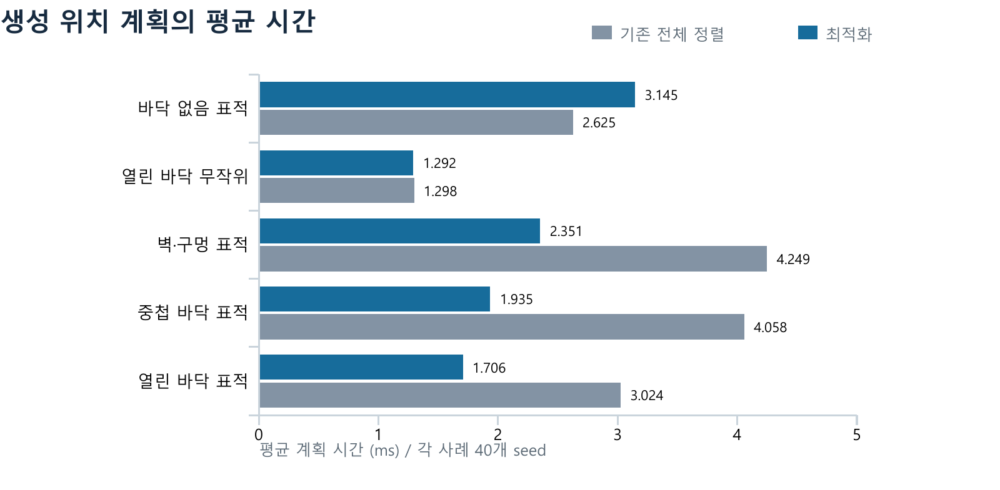
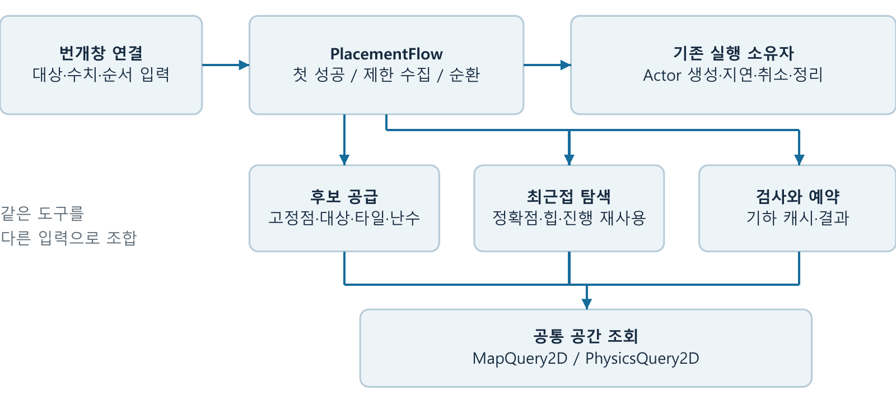

# 번개창 생성 위치 최적화와 공통 도구 조합 설계

Unity 2D 탑다운 로그라이크의 번개창 생성 위치 계산을 최적화하고, 세 생성 패턴을 같은 도구로 조합하도록 재구성했다. 표적 생성의 반복 수집·정렬·물리 검사를 줄인 뒤, 그 알고리즘과 게임 동작을 보존하면서 콘텐츠 규칙과 재사용 기능의 경계를 분리했다.

| 구분 | 확인한 결과 |
| --- | --- |
| 알고리즘 최적화 | 대표 표적 생성 사례의 평균 계획 시간 43.6~52.3% 감소 |
| 공통 도구 조합 | 최종 1,048개 비교 쌍에서 결과·난수 상태·작업량 일치 |
| 기능 검증 | 선택한 Unity Play Mode 회귀 테스트 17개 통과 |
| 측정 범위 | Editor의 동기식 생성 위치 계획. 실제 생성·VFX·렌더링·FPS 제외 |

프로젝트는 Unity 6000.4.2f1과 C#을 사용한다. 첫 단계의 시간 개선과 마지막 단계의 구조 검증은 서로 다른 기준으로 측정했으며, 두 값을 합쳐 최종 누적 성능 개선율로 계산하지 않았다.

## 해결하려던 문제

번개창은 세 번째 기본 공격에서 한 개를 생성하고, 일반 번개비에서는 플레이어 주변에 여러 개를 생성한다. 표적 번개비는 대상의 위치를 우선으로 사용하고, 간격이나 지형 때문에 실패하면 가까운 타일과 무작위 후보를 찾는다. 생성 위치는 방·반경·최소 거리·창 간격·벽과 바닥·경로 및 착지 조건을 통과해야 한다.

동일한 대상 주변에 여러 창을 배치하는 동안 같은 반경의 타일을 반복 수집하고 전체 정렬하는 작업이 발생했다. 이미 확인한 지형을 다시 검사하고, 간격만 확인해도 거절할 후보에 물리 검사를 먼저 수행하는 비용도 있었다. 이 기능은 위치 선택, 공간 조회, 예약 상태, Actor 생성과 시간축 실행이 연결돼 있어 규칙 변경의 영향 범위를 파악하기 어려웠다.

작업의 목표는 필요한 판단을 유지하면서 반복 계산을 줄이고, 클래스를 다른 구성에서도 사용할 수 있는 도구로 만드는 것이었다. 새로운 생성 패턴은 후보 공급·탐색·검사·예약·반복 흐름을 연결해 표현하고, 창 생성·취소·수명은 기존 실행 소유자에게 남겼다.

## 동작 보존 기준

정확한 대상 좌표를 먼저 사용하고, 타일 후보는 거리·X·Y 순서를 유지했다. 대상 정렬은 기존 거리 기준을 유지했다. 시도 예산, 대상별 순환, 난수 소비 순서와 간격 0에서의 같은 위치 반복 선택도 보존했다. 가벽 통과 기획과 맵 레이어 변경은 이 리팩터링의 범위에 넣지 않았다.

<!-- pagebreak -->

## 반복 작업을 줄인 알고리즘

기존 탐색도 플레이어의 생성 반경으로 타일 열거 범위를 제한하고 있었다. 개선한 부분은 그 범위에서 여러 번 수행하던 수집·전체 정렬·검사를 재사용한 것이다.

| 기존 비용 | 적용한 방법 | 효과와 보존 조건 |
| --- | --- | --- |
| 최근접 위치를 찾을 때마다 타일 수집 | 요청 안에서 한 번 지연 수집하고 좌표 중복 제거 | 정확한 대상 좌표가 유효하면 타일 수집 자체를 생략 |
| 매번 전체 후보를 거리순 정렬 | 최소 힙으로 가까운 후보부터 확인 | 힙 구성 O(C), 거절한 후보 제거 O(log C), 거리·X·Y 동률 유지 |
| 같은 목표를 다시 찾을 때 앞 후보부터 검사 | 목표별 탐색 진행과 소진 상태 재사용 | 요청 중 기하가 고정되고 예약이 증가한다는 전제 |
| 같은 위치의 벽·경로·착지 검사 반복 | 요청 단위 기하 결과 캐시 | 간격 판정은 캐시하지 않고 매번 확인 |
| 비싼 검사 후 최소 거리·간격에서 탈락 | 저렴한 범위·방·거리·간격 검사부터 실행 | 거절되는 후보의 물리 조회를 줄임 |
| 쿼리마다 임시 결과 배열 생성 | 커지는 List 결과와 컬렉션 용량 재사용 | 모든 collider 결과를 보존하고 부모 대상 중복 제거 |

성공한 힙 후보는 즉시 제거하지 않는다. 다음 시도에서 예약 간격 때문에 거절될 때 제거한다. 이 경계 덕분에 간격이 0이면 같은 위치를 다시 선택하는 기존 동작도 유지한다.

### 열린 바닥 표적 생성의 실제 작업량

아래 값은 초기 비교의 40개 seed 모두에서 동일했다. 기본 창 6개와 하나의 대상 주변에서 반복 작업의 차이를 확인했다.

| 작업 | 기존 | 최적화 후 |
| --- | ---: | ---: |
| 후보 판정 | 87 | 29 |
| 후보 수집 | 5 | 1 |
| 방문 타일 셀 | 1,125 | 225 |
| 전체 정렬 | 5 | 0 |
| 힙 구성 | 0 | 1 |
| 경로 물리 조회 | 87 | 6 |
| 착지 물리 조회 | 87 | 6 |

계획 결과를 바꾸지 않고 후보 수집 80%, 경로 및 착지 조회 각각 약 93.1%를 줄였다. 이것은 해당 fixture의 작업량 감소이며, 모든 상황의 프레임 비용 감소율을 뜻하지 않는다.

### 시간복잡도와 공간의 교환

B를 반경 안 열거 셀 수, C를 후보 수의 상한, J를 최근접 탐색 요청 수, U를 서로 다른 목표 좌표 수, K를 힙에서 거절한 후보 수라고 두면 탐색부는 기존 O(J·(B + C log C))에서 O(B + U·C + K log C)로 표현할 수 있다. 해시 조회의 평균 비용을 가정하며 Unity 물리 조회 자체의 비용은 별도다.

간격 검사는 여전히 후보 판정 Q회에 대해 O(Q·(A + N))의 상한을 가진다. A는 살아 있는 창 수, N은 예약 수다. 성공 목표에 유지하는 힙 수 H와 고유 기하 판정 수 G에 대해, 후보·실패 탐색용 힙·목표 소진·결과를 포함한 주요 탐색 저장량은 O((H + 1)·C + G + U + N)으로 표현할 수 있다. 재사용 용량은 이전 큰 요청 이후에도 남을 수 있다.

<!-- pagebreak -->

## 알고리즘 최적화의 측정 효과

Unity 6000.4.2f1 Editor Play Mode에서 기존 전체 정렬 경로와 최적화 경로를 같은 seed로 비교했다. 일반·표적 모드의 여섯 지형 fixture와 간격 0 사례에서 총 496개 결과 쌍의 위치·개수·순서·방 일치 및 유효성을 확인했다. 아래 시간은 사례별 40개 seed의 산술평균이다.

| 사례 | 기존 평균 ms | 최적화 평균 ms | 평균 시간 감소율 |
| --- | ---: | ---: | ---: |
| 열린 바닥 표적 | 3.0242 | 1.7055 | 43.6% |
| 중첩 바닥 표적 | 4.0577 | 1.9348 | 52.3% |
| 벽·구멍 표적 | 4.2489 | 2.3514 | 44.7% |
| 열린 바닥 무작위 | 1.2979 | 1.2923 | 0.4% |
| 바닥 없음 표적 | 2.6253 | 3.1451 | -19.8% |

감소율은 `(1 - 최적화 평균 / 기존 평균) × 100`으로 계산했다. 표적 생성의 반복 탐색에서는 효과가 컸고, 원래 타일 탐색을 사용하지 않는 일반 무작위 생성은 변화가 작았다. 바닥이 없어 성공 결과가 없는 사례는 느려졌다. 결과가 같은지와 비용이 낮아졌는지를 별개로 판단했다.

이 단계의 수치는 동기식 위치 계획 시간이다. 초기 결과 비교에는 RNG 상태 동등성 필드가 없으므로 496쌍을 RNG 상태 직접 검증 수로 표현하지 않는다. RNG 상태를 명시적으로 비교한 수치는 마지막 공통 도구 단계의 결과다.

원본 자료: [초기 요약](../SessionLogs/2026-10-07-test-scene/summary.json), [열린 바닥](../SessionLogs/2026-10-07-test-scene/open-targeted.json), [중첩 바닥](../SessionLogs/2026-10-07-test-scene/overlapping-floor-targeted.json), [벽·구멍](../SessionLogs/2026-10-07-test-scene/walls-and-holes-targeted.json).

<!-- pagebreak -->

## 전용 기능에서 공통 도구 조합으로

위치 계획과 맵·물리 조회를 먼저 분리해 책임을 드러낸 뒤, 그 경계를 콘텐츠 타입을 모르는 공통 도구로 재구성했다. 일반 비의 수집과 표적 비의 부족분 채우기는 같은 연산을 사용하고, 세 번째 공격도 같은 최근접 탐색·검사·예약을 사용한다.

| 공통 도구 | 역할 |
| --- | --- |
| MapQuery2D | 입력받은 맵 분류 규칙으로 바닥·벽·방 정보를 조회 |
| PhysicsQuery2D | 마스크·반경·초기 겹침 정책을 받아 overlap·cast 수행 |
| CandidateSources | 대상 좌표, 타일 중심, 고정점·지연 난수 후보 공급 |
| NearestPositionSearch | 정확한 우선점과 거리·X·Y 힙, 목표별 진행·소진 재사용 |
| PlacementSession | 수치 설정, live 간격·예약, 기하 캐시와 계획 결과 소유 |
| PlacementFlow | 첫 성공 선택, 제한 수집, 대상별 순환의 제어 흐름 조합 |

공통 코드에는 번개창 data·Actor·유물·GAS 참조가 없다. 번개창 연결부가 대상 포함 규칙, 반경·간격·마스크, 기존 맵 이름 정책을 전달한다. 단순 거리 계산이나 getter는 함수로 두고, 독립된 상태와 수명을 가진 기능을 도구로 만들었다. 새로운 Manager나 전역 mutable 버퍼는 추가하지 않았다.

다른 콘텐츠는 좌표 목록과 수치 설정 또는 자기 live 좌표 reader를 공급할 수 있다. 공통 타입의 실행 가능한 재사용성은 비무기 구성 테스트로 확인했다. 현재 production 연결은 번개창 하나이며, 다른 무기·몬스터·상자의 배치기를 이미 이전했다는 실적을 주장하지 않는다.

구현 근거: [공통 도구 지도](../StructureMemory/PlacementTools.md), [번개창 연결](../../Assets/_Project/Runtime/Features/Items/Weapons/Abilities/LightningSpearMarkPlacementPlanner.cs), [공통 Flow](../../Assets/_Project/Runtime/Features/Common/Placement/PlacementFlow.cs).

<!-- pagebreak -->

## 같은 도구로 구성한 세 생성 패턴

| 패턴 | 구성 | 유지한 예산과 원점 |
| --- | --- | --- |
| 세 번째 공격 | 대상의 우선점 → 최근접 탐색 → 실패하면 고정점·난수에서 첫 성공 | B=max(1, 표본 수). 고정 우선점·공격 끝도 B에 포함. 타일은 플레이어 생성 범위, 대상·마지막 난수는 공격 끝 반경 1.5 |
| 일반 번개비 | 원형 무작위 후보 → 검사·예약 → 개수 또는 예산까지 수집 | N개까지 S=max(표본 수, N×12)회. 난수는 필요한 순간에만 생성 |
| 표적 번개비 | 대상별 순환으로 최근접 위치 예약 → 부족하면 같은 무작위 수집 | N개 충족 또는 한 순환의 추가 성공 0에서 전환. 부족분도 원래 S 예산 사용 |

최근접 탐색 실패 뒤의 3타 fallback은 우선점·공격 끝·무작위 순서를 유지한다. 고정점이 같아도 중복 검사하며, 앞 단계가 성공하면 뒤 단계의 난수를 소비하지 않는다. 공통 Flow에 번개창 모드 switch를 넣는 대신, 연결부가 같은 도구의 호출 순서를 구성한다.

### 요청과 실행의 수명을 구별

`PlacementSession.CanPlace`는 검사하고 `Commit`은 승인된 위치를 한 번 예약한다. 기하 캐시는 원점·마스크·반경·월드가 고정된 동기 요청 안에서만 재사용하며, 늘어나는 예약의 간격은 매번 확인한다. 큰 요청의 List·힙 용량은 다음 요청에서 재사용한다.

반환 List는 다음 요청까지 빌려 쓰는 결과다. E는 계획 계산 직후, 첫 생성과 생성 간격 yield 전에 복사해, 0.07초 생성 간격 중 3타가 같은 도구를 재사용해도 자신의 계획을 유지한다. Actor 생성·등록, 사운드, 취소·무기 교체·disable/destroy 정리는 기존 실행 소유자가 담당한다. 안정성을 위해 이 결과 복사를 유지했다.

### 동작 보존과 재사용성 검증

최종 비교는 도구화 직전 Planner·World의 독립 Editor snapshot을 기준으로 했다. 공통 도구를 호출하지 않는 기준 경로와 새 경로를 같은 seed로 번갈아 실행했다.

| 검사 | 범위 | 결과 |
| --- | --- | --- |
| 일반·표적 비 반복 요청 | 496쌍 | 위치·개수·순서·방·RNG·10개 작업 카운터 일치 |
| 세 번째 공격 | 240쌍 | 같은 비교 항목 일치 |
| 새 버퍼 구성과 첫 요청 | 312쌍 | 같은 비교 항목 일치 |
| 공통 비무기 구성 | 7개 테스트 | 같은 도구로 수집·순환·첫 성공, 예산·RNG·예약·live 읽기 확인 |
| 번개창 및 관련 회귀 | 10개 테스트 | E 계획 재사용·취소·정리, feedback·슬롯 안내 확인 |

총 1,048쌍의 비교와 선택한 Play Mode 17개 테스트가 통과했다. 실제 Unity compile/import와 Editor·테스트 프로젝트 MSBuild도 통과했다. 이는 프로젝트 전체 테스트나 모든 gameplay 경로의 검증을 뜻하지 않는다.

근거: [최종 raw 결과와 요약](../SessionLogs/2026-10-10-lightning-tools/README.md), [NUnit XML](../SessionLogs/2026-10-10-lightning-tools/tests.xml).

<!-- pagebreak -->

## 구조 개선의 효능과 추가 비용

구조 변경의 효능은 서로 다른 세 흐름에서 같은 후보·탐색·검사·예약 연산을 사용하고, 콘텐츠 설정과 실행 수명을 구별한 데 있다. 공통 도구를 변경할 때 확인할 책임이 분명해졌으며, 다른 수치·좌표 구성으로 동일 기능을 실행하는 테스트도 추가했다. 파일 수 감소나 다른 production 기능의 마이그레이션은 이번 성과에 포함하지 않는다.

마지막 시간 비교는 이미 최적화된 전용 Planner와 공통 도구 조합 사이의 비교다. Null graphics Editor에서 같은 seed를 9회 실행한 평균 요청 시간을 한 표본으로 사용하고 AB/BA 순서를 교대했다. 아래 변화율은 같은 seed 시간비의 중앙값이며, 초기 알고리즘 단계의 산술평균 감소율과 다른 통계다.

| 최종 구조 비교 | 사례별 시간비 중앙값 변화 |
| --- | ---: |
| 반복 일반·표적 비 | -6.5%~+6.8% |
| 반복 세 번째 공격 | -4.6%~+8.9% |
| 새 도구 버퍼 구성과 첫 요청 | -5.2%~+13.3% |

작업 카운터는 같아도 도구 구성·설정·호출의 상수 비용과 시간 편차는 남았다. 새 버퍼의 가장 큰 증가 사례는 결과가 없는 바닥 없음·무작위 생성이다. 3타 열린 바닥의 독립 중앙값은 0.218→0.265ms였다. 각 경로의 독립 중앙값 비율과 같은 seed 시간비 중앙값은 서로 다른 값이다.

### 설계에서 선택한 교환

- 반복 수집·정렬·물리 검사를 줄이기 위해 힙 진행과 기하 결과를 보관했다. 용량 재사용은 다음 요청의 구성을 줄이지만 이전 큰 요청의 메모리가 남는다.
- 콘텐츠 결합을 줄이기 위해 공통 설정·도구·live 좌표 reader를 도입했다. 후보마다 객체나 캡처 closure를 만들지 않고 값 reader와 cursor를 사용했지만, 구성 비용의 완전한 동일성을 가정하지 않았다.
- 기존 동작을 보존하기 위해 Wall 이름 호환, 우선점 재검사, 두 원점과 예산을 유지했다. 의미를 바꾸는 맵 정책·장시간 비동기 탐색은 별도 변경으로 남겼다.

### 측정 경계와 다음 검증

4096-byte 할당 canary가 관측되지 않아 byte API는 사용할 수 없었다. GC collection 0을 무할당으로 해석하지 않는다. 측정에 prefab 생성·VFX·렌더링·FPS는 포함하지 않았고, Player/IL2CPP·실제 peak memory·프로세스/JIT/MonoBehaviour/씬 시작 비용도 별도 검증 대상이다.

후속으로 다른 실제 콘텐츠의 바닥 조회부터 같은 도구를 연결해 경계를 검증하고, 정상 Profiler에서 추가 비용과 할당을 확인할 수 있다. 맵 역할을 명시적으로 공급하는 구조도 기존 동작과 함께 검토할 과제다.

이 작업은 반복 계산의 원인을 알고리즘과 작업 카운터로 설명하고, 동일한 게임 동작을 유지하는 검증을 붙인 다음, 그 기능을 콘텐츠에 종속되지 않는 도구 조합으로 전환한 사례다.

근거: [최종 시간 CSV](../SessionLogs/2026-10-10-lightning-tools/timing.csv), [새 버퍼 CSV](../SessionLogs/2026-10-10-lightning-tools/fresh-buffer-timing.csv), [검증 조건](../SessionLogs/2026-10-10-lightning-tools/README.md).
