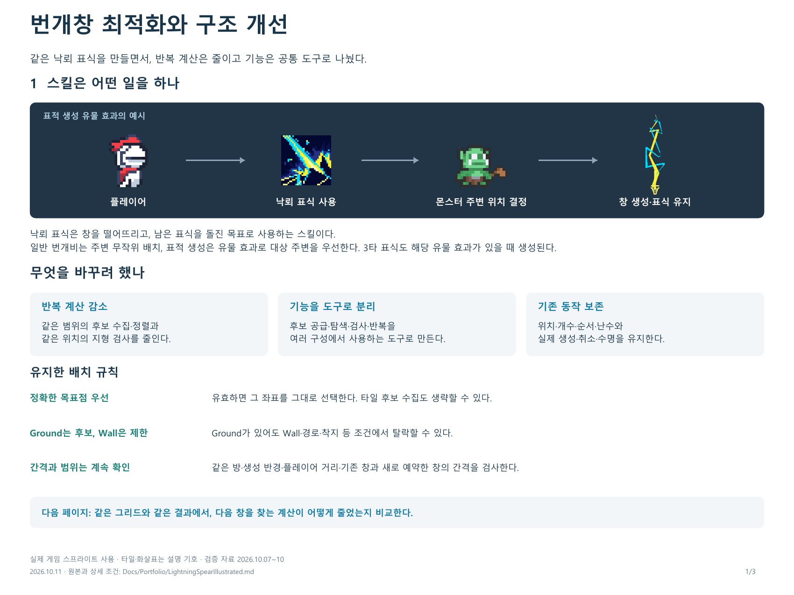
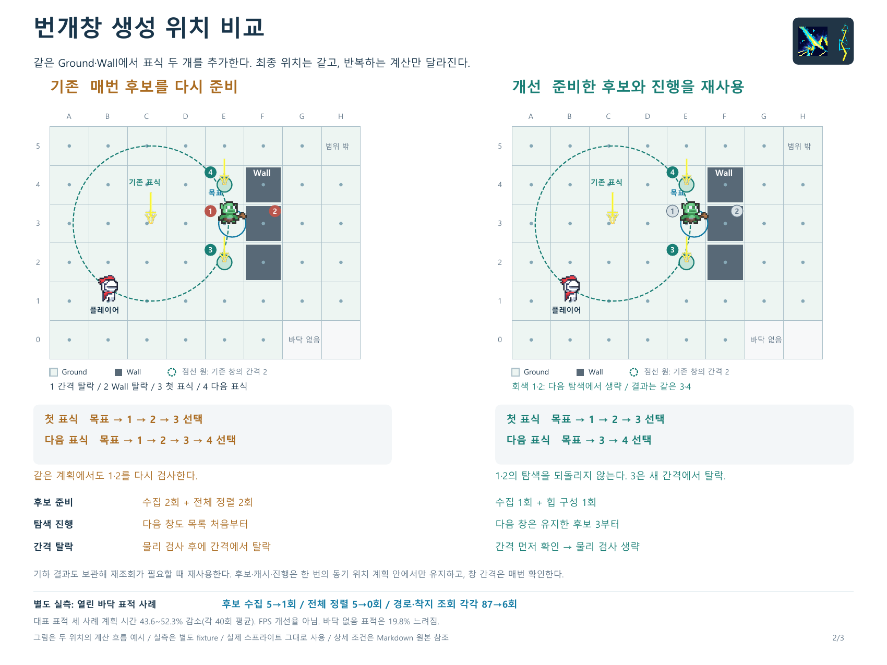
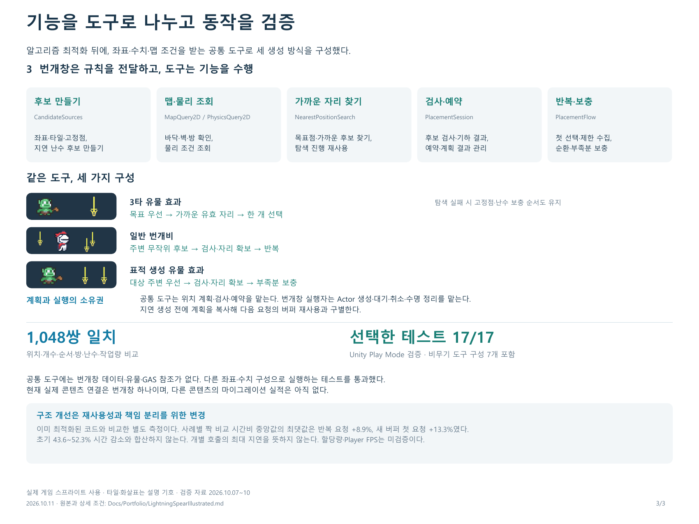

# 번개창 최적화와 구조 개선

**같은 낙뢰 표식을 만들면서, 반복 계산은 줄이고 기능은 공통 도구로 나눴다.**

[통합 포트폴리오 PDF](../../output/pdf/lightning-spear-portfolio-integrated.pdf) · [상세 코드와 검증 근거](LightningSpear.md)

## 스킬 동작과 개선 의도

낙뢰 표식은 창을 떨어뜨리고, 남은 표식을 돌진 목표로 사용하는 스킬이다. 일반 번개비는 플레이어 주변에 무작위로 배치한다. 표적 생성 유물 효과는 몬스터 주변을 우선하며, 3타 표식은 해당 유물 효과가 있을 때 생성된다.

같은 목표 주변에 창을 추가하는 동안 같은 범위의 타일 후보를 다시 모으고 정렬하고, 같은 위치의 지형을 다시 검사하는 비용이 발생했다. 기존 방식도 생성 반경 안에서 탐색했다. 이번 목표는 그 범위 안의 반복 계산을 줄이고, 후보 공급·검색·검사·반복 기능을 다른 구성에서도 쓰는 도구로 만드는 것이었다.

생성 위치·개수·순서·난수 흐름과 실행 수명을 보존하면서 개선했다. 최적화와 기능 분리는 서로 다른 단계로 검증했다.

## 표적 생성은 어떤 일을 하나

플레이어의 생성 범위 안에서 몬스터 주변의 유효한 자리를 찾고, 그 위치에 창을 내려 낙뢰 표식을 남긴다. Wall·바닥·방·거리·창 간격·경로·착지 조건을 확인한다. 정확한 목표점이 유효하면 타일 중심으로 옮기지 않고 그대로 선택한다.

## 같은 그리드에서 기존과 개선 비교

한 번의 동기 위치 계획에서 같은 몬스터 주변에 **표식 두 개**를 추가한다. 두 그림의 Ground·Wall·플레이어·몬스터·기존 창과 최종 위치 3·4는 동일하다. 개선 쪽 회색 1·2는 다음 탐색에서 생략하는 후보다.

| 비교 항목 | 기존 알고리즘 | 개선 알고리즘 |
| --- | --- | --- |
| 첫 표식 | 목표점 검사 → 후보 수집·전체 정렬 → 1 → 2 → 3 선택 | 목표점 검사 → 후보 수집·힙 준비 → 1 → 2 → 3 선택 |
| 다음 표식 | 목표점 검사 → 후보 재수집·전체 재정렬 → 1 → 2 → 3 → 4 선택 | 목표점 검사 → 후보·탐색 진행 재사용 → 3 → 4 선택 |
| 두 자리 예시의 후보 준비 | 수집 2회, 전체 정렬 2회 | 수집 1회, 힙 구성 1회, 전체 정렬 0회 |
| 간격 탈락 | 경로·착지 검사 뒤에 간격을 확인 | 간격을 먼저 확인해 물리 검사 생략 |

Ground 중심점은 후보일 뿐이다. 1은 기존 창 간격 때문에, 2는 Ground 위에 겹친 Wall 때문에 탈락한다. 3을 선택해 예약한 뒤, 다음 탐색은 유지한 후보 3부터 시작한다. 새 간격에서 3이 탈락하면 4를 선택한다. 간격의 경계와 같은 거리 2는 허용된다.

## 반복 계산을 줄인 방법

1. **후보와 검사 결과 재사용**: 같은 범위의 후보와 벽·경로·착지 검사 결과를 한 번의 위치 계획 안에서 재사용한다.
2. **가까운 후보부터 이어서 탐색**: 목표점 검사 실패 후 가까운 타일 후보를 찾고, 목표별 탐색 진행을 재사용한다.
3. **간격은 비싼 검사 전에 확인**: 기존·예약 창과 너무 가까운 후보는 물리 조회 전에 제외한다. 변하는 간격 조건은 매번 확인한다.

목표점은 두 방식 모두 먼저 검사한다. 유효하면 후보 수집도 생략한다. 후보·기하 캐시·탐색 진행은 같은 동기 계획 안에서만 재사용한다. 일반 번개비의 무작위 후보는 타일 중심으로 제한하지 않는다.

초기 기준은 [PlacementBenchmark](../../Assets/_Project/Runtime/Features/Items/Weapons/Abilities/LightningSpearRuntimeState.PlacementBenchmark.cs)의 legacy 수집·전체 정렬 경로다. 이미 최적화된 `LightningSpearPlacementBeforeRefactor`와 구별한다.

## 같은 도구로 세 가지 생성 구성

기능 분리는 최적화된 알고리즘을 콘텐츠 타입을 모르는 도구로 구성한 단계다. 번개창은 대상·반경·간격·마스크와 호출 순서를 전달한다.

| 공통 도구 | 맡은 기능 |
| --- | --- |
| CandidateSources | 좌표·타일·고정점·지연 난수 후보 만들기 |
| MapQuery2D / PhysicsQuery2D | 맵의 바닥·벽·방과 물리 조건 조회 |
| NearestPositionSearch | 정확한 목표점과 가까운 후보 찾기, 탐색 진행 재사용 |
| PlacementSession | 후보 검사·기하 결과·예약·계획 결과 관리 |
| PlacementFlow | 첫 성공 선택·제한 수집·대상별 순환·부족분 보충 |

| 생성 방식 | 같은 도구의 구성 |
| --- | --- |
| 3타 유물 효과 | 목표 우선 → 가까운 유효 자리 → 한 개 선택 |
| 일반 번개비 | 주변 무작위 후보 → 검사·자리 확보 → 반복 |
| 표적 생성 유물 효과 | 대상 주변 우선 → 검사·자리 확보 → 부족분 보충 |

3타의 최근접 탐색 실패 시 고정점·난수 순서도 유지했다. 표적 생성은 부족한 수만큼 같은 무작위 수집으로 보충한다. 공통 도구에는 번개창 데이터·유물·GAS 참조가 없으며, 간격·좌표를 받는 도구로 구성한다.

공통 도구는 위치 계획을 맡고, 번개창 실행자는 Actor 생성·등록·대기·취소·무기 교체·수명 정리를 맡는다. 지연 생성 전에 계획을 복사해 다음 요청의 버퍼 재사용과 구별한다.

## 확인한 효과와 비용

| 단계 | 확인 결과 | 범위 |
| --- | --- | --- |
| 초기 알고리즘 최적화 | 평균 계획 시간 43.6~52.3% 감소 | 대표 표적 세 사례, 각 40회 평균 |
| 열린 바닥 표적 실측 | 수집 5→1, 전체 정렬 5→0, 경로·착지 각각 87→6회 | 별도 창 6개 fixture. 두 위치 Wall 도식의 횟수와 구별 |
| 후속 공통 도구 구성 | 1,048쌍 일치, 선택한 Unity 테스트 17/17 통과 | 위치·개수·순서·방·난수·작업량 비교 |
| 도구 재사용성 | 비무기 구성 테스트 7개 | 실제 production 연결은 현재 번개창 하나 |
| 구조 단계의 추가 비용 | 반복 요청 최대 +8.9%, 새 버퍼 첫 요청 최대 +13.3% | 사례별 짝 비교 시간비 중앙값의 최댓값 |

초기 시간 비교는 Unity Editor의 동기 위치 계획이며 FPS 개선율이 아니다. 바닥 없음 표적은 19.8% 느려졌다. 구조 단계는 이미 최적화된 코드를 기준으로 한 별도 비교이며 초기 수치와 합산하지 않는다. 개별 호출의 최대 지연을 뜻하지 않으며 할당량·Player FPS는 미검증이다.

[초기 실측](../SessionLogs/2026-10-07-test-scene/summary.json) · [최종 검증과 조건](../SessionLogs/2026-10-10-lightning-tools/README.md) · [공통 도구 구조](../StructureMemory/PlacementTools.md)

## 타일 그리드로 보는 생성 위치 결정

아래는 비교 그림 제작용 좌표와 규칙이다. Ground와 별도 Wall이 겹친 칸도 후보로 수집될 수 있지만 최종 검사에서 탈락한다. H5는 반경 밖이라 후보 점이 없다. 바닥 없음은 Ground와 required-ground overlap이 모두 없는 칸이다. 모든 HoleTrap 자동 필터나 가벽 돌진 변경을 뜻하지 않는다.

검사 순서는 범위·방·플레이어 최소거리·창 간격 → 기하 캐시 → Wall → 경로 → 착지 → 바닥이다. 그림은 실제 스프라이트를 사용하는 설명 도식이며 숫자는 검사 순서, 원은 거리 조건이다.

### 도식 배치와 설정

1칸은 1단위이며 방 경계는 그림 영역 전체, Wall 콜라이더는 해당 칸을 덮는 것으로 표현한다. 다른 장애물은 없는 설명용 배치다. 실제 게임 방이나 벤치마크 지형을 복제한 것은 아니다.

| 도식 입력 | 값 |
| --- | --- |
| 그리드 | (8, 6) |
| Wall 칸 | [(5, 2), (5, 3), (5, 4)] |
| 바닥 없음 칸 | [(6, 0), (7, 0)] |
| 플레이어 좌표 | (1.5, 1.5) |
| 몬스터 목표 좌표 | (4.7, 3.5) |
| 기존 표식 좌표 | (2.6, 3.5) |
| 후보 1 | (4.5, 3.5) |
| 후보 2 | (5.5, 3.5) |
| 후보 3 | (4.5, 2.5) |
| 후보 4 | (4.5, 4.5) |
| 생성 반경 | 7 |
| 플레이어 최소 거리 | 1.2 |
| 창 최소 간격 | 2 |
| 경로 검사 반경 | 0.25 |
| 착지 검사 반경 | 0.35 |

코드 근거: [후보 수집](../../Assets/_Project/Runtime/Features/Common/Placement/CandidateSources.cs), [최근접 탐색](../../Assets/_Project/Runtime/Features/Common/Placement/NearestPositionSearch.cs), [후보 검사와 예약](../../Assets/_Project/Runtime/Features/Common/Placement/PlacementSession.cs), [맵 조회](../../Assets/_Project/Runtime/Features/Common/Placement/MapQuery2D.cs).

## 사용한 실제 스프라이트

프로젝트 PNG와 Unity의 스프라이트 영역에서 아래 프레임을 그대로 추출했다. 확대는 Nearest 방식이며 모양·색·투명 픽셀을 재생성하지 않는다. 도식의 화살표와 점은 설명 기호이고, 원본 게임 자산은 변경하지 않는다.

| 요소 | 문서용 프레임 | 게임 원본 |
| --- | --- | --- |
| 플레이어 | [player.png](assets/lightning-spear-sprites/player.png) | [Character 1 v1.png](<../../Assets/_Project/Art/Sprites/Player/Pixel_Plains_Premium_Pack/Characters 24x24/Character 1 v1.png>), 실제 Player Idle 첫 프레임 |
| 낙뢰 표식 스킬 아이콘 | [skill.png](assets/lightning-spear-sprites/skill.png) | [LinghtningSkill2Icon.png](../../Assets/_Project/Art/Sprites/ThirdParty/WeaponAndSandBack/WeaponSkill/LightningSpear/LinghtningSkill2Icon.png), 실제 스킬 정의 참조 |
| 낙뢰 이펙트 | [lightning.png](assets/lightning-spear-sprites/lightning.png) | [LightningDropMarkEffect.png](../../Assets/_Project/Art/Sprites/Items/Weapon/LightningSpear/LightningDropMarkEffect.png), 실제 Mark SpawnEffectVisual 프레임 |
| 꽂힌 창 표식 | [mark.png](assets/lightning-spear-sprites/mark.png) | [LightningSpearClone.png](../../Assets/_Project/Art/Sprites/Items/Weapon/LightningSpear/LightningSpearClone.png), 실제 Mark ActiveVisual |
| 몬스터 | [monster.png](assets/lightning-spear-sprites/monster.png) | [Orc Kid Sprite Sheet.png](<../../Assets/_Project/Art/Sprites/Monsters/CommonMonster/Orc Kid Sprite Sheet.png>), 실제 GoblinWarrior Idle 첫 프레임 |

[프레임 출처와 해시](assets/lightning-spear-sprites/sources.json) · [통합 문서 제작](_build/lightning_spear_integrated_portfolio.py) · [전후 비교 제작](_build/lightning_spear_tile_comparison.py)

