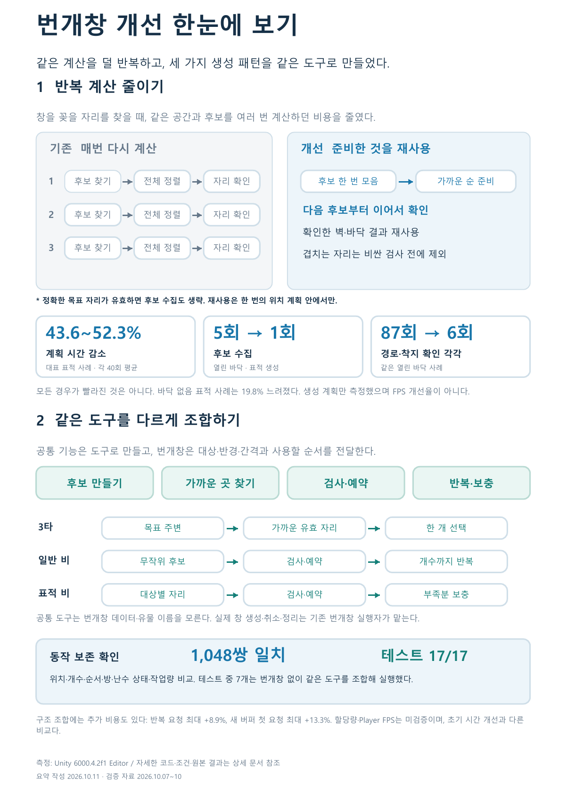

# 번개창 개선 한눈에 보기

**같은 계산을 덜 반복하고, 세 가지 생성 패턴을 같은 도구로 만들었다.**

## 1 반복 계산 줄이기

기존: 창을 추가할 때마다 후보 찾기 → 전체 정렬 → 자리 확인을 반복했다.

개선: 필요한 후보를 한 번 모으고 가까운 순서로 찾는다. 이미 확인한 지형과 탐색 진행을 재사용하고, 너무 가깝거나 겹치는 자리는 먼저 제외한다.

| 실제 변화 | 확인한 범위 |
| --- | --- |
| 표적 생성 계획 시간 43.6~52.3% 감소 | 대표 세 사례, 각 40회 평균 |
| 후보 수집 5회 → 1회 | 열린 바닥 표적 생성 |
| 경로 확인 87회 → 6회, 착지 확인 87회 → 6회 | 같은 열린 바닥 사례 |

한 번의 위치 계획 안에서 재사용한다. 모든 생성이 빨라진 것은 아니며, 바닥 없음 표적 사례는 19.8% 느려졌다. 실제 창 생성·렌더링·FPS는 이 시간 측정에 포함되지 않는다.

## 2 같은 도구를 다르게 조합하기

공통 도구: **후보 만들기 · 가까운 곳 찾기 · 자리 검사와 예약 · 반복과 보충**.

| 패턴 | 같은 도구의 조합 |
| --- | --- |
| 3타 | 목표 주변 찾기 → 유효한 가까운 자리 → 한 개 선택 |
| 일반 번개비 | 무작위 후보 → 자리 검사·예약 → 원하는 수까지 반복 |
| 표적 번개비 | 대상별 가까운 자리 → 검사·예약 → 부족분 무작위 보충 |

번개창은 대상·반경·간격 같은 규칙을 전달하고, 실제 창 생성·취소·정리를 맡는다. 공통 도구는 번개창 데이터나 유물 이름을 모른다.

## 실제로 확인한 것

**최종 비교 1,048쌍에서 위치·개수·순서·방·난수 상태·작업량이 같았다. 선택한 Unity 테스트 17개가 통과했다.** 그중 7개는 번개창 없이 좌표와 설정만으로 같은 도구를 조합하는 검사다. 다른 실제 콘텐츠를 이전한 실적은 아직 아니다.

구조 조합은 재사용성을 위한 변경이다. 그 단계의 반복 요청 시간은 사례별 최대 +8.9%, 새 버퍼의 첫 요청은 최대 +13.3%였으므로 추가 속도 향상을 주장하지 않는다. 할당량·Player FPS는 미검증이다.

[1페이지 PDF](../../output/pdf/lightning-spear-portfolio-summary.pdf) · [자세한 설명과 근거](LightningSpear.md) · [초기 측정](../SessionLogs/2026-10-07-test-scene/summary.json) · [최종 검증](../SessionLogs/2026-10-10-lightning-tools/README.md)
