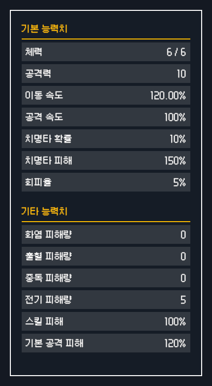
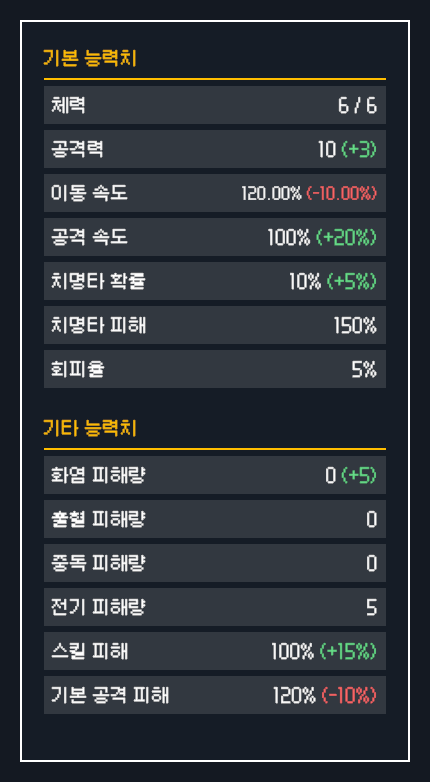
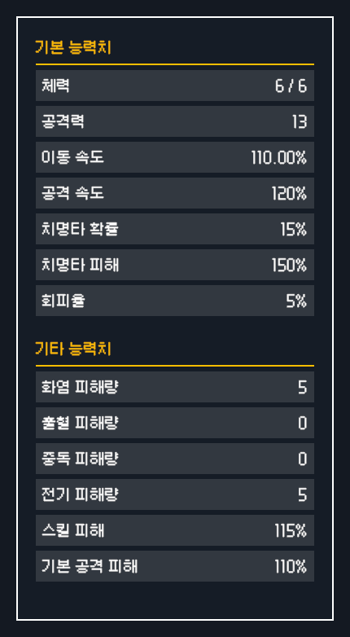

# Approved player stat layout and relic deltas

Implemented after approval of `player-stats-layout-v5` and `player-stats-delta-v1` on2026-10-31. These images are native Unity6000.4.2f1 captures of the saved shared stat prefabs in a disposable Play Mode fixture, not Aseprite mockups or full game recordings. Example values are temporary test data, not a newly added game relic.

## Result

- Default panel390×742; rows342×38 with6px gaps. Basic7: HP, attack, movement, attack speed, critical chance, critical damage, evasion. Other6: fire, bleed, poison, electric, skill damage, normal attack damage.
- Attack speed uses Percent×100,0 decimals:1.0→100%,+.2→+20%. Existing green/red deltas,136px value column,12–18px auto sizing and gameplay calculation owners remain unchanged.
- The existing movement/normal multiplier assets have a minimum of1. The native negative-delta fixture therefore starts at120%, previews−10 percentage points and acquires110%; it does not force the earlier illustrative100→90 mockup past gameplay limits. No balance asset was changed.

| Before selection | During selection | After acquisition |
| --- | --- | --- |
|  |  |  |

Five-locale delta captures: [Korean](stats-delta-ko.png), [English](stats-delta-en.png), [Japanese](stats-delta-ja.png), [Simplified Chinese](stats-delta-zh-Hans.png), [Traditional Chinese](stats-delta-zh-Hant.png). All were visually inspected; long movement values fit with automatic font sizing.

## Changed files and reasons

| Files | Change |
| --- | --- |
| `Assets/_Project/Prefabs/UI/PopupUI/PlayerStatUI/PlayerStatRowView.prefab` | Four geometry fields28→38. Original object IDs, hierarchy, font/material, callbacks and references preserved. The parent content fitter grows the panel. |
| `Assets/_Project/Data/UI/StatDisplays/PS_Section_BasicStats.asset`, `PS_Section_CombatStats.asset` | Existing13 definitions reordered into7/6 groups; existing Combat asset retains its GUID and displays Other Stats. |
| `Assets/_Project/Data/UI/StatDisplays/PS_StatInfo_AttackSpeed.asset` | Display format, multiplier and decimal places only; no gameplay speed change. |
| `Assets/_Project/Data/Localization/GameText_{ko,en,ja,zh-Hans,zh-Hant}.asset`, `DataSheets/Localization/GameText.csv` | Only the existing section-title key changed in each locale and its source row. |
| `Assets/_Project/Editor/Tools/UI/PlayerStatsAndRewardUiAuthoring.cs` | Stats-only native authoring entry point; full skin authoring retains this approved revision. |
| `Assets/_Project/Editor/Tools/Validation/ApprovedUiSkinValidation.cs` | Actual attribute/stat binding, detached relic projection, chest transfer, cancellation and removal checks; localized captures. Temporary fixtures are not saved. |
| Skin README, active task/router, session and existing InventoryAndChestUIStructure | Record current dimensions, authoring route, ownership and evidence. |

## Verification

- Native authoring/import and final Play Mode validation exit0. [562 passing checks](validation.txt),11 GPU captures. Checks cover layout/order, five-locale titles/text fit, positive/negative percentage deltas, selection without granting, clearing on cancellation, real transfer acquisition and removal-driven refresh.
- [Focused existing Play Mode regressions](playmode.xml):21/21 passed, skipped0, Unity exit0. Includes ChestRevealWidthRegressionPlayModeTests, PlayerInventorySlotReusePlayModeTests, and the selected fixed-attack/LastBreath/electric relic acquisition-preview and restore/removal cases. This is not a full-project suite; the two previously recorded unrelated failures from the original skin integration were not changed or included.
- Editor.csproj MSBuild exit0 after Unity exited; both changed Editor sources are present in that generated project. Scoped `git diff --check` and evidence/documentation links passed. See [verification summary](verification.txt).
- [Serialization audit](serialized-preservation.json):49 before-snapshotted files compared. Only intended asset fields changed; all sampled existing `.meta` files, main GlobalUIRoot, section/panel prefabs and reward prefabs are byte-identical. Five existing translation entries and one CSV row changed. Newly introduced native empty-scalar trailing spaces were trimmed from the row prefab.
- Locale switches emit transient missing-glyph warnings while old fonts and new strings overlap; final captured Japanese and Chinese views use their locale fonts and show the text correctly. Existing package/obsolete warnings were not treated as a clean-warning build.

## Remaining / documentation impact

Full inventory/chest scene interaction across all resolutions and standalone Player build were not manually exercised. Runtime stat calculation, acquisition ownership, potion/reward views, scenes, project settings and existing GUIDs were not modified in this revision.

Doc Impact: SessionLog + existing StructureMemory, with active task/router and skin README synchronized. No new ErrorLog/DecisionLog entries, Architecture/Contracts promotion or Presentation HTML stale candidate.
