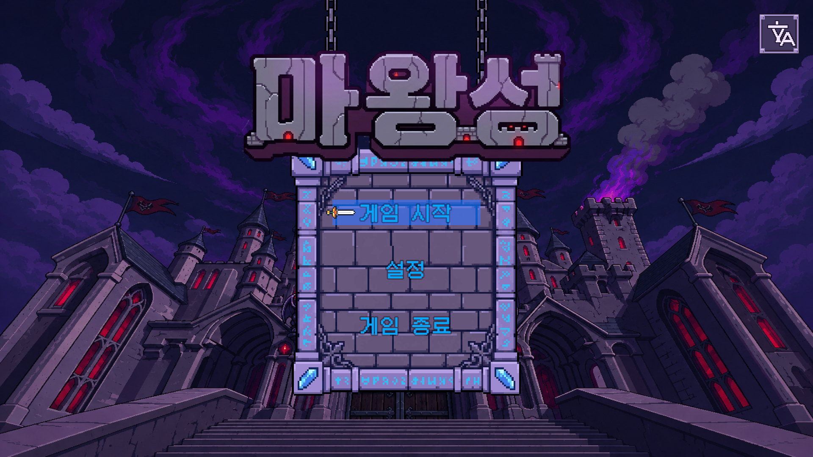
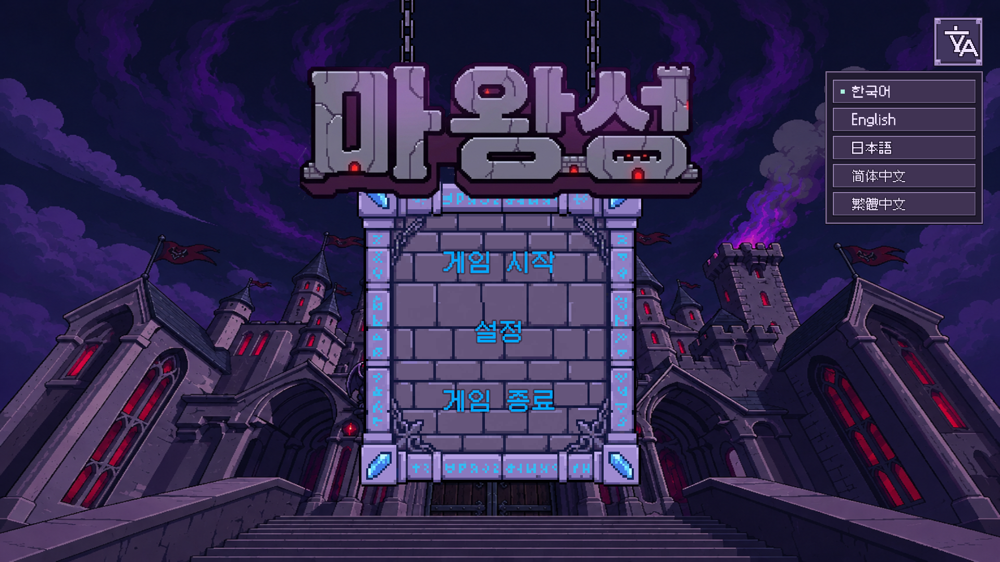

# Title language menu integration

2026-11-01. Implementation authorized by the request to add the previous title
language-button design, followed by the user's choice of an expanding language list.

## Result

Artwork follow-up: the user reported an off-center, malformed inner icon. The
three sprite states and Aseprite source were replaced with a centered imagegen
silhouette converted to native pixels. [Correction and current preview](../../../outputs/title-language-icon-revision-2026-11-01/README.md).
The captures below document the earlier integration and show the previous icon.

- Upper-right violet translation button, with normal/hover/pressed 48×48 sprites.
- Five authored native-name choices: 한국어, English, 日本語, 简体中文, 繁體中文.
- Current choice marker; selection, outside click and Escape close the list.
- Existing `GameSettingsService.SetLanguage` owns preference persistence and async
  locale/font preparation. The title menu only projects that state.
- Title input locks also cover the language menu. The dropdown and main menu use
  separate keyboard navigation groups; closing the dropdown restores button focus.
- UI objects and references are saved in TitleScene. No runtime UI hierarchy,
  new service, package, save schema or localization-table change.

## Changed files and purpose

| File | Purpose |
| --- | --- |
| [TitleScene.unity](../../../Assets/_Project/Scenes/TitleScene.unity) | Authored button, dismiss surface, five rows, native-language fonts and references. |
| [TitleLanguageMenuUI.cs](../../../Assets/_Project/Runtime/UI/Title/TitleLanguageMenuUI.cs) | Open/close, language selection, selected marker and list focus. |
| [TitleMenuController.cs](../../../Assets/_Project/Runtime/UI/Title/TitleMenuController.cs) | Serialized menu reference, title navigation and modal/input gating. |
| [Language artwork](../../../Assets/_Project/Art/Sprites/UI/Title/Language/) | Three production PNG states, native Aseprite source and generated metadata. |
| [make_title_language_button.lua](../../../Tools/Art/make_title_language_button.lua) | Reproducible native pixel authoring based on the previously approved violet 文/A concept. |
| [TitleLanguageMenuAuthoring.cs](../../../Assets/_Project/Editor/Tools/Title/TitleLanguageMenuAuthoring.cs) | Unity API scene authoring and preservation of unrelated serialized blocks. |
| [TitleLanguageMenuValidation.cs](../../../Assets/_Project/Editor/Tools/Validation/TitleLanguageMenuValidation.cs) | Actual saved-scene Play Mode interaction, font, raycast, persistence and capture checks. |
| [LocalizationFlow.md](../../StructureMemory/LocalizationFlow.md) | Narrow ownership/authoring map for later title-localization work. |
| [SessionLog](../2026-11-01.md) | Outcome and verification record. |

## Evidence and limits

- Unity 6000.4.2f1 imported and compiled the scripts/assets and authored the scene.
- [98 Play Mode checks passed](validation.txt): all five languages and persisted
  values, native label glyphs/fit, actual row raycasts, focus ownership/return,
  repeated open/close, outside dismiss and settings-screen return.
- Actual title Canvas rendered at 1920×1080 and 1280×720. Captures use a temporary
  validation camera; no camera or capture objects are saved to the scene.
- [Scope check](scope-validation.json): all 1,832 original scene blocks retained;
  only the Canvas child list and title controller reference changed. 84 new blocks
  describe the authored menu. No task-added trailing whitespace.
- Existing six profile-save files remained byte-identical. Language preference
  was restored after validation. New C# files are included in regenerated projects;
  final Editor.csproj MSBuild passed with zero errors, including the UI project
  dependency. [Build and preservation summary](build-validation.txt).
- Physical mouse/keyboard/gamepad manual acceptance and a Player build were not
  executed. The Escape handler and EventSystem navigation/raycast paths were
  exercised programmatically; this is not a claim of full manual playthrough.
- Existing scene whitespace from earlier work remains untouched. Verification
  compares this task against its captured working-tree baseline, not only HEAD.

Doc Impact: SessionLog + existing StructureMemory. ErrorLog/DecisionLog unchanged;
no Architecture/Contracts promotion or Presentation HTML stale candidate.
