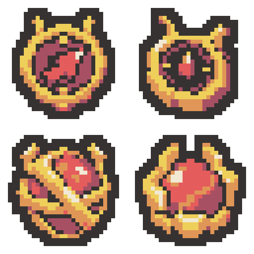

# 홍련의 한계선 전용 유물 — 각 2안, 총 4안

위쪽은 한계선의 잔불 추격을 위한 추적 나침반 2안, 아래쪽은 한계선의 관통 용암을 위한 용암 봉인핵 2안입니다. 콘셉트 이름은 비교용이며 프로젝트의 이름·이미지는 변경하지 않았습니다.

| 위치 | 유물과 디자인 | 32×32 PNG |
| --- | --- | --- |
| 왼쪽 위 | 추적 나침반 A · 원반형 — 정면에서 본 둥근 금빛 나침반과 붉은 불씨 지시침 | [PNG](01-ember-compass-round-draft-v1-32x32.png) |
| 오른쪽 위 | 추적 나침반 B · 입체 팔각형 — 두께가 보이는 팔각 금빛 케이스와 짧은 불씨 지시침 | [PNG](02-ember-compass-faceted-draft-v1-32x32.png) |
| 왼쪽 아래 | 용암 봉인핵 A · 교차 고리형 — 붉은 구체를 두 굵은 금빛 띠로 감싼 입체 봉인핵 | [PNG](03-lava-core-crossed-draft-v1-32x32.png) |
| 오른쪽 아래 | 용암 봉인핵 B · 고정구형 — 두꺼운 금빛 고정구에 붉은 용암 핵을 끼운 형태 | [PNG](04-lava-core-clamped-draft-v1-32x32.png) |

금빛으로 감싸는 장식, 붉은 마력 중심부와 위쪽 두 돌기로 원래 지팡이의 머리 모양을 연결했습니다. 각 디자인은 실제 32×32, 외곽선 포함 6색, 2픽셀 외곽선과 사방 최소 2픽셀 투명 여백을 사용합니다.

- [64×64 원본 시트](crimson-exclusive-four-designs-v1-64x64.png)
- [최종 프롬프트 4개](prompts.json)
- [생성 원본 경로](generation-sources.json)
- [검증 결과](verification.json)

생성: built-in image_gen으로 디자인당 1회, 총 4회 생성했습니다. AI 생성 결과를 최근접 표본화·팔레트 제한·외곽선 정돈하여 실제 32×32로 내보냈습니다. 미리보기는 정확한 최근접 8배이며 시트의 각 셀과 개별 파일이 일치합니다.

변경 파일은 이 테스트 출력 폴더의 개별 PNG 4개, 원본/확대 시트, 무기 참조 PNG, 생성 프롬프트/원본 경로/검증/내보내기 JSON, PowerShell 내보내기 스크립트와 README입니다. 기존 에셋·정의·무기 아트·문서·로그 보호 파일 412개는 해시가 그대로입니다.

Unity import·컴파일·Play Mode는 실행하지 않았습니다. Doc Impact Check: no doc update needed. SessionLogs/ErrorLog/DecisionLog/Presentation HTML은 변경하지 않았으며 HTML stale candidate도 없습니다.
