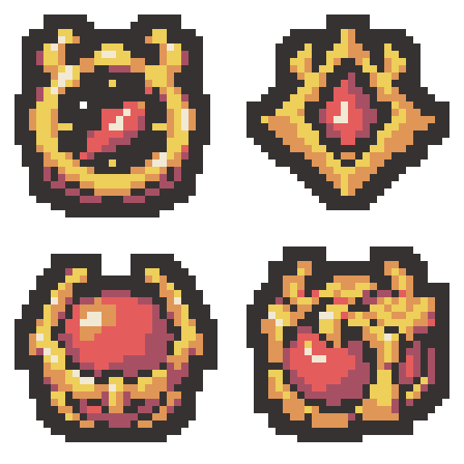

# 한계선 전용 유물 비교 초안 4종 — 2026-11-02

한계선의 잔불 추격을 위한 추적 나침반 2안과 한계선의 관통 용암을 위한 용암 봉인핵 2안입니다. 아직 프로젝트에 적용하지 않았으며 이름·효과·이미지 연결은 그대로입니다.

| 위치 | 디자인 | 실제 32×32 PNG |
| --- | --- | --- |
| 1 왼쪽 위 | 추적 나침반 A — 원형 — 두꺼운 금빛 원형 테두리와 붉은 불씨 모양 지시침 | [PNG](01-compass-round-draft-v1-32x32.png) |
| 2 오른쪽 위 | 추적 나침반 B — 마름모형 — 각진 금빛 외장에 불씨 지시침을 넣은 나침반 | [PNG](02-compass-diamond-draft-v1-32x32.png) |
| 3 왼쪽 아래 | 용암 봉인핵 A — 고리형 — 붉은 구체를 두꺼운 금빛 고리가 붙잡은 입체형 | [PNG](03-core-ring-draft-v1-32x32.png) |
| 4 오른쪽 아래 | 용암 봉인핵 B — 봉인틀 — 각진 금빛 봉인틀 안에 붉은 핵을 넣은 입체형 | [PNG](04-core-cage-draft-v1-32x32.png) |

- [64×64 원본 시트](crimson-exclusive-four-designs-v1-64x64.png)
- [최종 생성 프롬프트 4개](prompts.json)
- [생성 원본 경로](generation-sources.json)
- [검증 결과](verification.json)

생성 도구: built-in image_gen, 디자인당 1회로 총 4회 생성. 기존 한계선 지팡이 머리의 붉은 핵과 금빛 장식을 공통 요소로 삼고 승인된 화염 유물의 단순한 색면과 픽셀 화풍을 참고했습니다. AI 고해상도 결과를 최근접 표본화하고 팔레트·외곽선을 정돈하여 실제 32×32로 내보냈습니다.

네 이미지 각각 외곽선 포함 공통 6색, 2픽셀 외곽선, 사방 최소 2픽셀 투명 여백, 이진 알파를 검증했습니다. 원본 시트의 각 칸은 개별 PNG와 픽셀이 같으며 미리보기는 정확한 최근접 8배입니다.

변경 파일은 이 출력 폴더의 개별 PNG 4개, 원본/확대 시트, 참고 이미지 2개, 프롬프트·생성 경로·내보내기·검증·보호 해시 JSON, 기술 내보내기 PowerShell 스크립트와 이 README입니다. 기존 보호 파일 412개는 바이트 해시가 그대로입니다.

Unity import·컴파일·Play Mode는 실행하지 않았습니다. Doc Impact Check: no doc update needed. SessionLogs/ErrorLog/DecisionLog/Presentation HTML은 변경하지 않았으며 HTML stale candidate도 없습니다.
