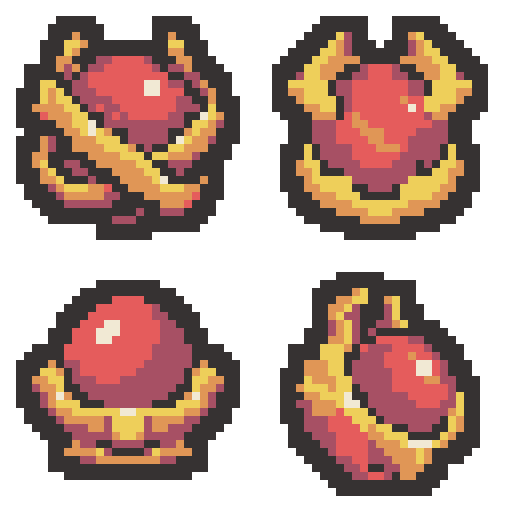

# 홍련의 한계선 — 마력핵 디자인 4안

마력핵만을 대상으로 한 비교 초안입니다. 각 디자인은 실제 32×32이며, 왼쪽 위부터 가로 순서로 1·2 / 3·4를 배치한 투명 64×64 시트입니다. 프로젝트에는 적용하지 않았습니다.

| 위치 | 디자인 | 개별 32×32 PNG |
| --- | --- | --- |
| 1 왼쪽 위 | 교차 고리형 — 붉은 구체를 두 개의 굵은 금빛 고리가 비스듬히 감싼 형태 | [PNG](01-crossed-rings-draft-v1-32x32.png) |
| 2 오른쪽 위 | 집게 봉인형 — 네 개의 짧고 두꺼운 금빛 집게가 구체를 고정한 형태 | [PNG](02-clamped-core-draft-v1-32x32.png) |
| 3 왼쪽 아래 | 받침 안치형 — 낮고 넓은 금빛 받침에 붉은 마력 구체를 안치한 형태 | [PNG](03-cradle-core-draft-v1-32x32.png) |
| 4 오른쪽 아래 | 외장 봉인형 — 두꺼운 금빛 외장 일부가 열려 붉은 핵이 드러나는 입체적인 형태 | [PNG](04-armored-core-draft-v1-32x32.png) |

- [64×64 원본 시트](crimson-magic-core-four-designs-v1-64x64.png)
- [최종 프롬프트 4개](prompts.json)
- [생성 원본 경로](generation-sources.json)
- [검증 결과](verification.json)

붉은 구체와 금빛으로 감싸는 구조를 무기의 공통 요소로 가져왔습니다. 금빛 외장은 팔레트의 노란색·주황색, 구체는 붉은색·탁한 붉은색으로 표현했습니다.

생성: built-in image_gen으로 디자인당 1회, 총 4회 생성했습니다. AI 생성 원본을 최근접 표본화하고 팔레트·외곽선을 정돈하여 실제 32×32로 내보냈습니다. 전부 지정된 동일 6색, 2픽셀 외곽선, 사방 최소 2픽셀 투명 여백과 이진 알파를 검증했습니다.

변경 파일은 이 출력 폴더의 4개 개별 PNG, 원본/확대 시트, 참조 PNG 2개, 프롬프트·생성 경로·검증·내보내기 JSON, PowerShell 기술 내보내기 스크립트, 보호 해시와 이 README입니다. 기존 보호 파일 410개의 바이트 해시는 유지했습니다.

Unity import·컴파일·Play Mode는 실행하지 않았습니다. 유물 이름·이미지 연결·효과·기존 에셋·문서는 변경하지 않았습니다. Doc Impact Check: no doc update needed. SessionLogs/ErrorLog/DecisionLog/Presentation HTML 변경 및 HTML stale candidate는 없습니다.
