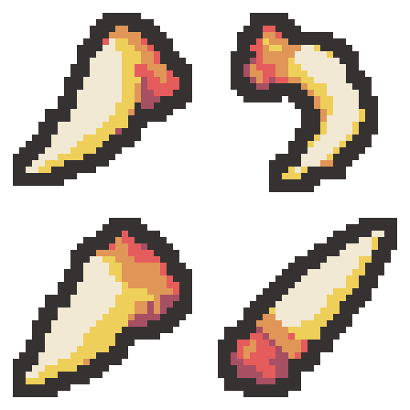

# 용의 이빨 디자인 4안

각 디자인의 실제 크기는 32×32이며, 위쪽 왼쪽부터 가로 순서로 1·2 / 3·4를 배치한 투명 64×64 시트입니다. 프로젝트 적용 전 비교 초안입니다.

| 위치 | 디자인 | 개별 32×32 PNG |
| --- | --- | --- |
| 1 왼쪽 위 | 짧고 굵은 송곳니 — 넓고 둥근 뿌리에서 짧은 촉으로 좁아지는 기본형 | [PNG](01-short-fang-draft-v1-32x32.png) |
| 2 오른쪽 위 | 갈고리처럼 휜 이빨 — 안쪽으로 깊게 휘어지는 곡선과 굵은 뿌리를 강조한 형태 | [PNG](02-hook-fang-draft-v1-32x32.png) |
| 3 왼쪽 아래 | 각진 쐐기형 이빨 — 넓적한 삼각형 단면과 짧고 날카로운 끝을 가진 형태 | [PNG](03-faceted-fang-draft-v1-32x32.png) |
| 4 오른쪽 아래 | 손잡이를 단 이빨 송곳 — 굵은 이빨을 짧은 붉은 손잡이에 고정한 유물형 | [PNG](04-grip-fang-draft-v1-32x32.png) |

- [64×64 원본 시트](dragon-fang-four-designs-v1-64x64.png)
- [최종 프롬프트 4개](prompts.json)
- [생성 원본 경로](generation-sources.json)
- [검증 결과](verification.json)

생성: built-in image_gen으로 디자인당 1회, 총 4회 생성했습니다. AI 생성 원본을 최근접 표본화하고 팔레트·외곽선을 정돈하여 실제 32×32로 내보냈습니다. 전부 기존 화염 팔레트 6색, 2픽셀 외곽선, 사방 최소 2픽셀 투명 여백, 이진 알파를 검증했습니다.

변경 파일은 이 출력 폴더의 4개 개별 PNG, 원본/확대 시트, 프롬프트·생성 경로·검증·내보내기 JSON, PowerShell 기술 내보내기 스크립트, 보호 해시와 이 README입니다. 기존 프로젝트 보호 파일 378개는 바이트 해시가 그대로입니다.

유물 이름·이미지 연결·효과·기존 에셋은 변경하지 않았습니다. Unity import·컴파일·Play Mode는 실행하지 않았습니다. Doc Impact Check: no doc update needed. SessionLogs/ErrorLog/DecisionLog/Presentation HTML 변경 및 HTML stale candidate는 없습니다.
