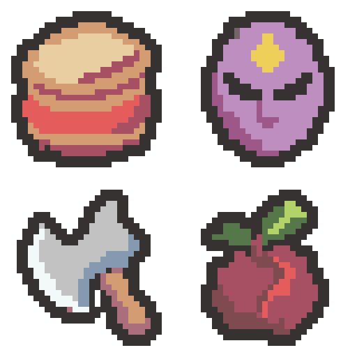

# 돌격의 북·주술사의 가면·처형자의 도끼·광기의 열매 초안 — 2026-11-04

사용자가 추천한 새 디자인으로 그려 달라고 요청하여, 이름을 기준으로 4개 초안을 내장 이미지 생성 기능으로 각각 제작했습니다. 직전 승인 화풍인 균열석·왕관·붕대·깃발 4종과 기존 8종, 기존 팔레트를 참조했습니다. 아래 이름은 디자인 제안이며 프로젝트 이름·효과·이미지는 변경하지 않았습니다.

왼쪽 위 돌격의 북 → 오른쪽 위 주술사의 가면 → 왼쪽 아래 처형자의 도끼 → 오른쪽 아래 광기의 열매.

| 제안 디자인 | 기존 유물 | 원본 | 확대본 | 색 수(외곽선 포함) |
| --- | --- | --- | --- | --- |
| 돌격의 북 | 깨진 시계 | [32×32 PNG](01-charge-drum-32x32.png) | [8배 PNG](01-charge-drum-preview.png) | 5 |
| 주술사의 가면 | 검은 향로 | [32×32 PNG](02-shamans-mask-32x32.png) | [8배 PNG](02-shamans-mask-preview.png) | 5 |
| 처형자의 도끼 | 예리한 송곳 | [32×32 PNG](03-executioners-axe-32x32.png) | [8배 PNG](03-executioners-axe-preview.png) | 6 |
| 광기의 열매 | 광전사의 끈 | [32×32 PNG](04-madness-fruit-32x32.png) | [8배 PNG](04-madness-fruit-preview.png) | 6 |

- [2×2 원본 시트: 64×64](four-relics-64x64.png)
- [세로 원본 시트: 32×128](four-relics-32x128.png)
- [가로 원본 시트: 128×32](four-relics-128x32.png)
- [PNG 파일 묶음](four-relics-native.zip)
- [생성 프롬프트 4개와 색상 목록](prompts.json) · [승인 화풍 기준](../../style-review-2026-11-04/README.md)

## 디자인

- 돌격의 북: 황갈색 가죽 면·굵은 테두리와 붉은 몸통을 가진 짧은 전투 북. 가는 끈이나 북채를 생략했습니다.
- 주술사의 가면: 보라색 면과 어두운 눈, 금색 이마 표식으로 마법적인 성격을 표현했습니다.
- 처형자의 도끼: 넓은 은빛 날과 짧은 목재 손잡이로 큰 타격감을 표현했습니다. 날과 손잡이 사이의 구조적인 빈틈은 유지했습니다.
- 광기의 열매: 짙은 붉은 껍질, 산호색 속살이 드러난 갈라진 면과 초록 잎으로 마법 식물의 느낌을 표현했습니다.

## 형식과 확인

큰 생성 래스터를 최근접 샘플링·허용 팔레트 정리 후 실제 32×32로 내보내고 둥근 2픽셀 외곽선과 모서리를 정리했습니다. 사방 최소 2픽셀 투명 여백, 알파 0/255, 기존 팔레트 내 색만 사용하며 불필요하게 색 수를 채우지 않았습니다.

[크기·색상·여백·시트/확대본 픽셀·프로젝트 보존 확인](verification.json). 원본 크기와 확대본에서 형태를 육안 확인했습니다. 이 출력 폴더에만 초안/생성 원본 사본/프롬프트/시트/스크립트/검증 기록을 저장했습니다. Assets·이름·효과·번역·기존 Docs/로그는 변경하지 않았습니다.

Doc Impact Check: no doc update needed. SessionLogs/ErrorLog/DecisionLog/Presentation HTML 변경 및 새로운 HTML stale candidate 없음. Unity import/자동화 테스트는 실행하지 않았습니다.
