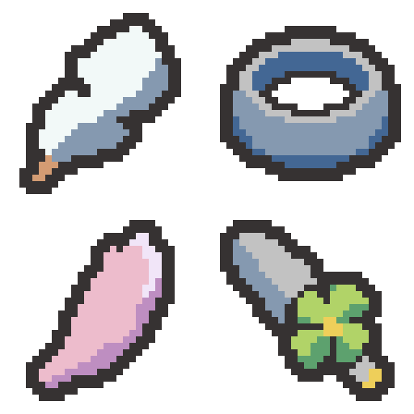

# 회피의 깃·무거운 팔찌·벚꽃잎·클로버 단검 초안 — 2026-11-04

요청한 4종을 내장 이미지 생성 기능으로 제작했습니다. 승인 화풍인 균열석·왕관·붕대·깃발 4종과 기존 8종, 기존 팔레트를 참조했습니다. 프로젝트에는 적용하지 않았으며 이름과 효과도 변경하지 않았습니다.

왼쪽 위 회피의 깃 → 오른쪽 위 무거운 팔찌 → 왼쪽 아래 벚꽃잎 형태의 검흔 초안 → 오른쪽 아래 네잎클로버 장식 단검(보약 곰방대 대체 디자인). 프로젝트 현재 이름은 귀인의 검흔이며, 이번에는 개별 벚꽃잎 디자인만 검토했습니다.

| 디자인 | 원본 | 확대본 | 색 수(외곽선 포함) |
| --- | --- | --- | --- |
| 회피의 깃 | [32×32 PNG](01-evasion-plume-32x32.png) | [8배 PNG](01-evasion-plume-preview.png) | 4 |
| 무거운 팔찌 | [32×32 PNG](02-heavy-bracelet-32x32.png) | [8배 PNG](02-heavy-bracelet-preview.png) | 4 |
| 벚꽃잎 · 검흔 초안 | [32×32 PNG](03-sakura-petal-32x32.png) | [8배 PNG](03-sakura-petal-preview.png) | 4 |
| 네잎클로버 장식 단검 | [32×32 PNG](04-clover-dagger-32x32.png) | [8배 PNG](04-clover-dagger-preview.png) | 6 |

- [2×2 원본 시트: 64×64](four-relics-64x64.png)
- [세로 원본 시트: 32×128](four-relics-32x128.png)
- [가로 원본 시트: 128×32](four-relics-128x32.png)
- [PNG 파일 묶음](four-relics-native.zip)
- [생성 프롬프트 4개](prompts.json) · [벚꽃잎 수정 프롬프트](sakura-correction-prompt.json) · [승인 화풍 기준](../../style-review-2026-11-04/README.md)

## 디자인과 육안 검토

- 회피의 깃: 넓고 휘어진 흰 깃과 청회색 그림자, 짧은 황갈색 깃대를 표현했습니다. 개별 잔털 대신 큰 갈라짐만 남겼습니다.
- 무거운 팔찌: 두꺼운 청회색 철제 몸통과 밝은 윗면, 실제로 비어 있는 손목 공간으로 두께를 강조했습니다. 중심 투명 공간을 보존했습니다.
- 벚꽃잎: 첫 시안의 넓은 두 갈래가 32×32에서 하트처럼 읽힐 여지가 있어, 이미지 생성 편집으로 더 길고 비대칭인 한 장의 꽃잎으로 다듬었습니다. 끝의 작은 갈라짐·밝은 접힌 면·분홍 주조색으로 표현했습니다. 개별 꽃잎만으로 꽃 종류를 전달하는 데는 한계가 있어, 갈라진 끝이 충분히 읽히는지 사용자 검토를 위한 초안입니다. [처음의 넓은 꽃잎 비교](03-sakura-petal-preview-v1.png).
- 단검: 넓은 짧은 날과 큰 네잎클로버 가드를 결합했습니다. 초록 잎 네 덩어리와 금색 중심점이 장식의 식별점입니다.

## 형식과 확인

큰 생성 래스터를 최근접 샘플링·허용 팔레트 정리 후 실제 32×32로 내보내고 둥근 2픽셀 외곽선과 모서리를 정리했습니다. 사방 최소 2픽셀 투명 여백, 알파 0/255, 기존 팔레트 내 색만 사용하며 색 수를 억지로 채우지 않았습니다.

[크기·색상·여백·시트/확대본 픽셀·프로젝트 보존 확인](verification.json). 원본 크기와 확대본에서 형태를 육안 확인했습니다. 이 출력 폴더에만 초안/생성 원본 사본/프롬프트/시트/스크립트/검증 기록을 저장했습니다. Assets·이름·효과·번역·기존 Docs/로그는 변경하지 않았습니다.

Doc Impact Check: no doc update needed. SessionLogs/ErrorLog/DecisionLog/Presentation HTML 변경 및 새로운 HTML stale candidate 없음. Unity import/자동화 테스트는 실행하지 않았습니다.
