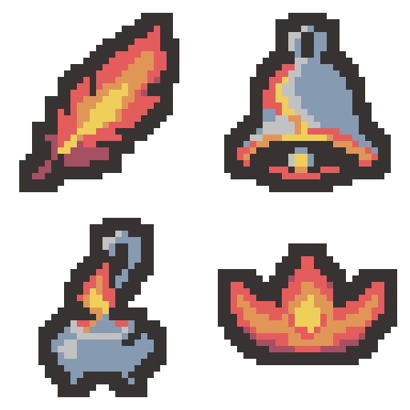

# 화염 유물 4종 — 정리 시안 v2

2026-11-01 · 테스트용 · 프로젝트 미적용

사용자의 요청에 따라 이전 시안의 불꽃 잔무늬와 작은 하이라이트를 줄이고, 전기 유물처럼 큰 색면 위주로 단순화했습니다. 종과 향로의 불이 아닌 구조물은 팔레트의 회청색 #8599B0·연회색 #C2C2C2로 구분했습니다. 모양·방향·비율과 두꺼운 외곽선은 유지하는 방향으로 생성했습니다.

| 시트 순서 / 세로 구간 | 유물 | 개별 PNG | 색 수 | 좌 / 상 / 우 / 하 여백 |
| --- | --- | --- | --- | --- |
| 1 / y=0–31 | 불타는 깃털 | [32×32](01-burning-feather-draft-v2-32x32.png) | 5 | 3 / 2 / 4 / 2 px |
| 2 / y=32–63 | 녹아내린 종 | [32×32](02-melted-bell-draft-v2-32x32.png) | 6 | 3 / 2 / 3 / 2 px |
| 3 / y=64–95 | 매캐한 향로 | [32×32](03-smoky-incense-draft-v2-32x32.png) | 6 | 6 / 2 / 6 / 2 px |
| 4 / y=96–127 | 홍련의 왕관 | [32×32](04-crimson-crown-draft-v2-32x32.png) | 5 | 2 / 6 / 2 / 7 px |

- [32×128 시트 원본](fire-four-draft-v2-32x128.png)
- [세로 시트 8배 확대](fire-four-draft-v2-vertical-preview.png)
- [2×2 모아보기](fire-four-draft-v2-2x2-preview.png)
- [이전 시안](fire-four-draft-v1-2x2-preview.png)
- [생성 프롬프트](prompt-draft-v2.txt)
- [기술 내보내기 스크립트](export-draft-v2.ps1)
- [검증 기록](verification-draft-v2.json)

깃털·왕관은 외곽선 #363232, 붉은 그림자 #A75064, 빨강 #E55C5C, 주황 #E09656, 노랑 #EECF5A의 5색입니다. 종·향로는 붉은 그림자 대신 회청색·연회색 2색을 사용한 6색입니다. 네 유물을 합친 시트 전체에서는 총 7색이며 모두 제공된 팔레트에 있습니다. 투명은 색 수에서 제외합니다.

한 번의 내장 image_gen 호출로 네 유물이 있는 2×2 시트를 수정했습니다. 이후 System.Drawing으로 비율을 보존해 최근접 축소, 팔레트 제한, 2픽셀 외곽선 처리를 했으며 각 32×32 프레임을 픽셀 변경 없이 32×128로 연결했습니다. Python/PIL/NumPy는 이미지 검증에만 사용했습니다.

각 유물의 32×32 크기, 6색 이하, 팔레트 포함 여부, 알파 0/255, 2픽셀 외곽선, 최소 2픽셀 투명 여백, 개별 PNG와 시트의 픽셀 일치, 확대본의 정확한 최근접 확대를 확인했습니다. 기존 공유 이미지·메타데이터·유물 정의 등 보호 파일 10개의 해시를 유지했습니다.

output 안에 v2 PNG·프롬프트·검증 자료만 추가했으며 이전 시안도 보존했습니다. Unity import·컴파일·Play Mode는 실행하지 않았습니다. SessionLogs / ErrorLog / DecisionLog 변경 없음. Doc Impact Check: no doc update needed. Presentation HTML 영향 없음.

