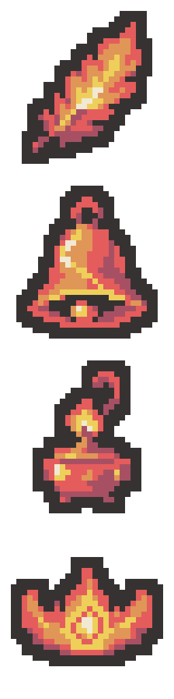

# 화염 유물 4종 묶음 초안

2026-11-01 · 테스트용 · 프로젝트 미적용

한 번의 이미지 생성에서 2×2로 네 유물을 수정한 후, 각 그림을 비율을 보존해 32×32로 정돈하고 세로로 연결했습니다. 최종 PNG는 실제 32×128이며 투명 배경입니다.

| 순서 / 세로 구간 | 유물 | 개별 32×32 PNG | 색 수 | 좌 / 상 / 우 / 하 여백 |
| --- | --- | --- | --- | --- |
| 1 / y=0–31 | 불타는 깃털 | [PNG](01-burning-feather-draft-v1-32x32.png) | 6 | 4 / 2 / 4 / 2 px |
| 2 / y=32–63 | 녹아내린 종 | [PNG](02-melted-bell-draft-v1-32x32.png) | 6 | 3 / 2 / 3 / 2 px |
| 3 / y=64–95 | 매캐한 향로 | [PNG](03-smoky-incense-draft-v1-32x32.png) | 6 | 6 / 2 / 6 / 2 px |
| 4 / y=96–127 | 홍련의 왕관 | [PNG](04-crimson-crown-draft-v1-32x32.png) | 6 | 2 / 6 / 2 / 6 px |

- [32×128 시트 원본](fire-four-draft-v1-32x128.png)
- [2×2 모아보기](fire-four-draft-v1-2x2-preview.png)
- [생성 프롬프트](prompt-draft-v1.txt)
- [검증 기록](verification-draft-v1.json)

공통 팔레트 6색(외곽선 포함): #363232 / #A75064 / #E55C5C / #E09656 / #EECF5A / #F1E9D4.

각 유물의 총 6색, 알파 0/255, 2픽셀 외곽선, 최소 2픽셀 투명 여백, 개별 PNG와 시트 각 구간의 픽셀 일치, 최근접 확대를 확인했습니다. 왕관은 원래의 넓고 낮은 비율을 보존해 상하 여백이 더 큽니다.

기존 공유 이미지·메타데이터·유물 정의 등 보호 파일 10개의 해시를 보존했습니다. output의 초안·참고 시트·프롬프트·검증 자료만 추가했습니다. Unity import·컴파일·Play Mode는 실행하지 않았습니다. SessionLogs / ErrorLog / DecisionLog 변경 없음. Doc Impact Check: no doc update needed. Presentation HTML 영향 없음.
