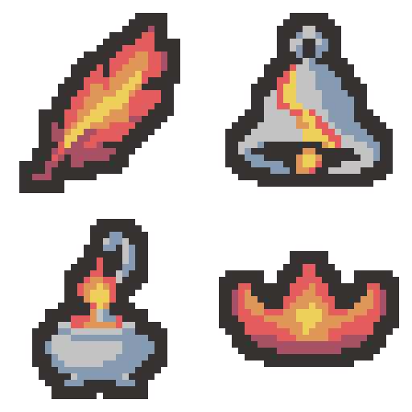

# 화염 유물 4종 v2 — 디테일 간소화와 금속 색 분리

2026-11-01 · 테스트용 이미지 수정 · 프로젝트 미적용

기존 네 유물의 종류·방향·실루엣을 유지하며 불꽃의 작은 밝은 점과 겹친 색층을 줄였습니다. 종과 향로는 팔레트의 청회색·밝은 회색 금속 몸통과 따뜻한 불꽃이 구분되도록 수정했습니다.

| 32×128 시트 순서 | 유물 / 변경 이유 | 개별 32×32 | 외곽선 포함 색 수 |
| --- | --- | --- | --- |
| 1 / y=0–31 | 불타는 깃털 — 작은 갈래와 밝은 점을 줄이고 큰 중심 색면으로 정리 | [PNG](01-burning-feather-draft-v2-32x32.png) | 5 |
| 2 / y=32–63 | 녹아내린 종 — 금속 몸통을 회색으로 분리하고 녹아내린 틈은 한 줄로 정리 | [PNG](02-melted-bell-draft-v2-32x32.png) | 6 |
| 3 / y=64–95 | 매캐한 향로 — 회색 금속 몸통과 작은 불꽃을 구분하고 표면 무늬 축소 | [PNG](03-smoky-incense-draft-v2-32x32.png) | 6 |
| 4 / y=96–127 | 홍련의 왕관 — 낮고 넓은 실루엣과 하나의 노란 중심 장식 유지 | [PNG](04-crimson-crown-draft-v2-32x32.png) | 5 |

- [실제 32×128 시트](fire-four-draft-v2-32x128.png)
- [세로 시트 8배 확대](fire-four-draft-v2-vertical-preview.png)
- [실제 64×64 모아보기](fire-four-draft-v2-2x2-64x64.png)
- [이전 v1 미리보기](../fire-four-draft-v1-2x2-preview.png)
- [최종 생성 프롬프트](prompt-draft-v2.txt)
- [픽셀 규격 변환 스크립트](export-draft-v2.ps1)
- [검증 기록](verification-draft-v2.json)

시트 전체는 제공 팔레트의 7색을 사용하며 각 유물은 5–6색입니다. #363232 외곽선, #A75064 붉은 그림자, #E55C5C 빨강, #E09656 주황, #EECF5A 노랑, #8599B0 금속 그림자, #C2C2C2 금속 기본색을 사용했습니다. 종·향로에는 붉은 그림자색 대신 두 금속색을 사용합니다. 별도의 크림색 반짝임은 제거했습니다.

내장 image_gen 도구로 네 유물을 한 장의 2×2 시트로 수정했습니다. 생성 후 각 유물의 비율을 보존해 최근접 방식으로 32×32에 맞추고, 제한 팔레트와 2픽셀 외곽선을 적용한 뒤 세로 32×128로 연결했습니다. 정수 배율 미리보기는 추가 보간이 없습니다.

검증: 각 그림 32×32, 시트 32×128, 유물별 최대 6색, 모든 색이 제공 팔레트에 포함됨, 알파 0/255, 2픽셀 외곽선, 상하좌우 최소 2픽셀 여백, 개별 그림과 시트 셀의 픽셀 일치, 미리보기의 정확한 8배 최근접 확대를 확인했습니다. 넓고 낮은 왕관은 상하 7픽셀 여백으로 원래 비율을 유지했습니다.

추가 파일은 이 v2 초안·변환 스크립트·프롬프트·검증 기록뿐입니다. 원본 공유 스프라이트, 메타데이터, 네 유물 정의 등 보호 파일 10개의 전후 해시가 일치합니다. 프로젝트에 적용하지 않았으며 Unity import·컴파일·Play Mode·실제 게임 화면 검증은 실행하지 않았습니다. 현재 결과는 시각 검토용 초안입니다.

SessionLogs / ErrorLog / DecisionLog 변경 없음. Doc Impact Check: no doc update needed. Presentation HTML 영향 없음.

