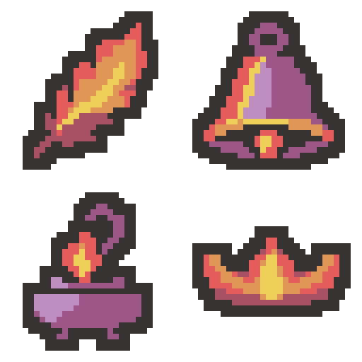

# 화염 유물 4종 — 간소화·보라색 금속 시안

2026-11-01 · 테스트용 · 프로젝트 미적용

불꽃의 잔가지·작은 하이라이트·여러 겹의 내부 색띠를 줄이고, 기존 전기 유물처럼 큰 색면 위주로 정리했습니다. 종과 향로의 금속 몸통은 제공 팔레트의 보라색 #9D5789와 밝은 보라 #BE8EC1로 구분했습니다. 기존 유물 종류·방향·넓고 낮은 왕관의 비율을 유지하는 방향의 초안입니다.

| 순서 / 세로 구간 | 유물 | 개별 32×32 | 외곽선 포함 색 수 | 좌 / 상 / 우 / 하 여백(px) |
| --- | --- | --- | --- | --- | --- |
| 1 / y=0–31 | 불타는 깃털 | [PNG](01-burning-feather-draft-v3-32x32.png) | 5 | 4 / 2 / 4 / 2 |
| 2 / y=32–63 | 녹아내린 종 | [PNG](02-melted-bell-draft-v3-32x32.png) | 6 | 2 / 2 / 3 / 2 |
| 3 / y=64–95 | 매캐한 향로 | [PNG](03-smoky-incense-draft-v3-32x32.png) | 6 | 4 / 2 / 5 / 2 |
| 4 / y=96–127 | 홍련의 왕관 | [PNG](04-crimson-crown-draft-v3-32x32.png) | 5 | 2 / 8 / 2 / 8 |

- [32×128 시트 원본](fire-four-draft-v3-32x128.png)
- [세로 시트 8배 확대](fire-four-draft-v3-vertical-preview.png)
- [2×2 모아보기](fire-four-draft-v3-2x2-preview.png)
- [이전 따뜻한 색 시안](../fire-four-draft-v1-2x2-preview.png)
- [생성 프롬프트](prompt.txt)
- [기술 내보내기 스크립트](export-draft-v3.ps1)
- [검증 기록](verification.json)

깃털·왕관은 #363232 외곽선, #A75064 붉은 그림자, #E55C5C 빨강, #E09656 주황, #EECF5A 노랑의 5색을 사용합니다. 종·향로는 붉은 그림자 대신 보라색 2색을 사용해 각각 6색입니다. 시트 전체 합계는 7색이며 모두 제공 팔레트에 있습니다. 투명은 색 수에 포함하지 않습니다.

내장 image_gen으로 한 번에 네 유물을 수정했습니다. 2×2 배치로 요청했으나 실제 생성 결과는 세로 네 그림이었으며, 각 그림을 비율 보존·최근접 방식으로 32×32에 맞추고 정확한 팔레트·2픽셀 외곽선을 적용한 뒤 세로 32×128로 연결했습니다. 원본 생성 파일은 검증 기록에 있습니다.

검증: 각 32×32, 최종 시트 32×128, 유물별 6색 이하, 제공 팔레트 포함, 알파 0/255, 2픽셀 외곽선, 상하좌우 최소 2픽셀 투명 여백, 개별 PNG와 시트 구간의 픽셀 일치, 정확한 8배 최근접 확대를 확인했습니다. 기존 원본 이미지·메타데이터·유물 정의 보호 파일 10개의 해시도 기존 기준과 같습니다.

변경 파일은 이 폴더의 비교용 PNG·프롬프트·내보내기 스크립트·검증 기록·이 문서뿐입니다. Assets와 Docs는 수정하지 않았습니다. Unity import·컴파일·Play Mode 및 실제 게임 화면 검증은 실행하지 않았습니다. 현재는 시각 검토용 초안입니다.

SessionLogs / ErrorLog / DecisionLog 변경 없음. Doc Impact Check: no doc update needed. Presentation HTML 영향 없음.
