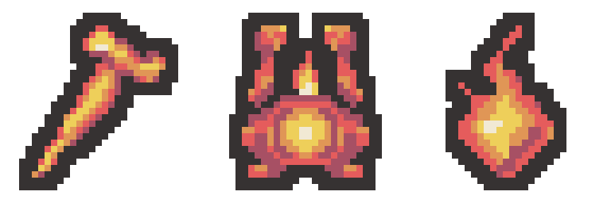

# 화염 유물 3종 리메이크 초안

2026-11-01 · 초안 제작 범위 · 프로젝트 미적용

기존 형태를 참고하고 방금 승인된 타오르는 심핵과 같은 단순한 색면으로 각각 생성했습니다. built-in image_gen을 유물별 한 번씩 사용한 뒤, 비율을 유지해 실제 32×32로 정돈하고 공통 팔레트와 외곽선을 맞췄습니다.

| 유물 | 개별 32×32 PNG | 좌 / 상 / 우 / 하 여백 |
| --- | --- | --- |
| 작열하는 송곳 | [PNG](scorching-awl-draft-v1-32x32.png) | 3 / 2 / 4 / 2 px |
| 휴대용 화로 | [PNG](portable-brazier-draft-v1-32x32.png) | 4 / 2 / 4 / 2 px |
| 태양의 파편 | [PNG](sun-fragment-draft-v1-32x32.png) | 6 / 2 / 7 / 2 px |

공통 6색(외곽선 포함): #363232 / #A75064 / #E55C5C / #E09656 / #EECF5A / #F1E9D4. 각 파일은 투명 배경이며 2픽셀 외곽선과 최소 2픽셀 여백을 확인했습니다.

- [96×32 가로 시트](fire-three-draft-v1-96x32.png)
- [유물별 최종 생성 프롬프트](prompts-draft-v1.json)
- [생성 원본 경로와 분석](generation-sources.json)
- [검증 내역](verification-draft-v1.json)

변경 파일은 이 output 폴더의 초안 PNG·확대본·참고 이미지·프롬프트·기술 출력 스크립트·검증 JSON·이 README입니다. 기존 유물 정의·이미지·메타데이터 368개는 해시가 같습니다. Assets와 프로젝트 데이터에는 적용하지 않았습니다.

Unity import·컴파일·Play Mode 확인은 실행하지 않았습니다. 검토 후 수정/적용할 수 있는 초안입니다. SessionLogs·ErrorLog·DecisionLog는 이 작업으로 변경하지 않았습니다. Doc Impact Check: no doc update needed. Presentation HTML 변경 및 stale candidate 없음.
