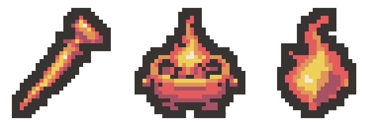

# 화염 유물 3종 리메이크 초안

왼쪽부터 작열하는 송곳 · 휴대용 화로 · 태양의 파편. 프로젝트에는 적용하지 않았습니다.

| 유물 | 32×32 투명 PNG | 디자인 |
| --- | --- | --- |
| 작열하는 송곳 | [PNG](scorching-awl-draft-v2-32x32.png) | 기존의 왼쪽 아래를 향한 뾰족한 도구 형태와 짧은 손잡이를 유지하고 내부를 단순화했습니다. |
| 휴대용 화로 | [PNG](portable-brazier-draft-v2-32x32.png) | 기존 긴 상부 구조를 넓은 입구, 입구 위 불꽃, 낮은 몸체와 짧은 받침으로 재구성했습니다. |
| 태양의 파편 | [PNG](sun-fragment-draft-v2-32x32.png) | 기존 비대칭 불꽃 파편을 큰 색면으로 정리했습니다. |

세 이미지 각각 실제 32×32, 외곽선 포함 지정 팔레트 6색, 2픽셀 외곽선과 사방 최소 2픽셀 투명 여백을 검증했습니다. 미리보기는 정확한 최근접 8배입니다.

- [96×32 원본 연결 시트](fire-three-draft-v2-96x32.png)
- [최종 프롬프트 3개](prompts.json)
- [생성 원본 경로](generation-sources.json)
- [검증 결과](verification.json)

생성 도구: built-in image_gen, 유물당 별도 생성 1회, 총 3회. 고해상도 생성 결과를 최근접 표본화·팔레트 제한·외곽선 정돈하여 실제 32×32로 내보냈습니다.

변경 파일은 이 테스트 출력 폴더의 PNG, 참조 이미지, 프롬프트·검증 JSON, 기술 내보내기 스크립트와 이 README입니다. 기존 에셋과 정의, 공용 시트, 문서·로그 등 보호 파일 378개의 해시가 그대로입니다.

Unity import·컴파일·Play Mode는 실행하지 않았습니다. Doc Impact Check: no doc update needed. SessionLogs/ErrorLog/DecisionLog/Presentation HTML은 변경하지 않았으며 HTML stale candidate도 없습니다.
