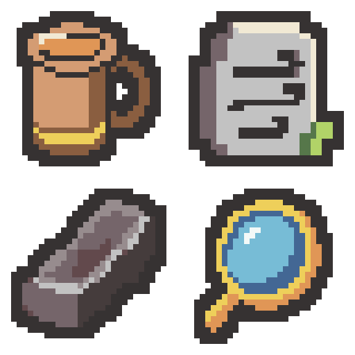

# 유물 초안 4종 — 술잔 재설계·석판·숫돌·렌즈

독한 술기운은 큰 거품 덩어리를 줄이고 술이 보이는 타원형 입구, 곧은 몸통과 큰 옆 손잡이를 강조한 새 술잔으로 재설계했습니다. 나머지는 현재 이미지를 참고해 간결한 32×32 아이콘으로 리메이크했습니다. 프로젝트 적용 전 검토용입니다.

| 위치 | 유물 | 개별 32×32 PNG | 디자인 |
| --- | --- | --- | --- |
| 왼쪽 위 | 독한 술기운 | [PNG](01-drunken-rush-new-draft-v1-32x32.png) | 입구 안의 호박색 술과 낮은 거품, 넓은 몸통, 큼직한 손잡이가 보이는 술잔입니다. |
| 오른쪽 위 | 질풍의 석판 | [PNG](02-wind-tablet-draft-v1-32x32.png) | 큰 돌판 면에 바람을 나타내는 세 개의 단순한 홈과 짧은 녹색 장식을 배치했습니다. |
| 왼쪽 아래 | 낡은 숫돌 | [PNG](03-worn-whetstone-draft-v1-32x32.png) | 기존 대각선 직육면체의 입체감과 닳은 윗면을 몇 개의 큰 회색 면으로 정리했습니다. |
| 오른쪽 아래 | 집중의 렌즈 | [PNG](04-focus-lens-draft-v1-32x32.png) | 푸른 원형 렌즈, 두꺼운 금빛 테와 짧은 손잡이를 유지하고 반사를 한 덩어리로 줄였습니다. |

- [64×64 시트 PNG](four-relic-remakes-02-v1-64x64.png)
- [최종 생성 프롬프트 4개](prompts.json)
- [생성 원본 경로](generation-sources.json)
- [검증 기록](verification.json)

생성: built-in image_gen으로 유물당 1회, 총 4회 생성했습니다. AI 생성 원본을 최근접 표본화하고 팔레트·외곽선을 정돈하여 실제 32×32로 내보냈습니다. 네 이미지는 각 6색이며 모든 색을 제공한 팔레트 PNG의 실제 RGB와 대조했습니다. 2픽셀 외곽선, 사방 최소 2픽셀 투명 여백과 이진 알파, 시트/개별 PNG 일치, 최근접 8배 미리보기를 검증했습니다.

변경 파일은 이 출력 폴더의 개별 PNG 4개, 원본 크기의 시트와 확대 시트, 참조 PNG 5개, 프롬프트·생성 경로·검증·내보내기 JSON, PowerShell 기술 내보내기 스크립트, 보호 해시와 이 README입니다. 기존 보호 파일 388개의 바이트 해시를 유지했습니다.

프로젝트의 이미지·메타데이터·유물 이름·효과·연결은 변경하지 않았습니다. Unity import·컴파일·Play Mode는 실행하지 않았습니다. Doc Impact Check: no doc update needed. SessionLogs/ErrorLog/DecisionLog/Presentation HTML 변경 및 HTML stale candidate는 없습니다.
