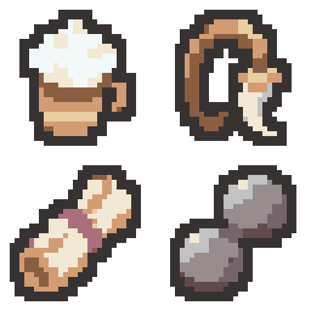

# 유물 4종 리메이크 초안 — 2026-11-04

기존 이미지를 참고하여 형태를 유지하면서 디테일과 색면을 단순화했습니다. 원본은 25×25이며 각 초안은 실제 32×32입니다. 프로젝트 적용 전 검토용입니다.

| 위치 | 유물 | 개별 32×32 PNG | 디자인 |
| --- | --- | --- | --- |
| 왼쪽 위 | 독한 술기운 | [PNG](01-drunken-rush-draft-v1-32x32.png) | 거품이 올라온 갈색 술잔. 거품을 큰 덩어리로, 몸체와 손잡이를 단순한 면으로 정리했습니다. |
| 오른쪽 위 | 송골매의 증표 | [PNG](02-hawk-emblem-draft-v1-32x32.png) | 갈색 가죽 고리와 굽은 밝은 장식. 고리의 폭과 여백을 확보하고 내부 선을 줄였습니다. |
| 왼쪽 아래 | 달리는 장부 | [PNG](03-running-ledger-draft-v1-32x32.png) | 기존의 대각선 두루마리 형태와 가운데 장밋빛 띠를 유지하며 종이 접힘을 단순화했습니다. |
| 오른쪽 아래 | 회전하는 철구 | [PNG](04-rotating-iron-balls-draft-v1-32x32.png) | 기존의 연결된 두 철구 형태를 유지하고 큰 회색 면으로 입체감을 표현했습니다. |

- [64×64 시트 PNG](four-relic-remakes-v1-64x64.png)
- [최종 생성 프롬프트 4개](prompts.json)
- [생성 원본 경로](generation-sources.json)
- [검증 기록](verification.json)

생성: built-in image_gen으로 유물당 1회, 총 4회 생성했습니다. AI 생성 원본을 최근접 표본화하고 팔레트·외곽선을 정돈하여 실제 32×32로 내보냈습니다. 네 이미지는 각 6색이며 모든 색을 제공한 팔레트 PNG의 실제 RGB와 대조했습니다. 2픽셀 외곽선, 사방 최소 2픽셀 투명 여백과 이진 알파, 시트/개별 PNG 일치, 최근접 8배 미리보기를 검증했습니다.

변경 파일은 이 출력 폴더의 개별 PNG 4개, 원본 크기의 시트와 확대 시트, 참조 PNG 6개, 프롬프트·생성 경로·검증·내보내기 JSON, PowerShell 기술 내보내기 스크립트, 보호 해시와 이 README입니다. 기존 보호 파일 388개의 바이트 해시는 유지했습니다.

프로젝트의 이미지·메타데이터·유물 이름·효과·연결은 변경하지 않았습니다. Unity import·컴파일·Play Mode는 실행하지 않았습니다. Doc Impact Check: no doc update needed. SessionLogs/ErrorLog/DecisionLog/Presentation HTML 변경 및 HTML stale candidate는 없습니다.
