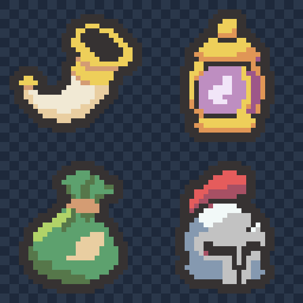

# 진군의 뿔피리·비전의 등불·순풍의 향낭·결사의 투구 초안 — 2026-11-04

사용자가 추천한 새 디자인으로 그려 달라고 요청하여 4개 초안을 내장 이미지 생성 기능으로 각각 제작했습니다. 승인된 균열석·왕관·붕대·깃발 4종을 우선 기준으로 삼고 기존 8종과 팔레트를 함께 참조했습니다. 아래 이름은 디자인 제안이며 프로젝트 이름·효과·이미지는 변경하지 않았습니다.

격자 배경은 확인용 미리보기에만 있으며 원본 PNG는 투명 배경입니다.

왼쪽 위 진군의 뿔피리 → 오른쪽 위 비전의 등불 → 왼쪽 아래 순풍의 향낭 → 오른쪽 아래 결사의 투구.

| 제안 디자인 | 기존 유물 | 원본 | 확대본 | 색 수(외곽선 포함) |
| --- | --- | --- | --- | --- |
| 진군의 뿔피리 | 깨진 시계 | [32×32 PNG](01-marching-horn-32x32.png) | [8배 PNG](01-marching-horn-preview.png) | 5 |
| 비전의 등불 | 검은 향로 | [32×32 PNG](02-arcane-lantern-32x32.png) | [8배 PNG](02-arcane-lantern-preview.png) | 6 |
| 순풍의 향낭 | 여유로운 심장 | [32×32 PNG](03-tailwind-sachet-32x32.png) | [8배 PNG](03-tailwind-sachet-preview.png) | 6 |
| 결사의 투구 | 마지막 숨 | [32×32 PNG](04-last-stand-helmet-32x32.png) | [8배 PNG](04-last-stand-helmet-preview.png) | 6 |

- [2×2 원본 시트: 64×64](four-relics-64x64.png)
- [세로 원본 시트: 32×128](four-relics-32x128.png)
- [가로 원본 시트: 128×32](four-relics-128x32.png)
- [PNG 파일 묶음](four-relics-native.zip)
- [생성 프롬프트 4개와 색상 목록](prompts.json) · [승인 화풍 기준](../../style-review-2026-11-04/README.md)

## 디자인

- 진군의 뿔피리: 두껍게 휘어진 상아색 몸통, 넓게 벌어진 입구와 금색 테두리. 입구의 어두운 안쪽은 불투명하게 보존했습니다.
- 비전의 등불: 금색 금속 뚜껑·받침·굵은 틀과 보랏빛 유리 안의 마력. 외부 입자나 가는 고리를 생략했습니다.
- 순풍의 향낭: 통통한 초록 천 주머니에 짧게 여민 입구, 큰 천 주름과 밝은 잎 모양 표식.
- 결사의 투구: 깊은 눈가와 튼튼한 코받침, 한쪽이 깨진 금속 면과 짧은 붉은 장식.

## 형식과 확인

큰 생성 래스터를 최근접 샘플링·허용 팔레트 정리 후 실제 32×32로 내보내고 둥근 2픽셀 외곽선과 모서리를 정리했습니다. 사방 최소 2픽셀 투명 여백, 알파 0/255, 기존 팔레트 내 색만 사용하며 불필요하게 색 수를 채우지 않았습니다. 뿔피리의 어두운 입구 등 내부 재질을 투명 구멍으로 바꾸지 않도록 확인했습니다.

[크기·색상·여백·시트/확대본 픽셀·프로젝트 보존 확인](verification.json). 원본 크기와 확대본에서 형태를 육안 확인했습니다. 이 출력 폴더에만 초안/생성 원본 사본/프롬프트/시트/스크립트/검증 기록을 저장했습니다. Assets·이름·효과·번역·기존 Docs/로그는 변경하지 않았습니다.

Doc Impact Check: no doc update needed. SessionLogs/ErrorLog/DecisionLog/Presentation HTML 변경 및 새로운 HTML stale candidate 없음. Unity import/자동화 테스트는 실행하지 않았습니다.
