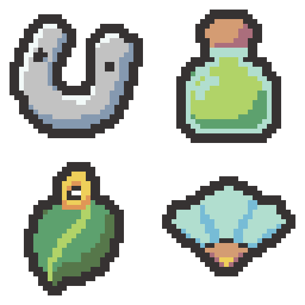

# 말 편자·각성의 약병·나뭇잎 펜던트·바람의 부채 초안 — 2026-11-04

선택한 4개 디자인을 내장 이미지 생성 기능으로 각각 제작했습니다. 승인 화풍인 균열석·왕관·붕대·깃발 4종과 기존 8종, 기존 팔레트를 참조했습니다. 아래 이름은 디자인 제안이며 프로젝트의 이름·효과·이미지는 변경하지 않았습니다.

왼쪽 위 말 편자 → 오른쪽 위 각성의 약병 → 왼쪽 아래 나뭇잎 펜던트 → 오른쪽 아래 바람의 부채.

| 제안 디자인 | 기존 유물 | 원본 | 확대본 | 색 수(외곽선 포함) |
| --- | --- | --- | --- | --- |
| 말 편자 | 반격의 박차 | [32×32 PNG](01-horseshoe-32x32.png) | [8배 PNG](01-horseshoe-preview.png) | 4 |
| 각성의 약병 | 보약 곰방대 | [32×32 PNG](02-awakening-tonic-32x32.png) | [8배 PNG](02-awakening-tonic-preview.png) | 6 |
| 나뭇잎 펜던트 | 생존자의 목걸이 | [32×32 PNG](03-leaf-pendant-32x32.png) | [8배 PNG](03-leaf-pendant-preview.png) | 6 |
| 바람의 부채 | 가벼운 끈 | [32×32 PNG](04-wind-fan-32x32.png) | [8배 PNG](04-wind-fan-preview.png) | 6 |

- [2×2 원본 시트: 64×64](four-relics-64x64.png)
- [세로 원본 시트: 32×128](four-relics-32x128.png)
- [가로 원본 시트: 128×32](four-relics-128x32.png)
- [PNG 파일 묶음](four-relics-native.zip)
- [생성 프롬프트 4개와 색상 목록](prompts.json) · [승인 화풍 기준](../../style-review-2026-11-04/README.md)

## 디자인

- 말 편자: 두꺼운 은빛 U자 몸통·청회색 측면·못 자국 두 개. 열린 중심을 유지했습니다.
- 각성의 약병: 통통한 초록 약액 병·짧은 코르크 마개·밝은 민트색 유리 면으로 구성했습니다.
- 나뭇잎 펜던트: 넓은 초록 잎 장식과 큰 잎맥 하나, 짧은 금빛 고리. 목걸이 줄은 생략하고 고리의 작은 투명 공간을 유지했습니다.
- 바람의 부채: 넓은 민트/청록색 세 접힌 면과 짧은 목재 손잡이·금빛 중심점으로 단순화했습니다.

## 형식과 확인

큰 생성 래스터를 최근접 샘플링·허용 팔레트 정리 후 실제 32×32로 내보내고 둥근 2픽셀 외곽선과 모서리를 정리했습니다. 사방 최소 2픽셀 투명 여백, 알파 0/255, 기존 팔레트 내 색만 사용하며 불필요하게 색 수를 채우지 않았습니다.

[크기·색상·여백·시트/확대본 픽셀·프로젝트 보존 확인](verification.json). 원본 크기와 확대본에서 형태를 육안 확인했습니다. 이 출력 폴더에만 초안/생성 원본 사본/프롬프트/시트/스크립트/검증 기록을 저장했습니다. Assets·이름·효과·번역·기존 Docs/로그는 변경하지 않았습니다.

Doc Impact Check: no doc update needed. SessionLogs/ErrorLog/DecisionLog/Presentation HTML 변경 및 새로운 HTML stale candidate 없음. Unity import/자동화 테스트는 실행하지 않았습니다.
