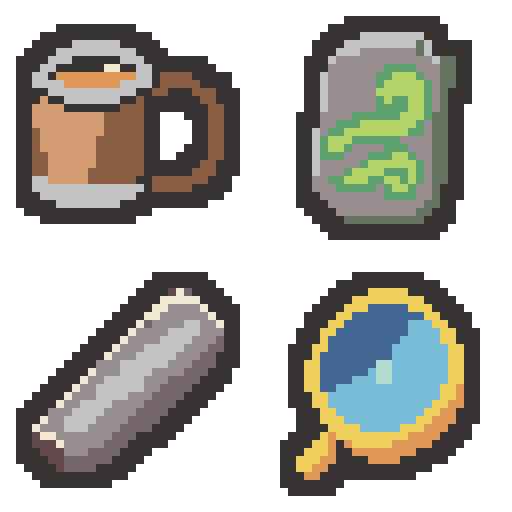

# 이름을 바탕으로 새로 그린 유물 4종 — 2026-11-04

기존 유물 이미지는 디자인 대상으로 사용하지 않았습니다. 이름에 맞춰 새로 만들고, 날개 부츠는 화풍 참고, 제공된 색상표는 팔레트 참고로만 사용했습니다. 최종 초안은 v2이며 프로젝트 적용 전 검토용입니다.

| 위치 | 유물 | 개별 32×32 PNG | 디자인 |
| --- | --- | --- | --- |
| 왼쪽 위 | 독한 술기운 | [PNG](01-strong-liquor-draft-v2-32x32.png) | 입구에 호박빛 술이 보이고 큰 손잡이와 금속 띠가 있는 나무 술잔 |
| 오른쪽 위 | 질풍의 석판 | [PNG](02-gale-tablet-draft-v2-32x32.png) | 바람 문양이 크게 새겨진 두꺼운 회색 석판 |
| 왼쪽 아래 | 낡은 숫돌 | [PNG](03-worn-whetstone-draft-v2-32x32.png) | 가운데가 닳고 모서리가 마모된 두툼한 회색 숫돌 |
| 오른쪽 아래 | 집중의 렌즈 | [PNG](04-focus-lens-draft-v2-32x32.png) | 짧은 손잡이와 금빛 테두리를 지닌 푸른 집광 렌즈 |

- [64×64 시트 PNG](name-inspired-four-relics-v2-64x64.png)
- [이름 기반 생성 프롬프트 4개](prompts.json)
- [술잔 손잡이 조정 프롬프트](01-strong-liquor-prompt-v2.txt)
- [최종 생성 원본 경로](generation-sources-v2.json)
- [검증 기록](verification.json)

생성 도구: built-in image_gen. 네 유물을 각각 생성하고, 술잔은 32×32에서 손잡이 구멍을 확보하기 위해 한 번 더 생성했습니다(총 5회). 고해상도 생성 결과를 최근접 표본화하고 팔레트·외곽선을 정돈해 실제 32×32로 내보냈습니다.

검증: 각 6색이 제공한 팔레트의 실제 RGB에 포함됨, 2픽셀 외곽선, 사방 최소 2픽셀 투명 여백, 이진 알파, 시트와 개별 PNG 일치, 정확한 최근접 8배 미리보기를 확인했습니다. 술잔에는 원본 크기 기준 20픽셀의 닫힌 투명 손잡이 구멍이 남아 있습니다. 보호 파일 388개의 해시는 그대로입니다.

이 출력 폴더에 최종 개별 PNG 4개와 시트·확대 미리보기, 참고 PNG 2개, 프롬프트·생성 경로·내보내기·검증 JSON, 기술 내보내기 PowerShell과 README를 저장했습니다. v1 초안과 기록도 함께 보존했습니다.

프로젝트 에셋·메타데이터·이름·효과·이미지 연결은 변경하지 않았습니다. Unity import·컴파일·Play Mode는 실행하지 않았습니다. Doc Impact Check: no doc update needed. SessionLogs/ErrorLog/DecisionLog/Presentation HTML 변경 및 HTML stale candidate는 없습니다.
