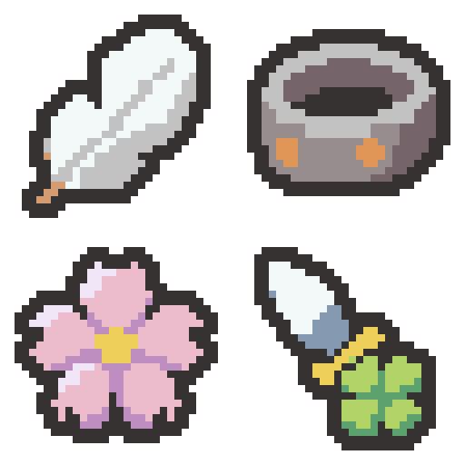

# 회피의 깃·무거운 팔찌·벚꽃 검흔·클로버 단검 초안 — 2026-11-04

요청한 4종을 내장 이미지 생성 기능으로 각각 제작했습니다. 검흔은 벚꽃 모티프로, 보약 곰방대의 새 디자인은 네잎클로버 장식 단검으로 시험했습니다. 기존 프로젝트명은 귀인의 검흔입니다. 승인 화풍인 균열석·왕관·붕대·깃발 4종과 기존 8종, 기존 팔레트를 참조했으며 프로젝트의 이미지·이름·효과는 변경하지 않았습니다.

왼쪽 위 회피의 깃 → 오른쪽 위 무거운 팔찌 → 왼쪽 아래 벚꽃 검흔 → 오른쪽 아래 네잎클로버 장식 단검.

| 초안 | 대상 | 원본 | 확대본 | 색 수(외곽선 포함) |
| --- | --- | --- | --- | --- |
| 회피의 깃 | 회피의 깃 | [32×32 PNG](01-evasion-plume-32x32.png) | [8배 PNG](01-evasion-plume-preview.png) | 4 |
| 무거운 팔찌 | 무거운 팔찌 | [32×32 PNG](02-heavy-bracelet-32x32.png) | [8배 PNG](02-heavy-bracelet-preview.png) | 5 |
| 귀인의 검흔 — 벚꽃 초안 | 귀인의 검흔 | [32×32 PNG](03-cherry-blossom-32x32.png) | [8배 PNG](03-cherry-blossom-preview.png) | 5 |
| 네잎클로버 장식 단검 | 보약 곰방대 | [32×32 PNG](04-clover-dagger-32x32.png) | [8배 PNG](04-clover-dagger-preview.png) | 6 |

- [2×2 원본 시트: 64×64](four-relics-64x64.png)
- [세로 원본 시트: 32×128](four-relics-32x128.png)
- [가로 원본 시트: 128×32](four-relics-128x32.png)
- [PNG 파일 묶음](four-relics-native.zip)
- [생성 프롬프트 4개와 색상 목록](prompts.json) · [승인 화풍 기준](../../style-review-2026-11-04/README.md)

## 디자인과 검토 지점

- 회피의 깃: 흰 깃털 면·회색 그림자·짧은 황갈색 깃대를 남기고 가는 깃털 선은 줄였습니다.
- 무거운 팔찌: 넓은 회색 금속 앞면과 타원형 안쪽 공간, 구리색 못 두 개로 무게감을 잡았습니다.
- 벚꽃 검흔: 분홍색 꽃잎 다섯 개와 끝의 갈라진 홈, 작은 금빛 중심으로 벚꽃을 표현했습니다. 벚꽃으로 읽히는지는 이번 초안의 주요 사용자 평가 지점입니다.
- 클로버 단검: 짧고 넓은 은빛 칼날과 금빛 가드, 네 갈래가 구분되는 큰 초록 클로버 장식으로 구성했습니다. 작은 크기의 식별을 위해 클로버 비중을 크게 잡았습니다.

## 형식과 확인

큰 생성 래스터를 최근접 샘플링·허용 팔레트 정리 후 실제 32×32로 내보내고 둥근 2픽셀 외곽선과 모서리를 정리했습니다. 사방 최소 2픽셀 투명 여백, 알파 0/255, 기존 팔레트 내 색만 사용합니다. 색 수는 필요한 만큼만 사용했습니다.

[크기·색상·여백·시트/확대본 픽셀·프로젝트 보존 확인](verification.json). 원본 크기와 확대본에서 형태를 육안 확인했습니다. 이 출력 폴더에만 초안/생성 원본 사본/프롬프트/시트/스크립트/검증 기록을 저장했습니다. Assets·이름·효과·번역·기존 Docs/로그는 변경하지 않았습니다.

Doc Impact Check: no doc update needed. SessionLogs/ErrorLog/DecisionLog/Presentation HTML 변경 및 새로운 HTML stale candidate 없음. Unity import/자동화 테스트는 실행하지 않았습니다.
