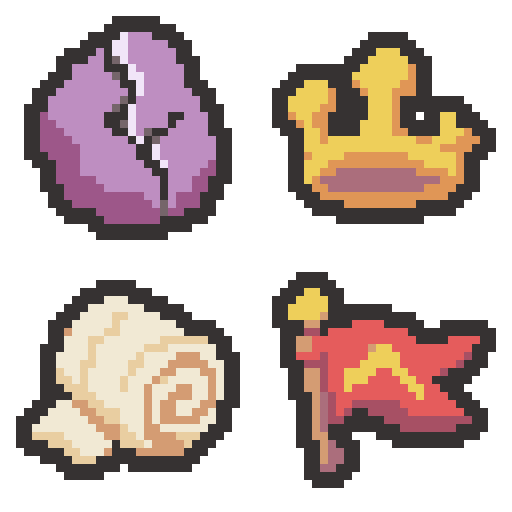

# 균열석·부서진 왕관·질긴 붕대·승리의 깃발 초안 — 2026-11-04

최근 8개 참고 아이콘의 통통한 윤곽, 간결한 기본색/그림자와 소재별 명암을 기준으로 내장 이미지 생성 기능으로 각각 생성했습니다. 이름을 기준으로 새로 디자인했으며, 프로젝트에는 적용하지 않았습니다.

순서: 왼쪽 위 균열석 → 오른쪽 위 부서진 왕관 → 왼쪽 아래 질긴 붕대 → 오른쪽 아래 승리의 깃발.

| 유물 | 원본 | 확대본 | 사용 색 수(외곽선 포함) |
| --- | --- | --- | --- |
| 균열석 | [32×32 PNG](01-rift-stone-32x32.png) | [8배 PNG](01-rift-stone-preview.png) | 5 |
| 부서진 왕관 | [32×32 PNG](02-broken-crown-32x32.png) | [8배 PNG](02-broken-crown-preview.png) | 4 |
| 질긴 붕대 | [32×32 PNG](03-tough-bandage-32x32.png) | [8배 PNG](03-tough-bandage-preview.png) | 4 |
| 승리의 깃발 | [32×32 PNG](04-victory-flag-32x32.png) | [8배 PNG](04-victory-flag-preview.png) | 6 |

- [2×2 원본 시트: 64×64](four-relics-64x64.png)
- [세로 원본 시트: 32×128](four-relics-32x128.png)
- [가로 원본 시트: 128×32](four-relics-128x32.png)
- [PNG 파일 묶음](four-relics-native.zip)
- [생성 프롬프트 4개와 색상 목록](prompts.json) · [사용한 화풍 기준](../../style-review-2026-11-04/README.md)

균열석은 자주색 덩어리와 갈라진 면, 왕관은 부러진 한쪽 장식과 두꺼운 금관, 붕대는 두루마리 단면과 짧은 천 끝, 깃발은 붉은 천·금색 표식·짧은 목재 깃대를 강조했습니다.

생성 원본은 더 큰 래스터이므로, 최근접 샘플링과 팔레트 정리 후 32×32로 내보내고 둥근 대각 모서리의 2픽셀 외곽선을 정리했습니다. 내부 균열/천 주름은 남겼습니다. 최종 PNG는 사방 최소 2픽셀 투명 여백, 알파 0/255, 지정한 기존 팔레트 내 색상만 사용합니다. 6색을 맞추기 위한 불필요한 중간색은 추가하지 않았습니다.

[크기·색상·여백·픽셀·원본 보존 확인](verification.json). 확대본과 각 시트의 프레임 픽셀 일치를 확인했으며 32×32 원본/확대 형태를 육안 확인했습니다. 이 폴더에만 초안·시트·미리보기·생성 원본 사본·프롬프트·내보내기 스크립트·검증 자료를 저장했습니다. 프로젝트 Assets·기존 Docs/로그는 변경하지 않았습니다.

Doc Impact Check: no doc update needed. SessionLogs/ErrorLog/DecisionLog/Presentation HTML 변경 및 새로운 HTML stale candidate 없음. Unity import/자동화 테스트는 실행하지 않았습니다.
