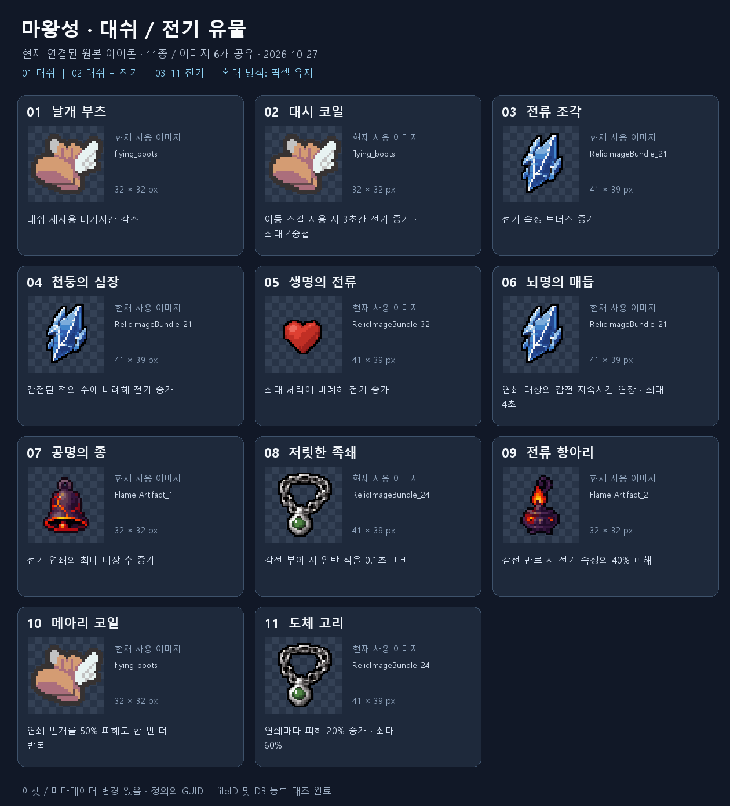

# 대쉬·전기 유물 이미지 조사

2026-10-27 · Investigation · Unity 프로젝트 원본 변경 없음

대쉬 직접 관련: 날개 부츠, 대시 코일. 전기 계열: 대시 코일 포함 10종. 중복을 제외하면 11종이며 실제 이미지 6개를 공유한다. 효과는 현재 유물 정의의 요약이며, 상세 레벨별 수치는 이번 조사 범위에 포함하지 않았다.

| 번호 | 유물 | 효과 | 정의 | 이미지 / 스프라이트 | fileID |
| --- | --- | --- | --- | --- | --- |
| 01 | 날개 부츠 | 대쉬 재사용 대기시간 감소 | [RD_FlyingBoots](../../Assets/_Project/Data/Items/Relics/Definitions/RD_FlyingBoots.asset) | [flying_boots](../../Assets/_Project/Art/Sprites/Items/RelicIcon/flying_boots.png) | `21300000` |
| 02 | 대시 코일 | 이동 스킬 사용 시 3초간 전기 증가 · 최대 4중첩 | [RD_DashCoil](../../Assets/_Project/Data/Items/Relics/Definitions/RD_DashCoil.asset) | [flying_boots](../../Assets/_Project/Art/Sprites/Items/RelicIcon/flying_boots.png) | `21300000` |
| 03 | 전류 조각 | 전기 속성 보너스 증가 | [RD_CurrentShard](../../Assets/_Project/Data/Items/Relics/Definitions/RD_CurrentShard.asset) | [RelicImageBundle_21](../../Assets/_Project/Art/Sprites/Items/RelicIcon/RelicImageBundle.png) | `-302269854803315565` |
| 04 | 천둥의 심장 | 감전된 적의 수에 비례해 전기 증가 | [RD_ThunderHeart](../../Assets/_Project/Data/Items/Relics/Definitions/RD_ThunderHeart.asset) | [RelicImageBundle_21](../../Assets/_Project/Art/Sprites/Items/RelicIcon/RelicImageBundle.png) | `-302269854803315565` |
| 05 | 생명의 전류 | 최대 체력에 비례해 전기 증가 | [RD_StormStep](../../Assets/_Project/Data/Items/Relics/Definitions/RD_StormStep.asset) | [RelicImageBundle_32](../../Assets/_Project/Art/Sprites/Items/RelicIcon/RelicImageBundle.png) | `336388868` |
| 06 | 뇌명의 매듭 | 연쇄 대상의 감전 지속시간 연장 · 최대 4초 | [RD_ThunderKnot](../../Assets/_Project/Data/Items/Relics/Definitions/RD_ThunderKnot.asset) | [RelicImageBundle_21](../../Assets/_Project/Art/Sprites/Items/RelicIcon/RelicImageBundle.png) | `-302269854803315565` |
| 07 | 공명의 종 | 전기 연쇄의 최대 대상 수 증가 | [RD_ResonanceBell](../../Assets/_Project/Data/Items/Relics/Definitions/RD_ResonanceBell.asset) | [Flame Artifact_1](../../Assets/_Project/Art/Sprites/Items/RelicIcon/Flame%20Artifact.png) | `-3570171897898288534` |
| 08 | 저릿한 족쇄 | 감전 부여 시 일반 적을 0.1초 마비 | [RD_TinglingShackles](../../Assets/_Project/Data/Items/Relics/Definitions/RD_TinglingShackles.asset) | [RelicImageBundle_24](../../Assets/_Project/Art/Sprites/Items/RelicIcon/RelicImageBundle.png) | `-9140534868678271618` |
| 09 | 전류 항아리 | 감전 만료 시 전기 속성의 40% 피해 | [RD_CurrentJar](../../Assets/_Project/Data/Items/Relics/Definitions/RD_CurrentJar.asset) | [Flame Artifact_2](../../Assets/_Project/Art/Sprites/Items/RelicIcon/Flame%20Artifact.png) | `-6833699381348243336` |
| 10 | 메아리 코일 | 연쇄 번개를 50% 피해로 한 번 더 반복 | [RD_EchoCoil](../../Assets/_Project/Data/Items/Relics/Definitions/RD_EchoCoil.asset) | [flying_boots](../../Assets/_Project/Art/Sprites/Items/RelicIcon/flying_boots.png) | `21300000` |
| 11 | 도체 고리 | 연쇄마다 피해 20% 증가 · 최대 60% | [RD_ConductorRing](../../Assets/_Project/Data/Items/Relics/Definitions/RD_ConductorRing.asset) | [RelicImageBundle_24](../../Assets/_Project/Art/Sprites/Items/RelicIcon/RelicImageBundle.png) | `-9140534868678271618` |

## 이미지 공유와 수정 시 참고

- 날개 부츠 / 대시 코일 / 메아리 코일: 동일한 날개 부츠 이미지.
- 전류 조각 / 천둥의 심장 / 뇌명의 매듭: 동일한 파란 번개 이미지.
- 저릿한 족쇄 / 도체 고리: 동일한 목걸이 이미지.
- 생명의 전류: 빨간 심장 이미지.
- 공명의 종 / 전류 항아리: 불꽃 시트의 서로 다른 스프라이트.
- 공유 PNG를 직접 바꾸면 다른 유물에도 영향을 줄 수 있다. 개별 유물만 바꾸려면 전용 이미지와 해당 유물의 icon 참조 교체 범위를 정해야 한다.

## 검증 및 문서 영향

- ItemDatabase 등록 11/11 확인. icon GUID 및 fileID를 .meta의 실제 스프라이트와 대조.
- 스프라이트 추출 시 Unity의 아래쪽 원점을 변환했으며, 원본 PNG 및 .meta는 수정하지 않음.
- 미리보기는 원본 픽셀을 최근접 방식으로 확대. 실행 중 UI 렌더링 캡처는 아님.
- Unity Editor, import, compilation, Play Mode 및 빌드는 실행하지 않음.
- 변경된 프로젝트 원본 없음. output에 검토용 PNG와 이 목록만 생성.
- SessionLogs / ErrorLog / DecisionLog: 변경 없음.
- Doc Impact Check: no doc update needed. Presentation HTML 영향 없음.
