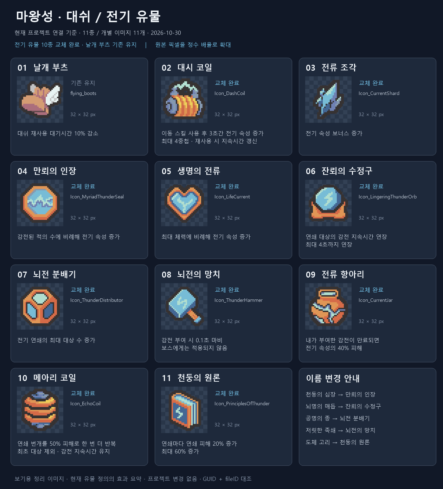

# 마왕성 · 대쉬 / 전기 유물 최종 정리

2026-10-30 · 현재 프로젝트 연결 기준 · 전기 유물 10종 교체 완료 / 날개 부츠 기존 유지

이미지·이름은 현재 유물 정의와 GUID/fileID 연결에서 확인했고, 이름은 CSV 및 한국어 StringTable과 대조했습니다. 모든 아이콘은 실제 32×32이며 정수 배율의 최근접 보간으로 확대했습니다. 효과는 현재 정의의 설명을 요약한 것으로, 레벨별 실측이나 Unity 실행 화면은 아닙니다.

| 번호 | 현재 이름 | 이전 이름 | 효과 요약 | 현재 이미지 |
| --- | --- | --- | --- | --- |
| 01 | [날개 부츠](../../../Assets/_Project/Data/Items/Relics/Definitions/RD_FlyingBoots.asset) | 유지 | 대쉬 재사용 대기시간 10% 감소 | [flying_boots](../../../Assets/_Project/Art/Sprites/Items/RelicIcon/flying_boots.png) |
| 02 | [대시 코일](../../../Assets/_Project/Data/Items/Relics/Definitions/RD_DashCoil.asset) | 유지 | 이동 스킬 사용 후 3초간 전기 속성 증가 / 최대 4중첩 · 재사용 시 지속시간 갱신 | [Icon_DashCoil](../../../Assets/_Project/Art/Sprites/Items/RelicIcon/Icon_DashCoil.png) |
| 03 | [전류 조각](../../../Assets/_Project/Data/Items/Relics/Definitions/RD_CurrentShard.asset) | 유지 | 전기 속성 보너스 증가 | [Icon_CurrentShard](../../../Assets/_Project/Art/Sprites/Items/RelicIcon/Icon_CurrentShard.png) |
| 04 | [만뢰의 인장](../../../Assets/_Project/Data/Items/Relics/Definitions/RD_ThunderHeart.asset) | 천둥의 심장 | 감전된 적의 수에 비례해 전기 속성 증가 | [Icon_MyriadThunderSeal](../../../Assets/_Project/Art/Sprites/Items/RelicIcon/Icon_MyriadThunderSeal.png) |
| 05 | [생명의 전류](../../../Assets/_Project/Data/Items/Relics/Definitions/RD_StormStep.asset) | 유지 | 최대 체력에 비례해 전기 속성 증가 | [Icon_LifeCurrent](../../../Assets/_Project/Art/Sprites/Items/RelicIcon/Icon_LifeCurrent.png) |
| 06 | [잔뢰의 수정구](../../../Assets/_Project/Data/Items/Relics/Definitions/RD_ThunderKnot.asset) | 뇌명의 매듭 | 연쇄 대상의 감전 지속시간 연장 / 최대 4초까지 연장 | [Icon_LingeringThunderOrb](../../../Assets/_Project/Art/Sprites/Items/RelicIcon/Icon_LingeringThunderOrb.png) |
| 07 | [뇌전 분배기](../../../Assets/_Project/Data/Items/Relics/Definitions/RD_ResonanceBell.asset) | 공명의 종 | 전기 연쇄의 최대 대상 수 증가 | [Icon_ThunderDistributor](../../../Assets/_Project/Art/Sprites/Items/RelicIcon/Icon_ThunderDistributor.png) |
| 08 | [뇌전의 망치](../../../Assets/_Project/Data/Items/Relics/Definitions/RD_TinglingShackles.asset) | 저릿한 족쇄 | 감전 부여 시 0.1초 마비 / 보스에게는 적용되지 않음 | [Icon_ThunderHammer](../../../Assets/_Project/Art/Sprites/Items/RelicIcon/Icon_ThunderHammer.png) |
| 09 | [전류 항아리](../../../Assets/_Project/Data/Items/Relics/Definitions/RD_CurrentJar.asset) | 유지 | 내가 부여한 감전이 만료되면 / 전기 속성의 40% 피해 | [Icon_CurrentJar](../../../Assets/_Project/Art/Sprites/Items/RelicIcon/Icon_CurrentJar.png) |
| 10 | [메아리 코일](../../../Assets/_Project/Data/Items/Relics/Definitions/RD_EchoCoil.asset) | 유지 | 연쇄 번개를 50% 피해로 한 번 더 반복 / 최초 대상 제외 · 감전 지속시간 유지 | [Icon_EchoCoil](../../../Assets/_Project/Art/Sprites/Items/RelicIcon/Icon_EchoCoil.png) |
| 11 | [천둥의 원론](../../../Assets/_Project/Data/Items/Relics/Definitions/RD_ConductorRing.asset) | 도체 고리 | 연쇄마다 연쇄 피해 20% 증가 / 최대 60% 증가 | [Icon_PrinciplesOfThunder](../../../Assets/_Project/Art/Sprites/Items/RelicIcon/Icon_PrinciplesOfThunder.png) |

검증: 11종 이름 대조, 11개 독립 이미지 연결, 원본 픽셀 정수 배율 확대 및 원본 파일 해시 보존 확인. 유물 정의·PNG·메타데이터·번역 파일·런타임 키 대응표는 수정하지 않았습니다.

변경 범위는 이 output 폴더의 정리 PNG·목록 JSON·재생성 스크립트·검증 JSON·README입니다. SessionLogs / ErrorLog / DecisionLog 변경 없음. Doc Impact Check: no doc update needed. Presentation HTML 영향 없음. Unity import·컴파일·Play Mode는 실행하지 않았습니다.
