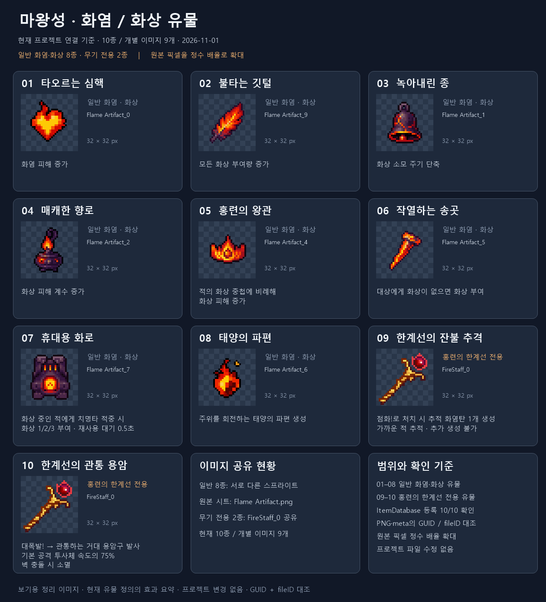

# 마왕성 · 화염 / 화상 유물 이미지 조사

2026-11-01 · Investigation · 프로젝트 원본 변경 없음

현재 ItemDatabase에 등록된 화염·화상 관련 일반 유물 8종과 홍련의 한계선 무기 전용 유물 2종을 포함합니다. 일반 유물은 각각 다른 스프라이트를 사용하고, 무기 전용 두 유물은 같은 FireStaff_0 이미지를 공유하여 10종 / 개별 이미지 9개입니다. 각 스프라이트는 실제 32×32이며, 미리보기는 정수 배율의 최근접 방식으로 확대했습니다.

이름은 정의 / 번역 CSV / 한국어 StringTable과 대조했고, icon GUID·fileID를 PNG 메타데이터의 실제 스프라이트 영역과 대조했습니다. 효과는 현재 유물 정의의 설명 요약이며 레벨별 실측이나 Unity 실행 화면은 아닙니다.

| 번호 | 유물 | 구분 | 효과 요약 | 현재 스프라이트 | 32×32 원본 추출 |
| --- | --- | --- | --- | --- | --- |
| 01 | [타오르는 심핵](../../../Assets/_Project/Data/Items/Relics/Definitions/RD_FireBonusRelic.asset) | 일반 화염 | 화염 피해 증가 | [Flame Artifact_0](<../../../Assets/_Project/Art/Sprites/Items/RelicIcon/Flame Artifact.png>) | [PNG](icons/RD_FireBonusRelic.png) |
| 02 | [불타는 깃털](../../../Assets/_Project/Data/Items/Relics/Definitions/RD_BurningFeather.asset) | 일반 화염 | 모든 화상 부여량 증가 | [Flame Artifact_9](<../../../Assets/_Project/Art/Sprites/Items/RelicIcon/Flame Artifact.png>) | [PNG](icons/RD_BurningFeather.png) |
| 03 | [녹아내린 종](../../../Assets/_Project/Data/Items/Relics/Definitions/RD_MeltedBell.asset) | 일반 화염 | 화상 소모 주기 단축 | [Flame Artifact_1](<../../../Assets/_Project/Art/Sprites/Items/RelicIcon/Flame Artifact.png>) | [PNG](icons/RD_MeltedBell.png) |
| 04 | [매캐한 향로](../../../Assets/_Project/Data/Items/Relics/Definitions/RD_SmokyIncense.asset) | 일반 화염 | 화상 피해 계수 증가 | [Flame Artifact_2](<../../../Assets/_Project/Art/Sprites/Items/RelicIcon/Flame Artifact.png>) | [PNG](icons/RD_SmokyIncense.png) |
| 05 | [홍련의 왕관](../../../Assets/_Project/Data/Items/Relics/Definitions/RD_CrimsonKing.asset) | 일반 화염 | 적의 화상 중첩에 비례해 / 화상 피해 증가 | [Flame Artifact_4](<../../../Assets/_Project/Art/Sprites/Items/RelicIcon/Flame Artifact.png>) | [PNG](icons/RD_CrimsonKing.png) |
| 06 | [작열하는 송곳](../../../Assets/_Project/Data/Items/Relics/Definitions/RD_ScorchingSong.asset) | 일반 화염 | 대상에게 화상이 없으면 화상 부여 | [Flame Artifact_5](<../../../Assets/_Project/Art/Sprites/Items/RelicIcon/Flame Artifact.png>) | [PNG](icons/RD_ScorchingSong.png) |
| 07 | [휴대용 화로](../../../Assets/_Project/Data/Items/Relics/Definitions/RD_PortableBrazier.asset) | 일반 화염 | 화상 중인 적에게 치명타 적중 시 / 화상 1/2/3 부여 · 재사용 대기 0.5초 | [Flame Artifact_7](<../../../Assets/_Project/Art/Sprites/Items/RelicIcon/Flame Artifact.png>) | [PNG](icons/RD_PortableBrazier.png) |
| 08 | [태양의 파편](../../../Assets/_Project/Data/Items/Relics/Definitions/RD_SunFragment.asset) | 일반 화염 | 주위를 회전하는 태양의 파편 생성 | [Flame Artifact_6](<../../../Assets/_Project/Art/Sprites/Items/RelicIcon/Flame Artifact.png>) | [PNG](icons/RD_SunFragment.png) |
| 09 | [한계선의 잔불 추격](../../../Assets/_Project/Data/Items/Relics/Definitions/RD_CrimsonKillShot.asset) | 무기 전용 | 점화!로 처치 시 추적 화염탄 1개 생성 / 가까운 적 추적 · 추가 생성 불가 | [FireStaff_0](<../../../Assets/_Project/Art/Sprites/Items/Weapon/CrimsonBoundary/FireStaff.png>) | [PNG](icons/RD_CrimsonKillShot.png) |
| 10 | [한계선의 관통 용암](../../../Assets/_Project/Data/Items/Relics/Definitions/RD_CrimsonLavaBall.asset) | 무기 전용 | 대폭발! → 관통하는 거대 용암구 발사 / 기본 공격 투사체 속도의 75% / 벽 충돌 시 소멸 | [FireStaff_0](<../../../Assets/_Project/Art/Sprites/Items/Weapon/CrimsonBoundary/FireStaff.png>) | [PNG](icons/RD_CrimsonLavaBall.png) |

## 무기 전용 효과의 범위

- 한계선의 잔불 추격: 점화!로 적 처치 시 해당 위치에 추적 화염탄 1개를 생성합니다. 가까운 적을 추적하며 추적할 적이 없으면 생성되지 않습니다. 추적 화염탄으로는 추가 생성되지 않습니다.
- 한계선의 관통 용암: 대폭발!을 적을 관통하는 거대 용암구 발사로 전환합니다. 대폭발!의 피해와 크기를 유지하며, 속도는 기본 공격 투사체의 75%이고 벽에 닿으면 소멸합니다.

## 검증 및 파일 범위

- ItemDatabase 등록 10/10, 표시명 대조 10/10, icon GUID/fileID 및 스프라이트 영역 검증.
- 일반 8종은 Flame Artifact.png의 서로 다른 스프라이트, 무기 전용 2종은 동일 FireStaff_0. PNG·메타데이터를 직접 수정하지 않았습니다.
- output의 정리 PNG·추출한 32×32 PNG·JSON 목록·재생성 스크립트·검증 JSON·README만 생성했습니다.
- Unity import·컴파일·Play Mode는 실행하지 않았습니다.
- SessionLogs / ErrorLog / DecisionLog 변경 없음. Doc Impact Check: no doc update needed. Presentation HTML 영향 없음.
