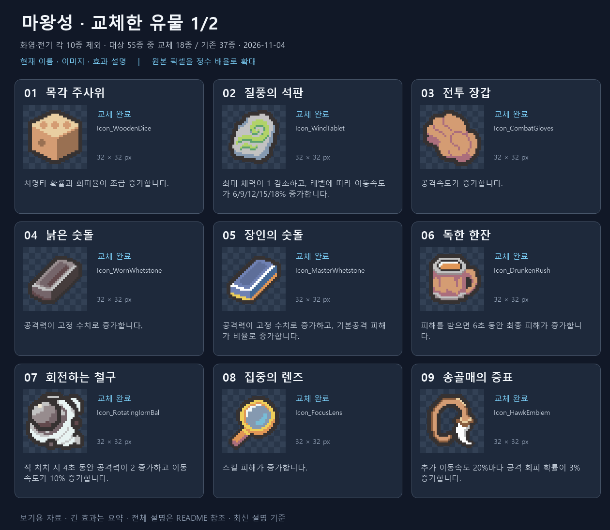
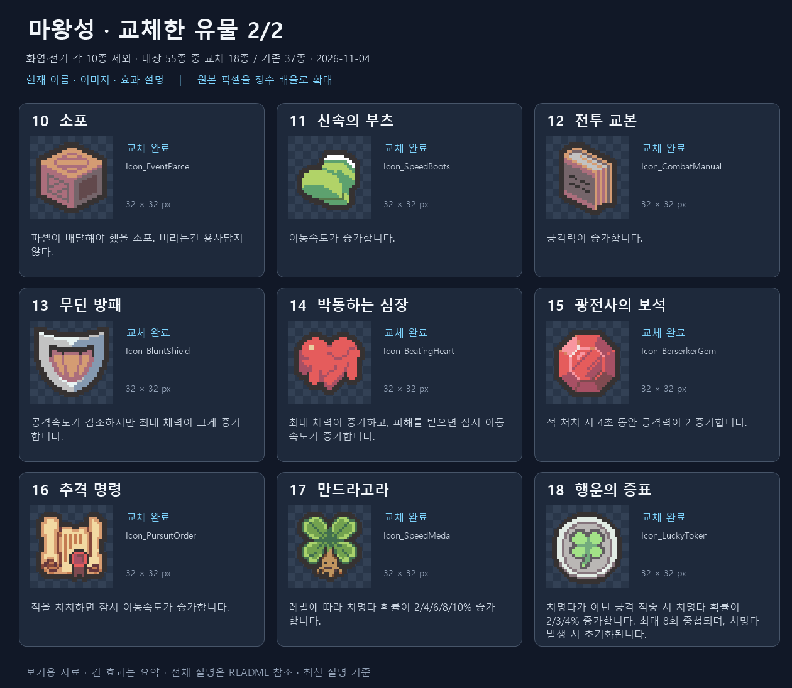
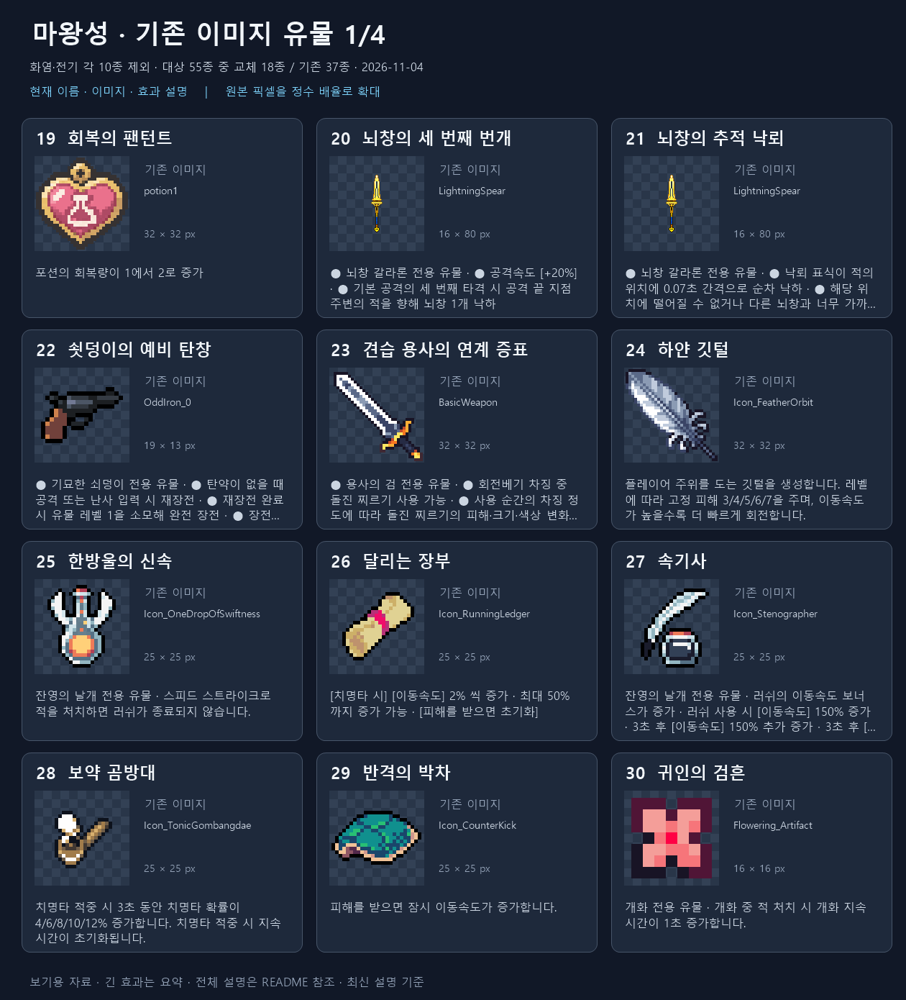
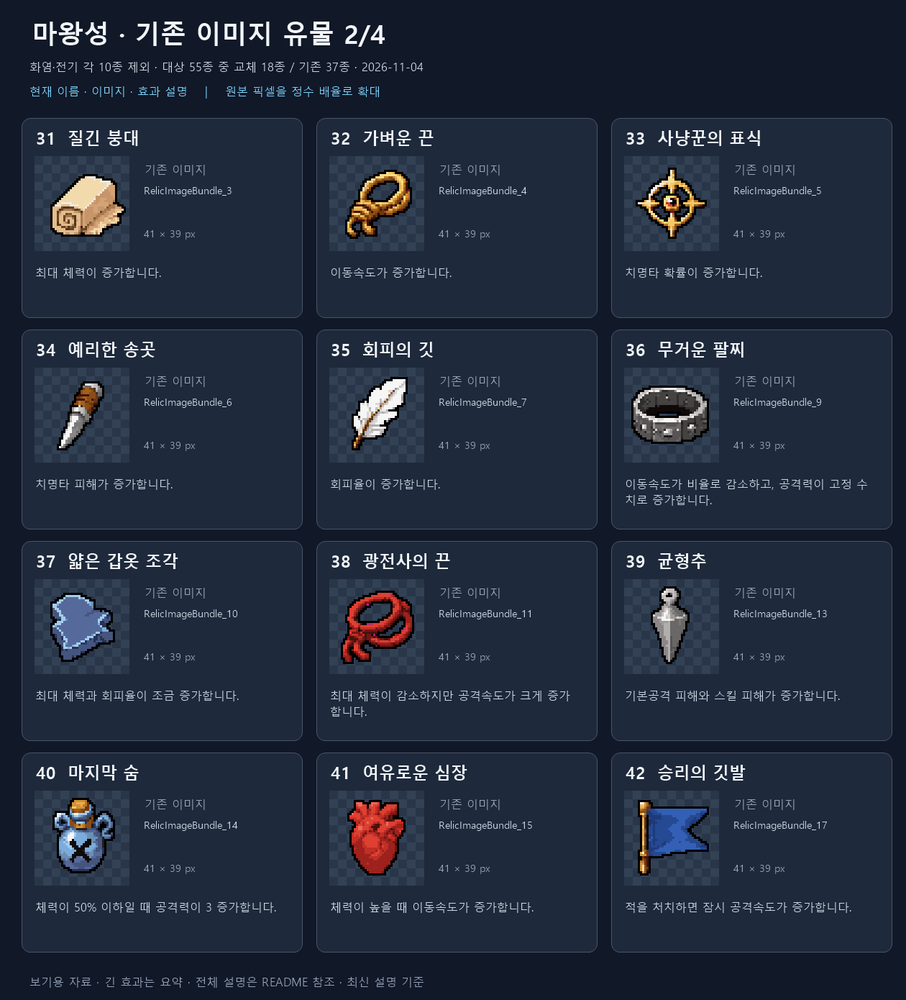
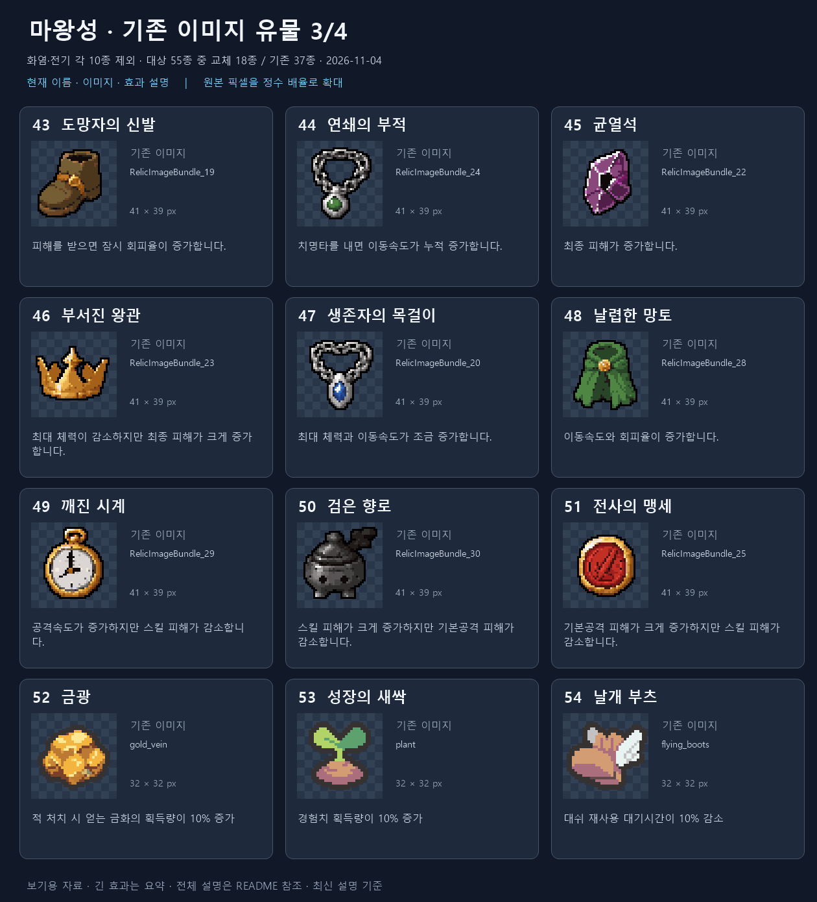
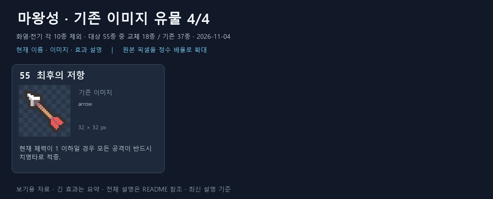

# 화염·전기 외 유물 최신 자료 — 2026-11-04

현재 ItemDatabase 등록 75종에서 기존 화염 10종·전기 10종을 제외한 55종입니다. 이 대화에서 최근 교체한 18종을 먼저 모으고, 아직 교체하지 않은 37종도 별도로 담았습니다. 교체 완료 여부는 전용 PNG 존재가 아니라 이 대화의 승인 적용 이력을 기준으로 합니다.

현재 정의 GUID/icon fileID·PNG 메타데이터를 대조하고 현재 번역 CSV와 한국어 StringTable에서 이름·설명을 확인했습니다. 카드의 긴 설명은 요약하며 아래에는 전체 설명을 기록했습니다. 효과는 현재 프로젝트 설명 기준이며 레벨별 실측 결과가 아닙니다.

만드라고라는 이동속도 증가 없이 치명타 확률만 레벨별 2/4/6/8/10% 증가하는 최신 변경을 반영했습니다. 교체하지 않은 날개 부츠는 일반 대시 유물로 포함했습니다. 뇌창 전용 유물 2종은 기존 일반 전기 10종 목록과 별도이므로 기존 이미지 목록에 포함했습니다.

## 교체한 유물 1/2

| 번호 / 현재 이름 | PNG | 현재 효과 설명 |
| --- | --- | --- |
| 01 [목각 주사위](../../../Assets/_Project/Data/Items/Relics/Definitions/RD_BronzeDice.asset) | [PNG](icons/RD_BronzeDice.png) | 치명타 확률과 회피율이 조금 증가합니다. |
| 02 [질풍의 석판](../../../Assets/_Project/Data/Items/Relics/Definitions/RD_WindTablet.asset) | [PNG](icons/RD_WindTablet.png) | 최대 체력이 1 감소하고, 레벨에 따라 이동속도가 6/9/12/15/18% 증가합니다. |
| 03 [전투 장갑](../../../Assets/_Project/Data/Items/Relics/Definitions/RD_CombatGloves.asset) | [PNG](icons/RD_CombatGloves.png) | 공격속도가 증가합니다. |
| 04 [낡은 숫돌](../../../Assets/_Project/Data/Items/Relics/Definitions/RD_WornWhetstone.asset) | [PNG](icons/RD_WornWhetstone.png) | 공격력이 고정 수치로 증가합니다. |
| 05 [장인의 숫돌](../../../Assets/_Project/Data/Items/Relics/Definitions/RD_MasterWhetstone.asset) | [PNG](icons/RD_MasterWhetstone.png) | 공격력이 고정 수치로 증가하고, 기본공격 피해가 비율로 증가합니다. |
| 06 [독한 한잔](../../../Assets/_Project/Data/Items/Relics/Definitions/RD_DrunkenRush.asset) | [PNG](icons/RD_DrunkenRush.png) | 피해를 받으면 6초 동안 최종 피해가 증가합니다. |
| 07 [회전하는 철구](../../../Assets/_Project/Data/Items/Relics/Definitions/RD_RotatingIornBall.asset) | [PNG](icons/RD_RotatingIornBall.png) | 적 처치 시 4초 동안 공격력이 2 증가하고 이동속도가 10% 증가합니다. |
| 08 [집중의 렌즈](../../../Assets/_Project/Data/Items/Relics/Definitions/RD_FocusLens.asset) | [PNG](icons/RD_FocusLens.png) | 스킬 피해가 증가합니다. |
| 09 [송골매의 증표](../../../Assets/_Project/Data/Items/Relics/Definitions/RD_HawkEmblem.asset) | [PNG](icons/RD_HawkEmblem.png) | 추가 이동속도 20%마다 공격 회피 확률이 3% 증가합니다. |

## 교체한 유물 2/2

| 번호 / 현재 이름 | PNG | 현재 효과 설명 |
| --- | --- | --- |
| 10 [소포](../../../Assets/_Project/Data/Items/Relics/RD_EventParcel.asset) | [PNG](icons/RD_EventParcel.png) | 파셀이 배달해야 했을 소포. 버리는건 용사답지 않다. |
| 11 [신속의 부츠](../../../Assets/_Project/Data/Items/Relics/Definitions/RD_SpeedBoots.asset) | [PNG](icons/RD_SpeedBoots.png) | 이동속도가 증가합니다. |
| 12 [전투 교본](../../../Assets/_Project/Unused/Items/Relics/RD_AttackBonusRelic.asset) | [PNG](icons/RD_AttackBonusRelic.png) | 공격력이 증가합니다. |
| 13 [무딘 방패](../../../Assets/_Project/Data/Items/Relics/Definitions/RD_BluntShield.asset) | [PNG](icons/RD_BluntShield.png) | 공격속도가 감소하지만 최대 체력이 크게 증가합니다. |
| 14 [박동하는 심장](../../../Assets/_Project/Data/Items/Relics/Definitions/RD_SmallHeart.asset) | [PNG](icons/RD_SmallHeart.png) | 최대 체력이 증가하고, 피해를 받으면 잠시 이동속도가 증가합니다. |
| 15 [광전사의 보석](../../../Assets/_Project/Data/Items/Relics/Definitions/RD_RedContract.asset) | [PNG](icons/RD_RedContract.png) | 적 처치 시 4초 동안 공격력이 2 증가합니다. |
| 16 [추격 명령](../../../Assets/_Project/Data/Items/Relics/Definitions/RD_PursuerClaw.asset) | [PNG](icons/RD_PursuerClaw.png) | 적을 처치하면 잠시 이동속도가 증가합니다. |
| 17 [만드라고라](../../../Assets/_Project/Data/Items/Relics/Definitions/RD_SpeedMedal.asset) | [PNG](icons/RD_SpeedMedal.png) | 레벨에 따라 치명타 확률이 2/4/6/8/10% 증가합니다. |
| 18 [행운의 증표](../../../Assets/_Project/Data/Items/Relics/Definitions/RD_FirmStep.asset) | [PNG](icons/RD_FirmStep.png) | 치명타가 아닌 공격 적중 시 치명타 확률이 2/3/4% 증가합니다. 최대 8회 중첩되며, 치명타 발생 시 초기화됩니다. |

## 기존 이미지 유물 1/4

| 번호 / 현재 이름 | PNG | 현재 효과 설명 |
| --- | --- | --- |
| 19 [회복의 팬턴트](../../../Assets/_Project/Data/Items/Relics/Definitions/RD_RecoveryPendant.asset) | [PNG](icons/RD_RecoveryPendant.png) | 포션의 회복량이 1에서 2로 증가 |
| 20 [뇌창의 세 번째 번개](../../../Assets/_Project/Data/Items/Relics/Definitions/RD_LightningSpearThirdStrike.asset) | [PNG](icons/RD_LightningSpearThirdStrike.png) | ● 뇌창 갈라론 전용 유물
 ● 공격속도 [+20%]
 ● 기본 공격의 세 번째 타격 시 공격 끝 지점 주변의 적을 향해 뇌창 1개 낙하 |
| 21 [뇌창의 추적 낙뢰](../../../Assets/_Project/Data/Items/Relics/Definitions/RD_LightningSpearTargetedRain.asset) | [PNG](icons/RD_LightningSpearTargetedRain.png) | ● 뇌창 갈라론 전용 유물
 ● 낙뢰 표식이 적의 위치에 0.07초 간격으로 순차 낙하
 ● 해당 위치에 떨어질 수 없거나 다른 뇌창과 너무 가까우면 적과 가까운 빈 위치에 낙하 |
| 22 [쇳덩이의 예비 탄창](../../../Assets/_Project/Data/Items/Relics/Definitions/RD_OddIronMagazine.asset) | [PNG](icons/RD_OddIronMagazine.png) | ● 기묘한 쇠덩이 전용 유물
 ● 탄약이 없을 때 공격 또는 난사 입력 시 재장전
 ● 재장전 완료 시 유물 레벨 1을 소모해 완전 장전
 ● 장전 후 다시 입력하면 발사
 ● 유물 레벨은 남은 장전 횟수를 의미
 ● 레벨이 0이 되면 유물 소멸 |
| 23 [견습 용사의 연계 증표](../../../Assets/_Project/Data/Items/Relics/Definitions/RD_ApprenticeChargeLink.asset) | [PNG](icons/RD_ApprenticeChargeLink.png) | ● 용사의 검 전용 유물
 ● 회전베기 차징 중 돌진 찌르기 사용 가능
 ● 사용 순간의 차징 정도에 따라 돌진 찌르기의 피해·크기·색상 변화
 ● 최대 차징 시 돌진 찌르기 피해 약 1.67배
 ● 돌진 중 버튼을 놓으면 강화 회전베기로 연계 |
| 24 [하얀 깃털](../../../Assets/_Project/Unused/Items/Relics/RD_FeatherOrbit.asset) | [PNG](icons/RD_FeatherOrbit.png) | 플레이어 주위를 도는 깃털을 생성합니다. 레벨에 따라 고정 피해 3/4/5/6/7을 주며, 이동속도가 높을수록 더 빠르게 회전합니다. |
| 25 [한방울의 신속](../../../Assets/_Project/Unused/Items/Relics/RD_OneDropOfSwiftness.asset) | [PNG](icons/RD_OneDropOfSwiftness.png) | 잔영의 날개 전용 유물
 스피드 스트라이크로 적을 처치하면 러쉬가 종료되지 않습니다. |
| 26 [달리는 장부](../../../Assets/_Project/Unused/Items/Relics/RD_RunningLedger.asset) | [PNG](icons/RD_RunningLedger.png) | [치명타 시] [이동속도] 2% 씩 증가
 최대 50%까지 증가 가능
 [피해를 받으면 초기화] |
| 27 [속기사](../../../Assets/_Project/Unused/Items/Relics/RD_Stenographer.asset) | [PNG](icons/RD_Stenographer.png) | 잔영의 날개 전용 유물
 러쉬의 이동속도 보너스가 증가
 러쉬 사용 시 [이동속도] 150% 증가
 3초 후 [이동속도] 150% 추가 증가
 3초 후 [이동속도] 200% 추가 증가 |
| 28 [보약 곰방대](../../../Assets/_Project/Data/Items/Relics/Definitions/RD_TonicGombangdae.asset) | [PNG](icons/RD_TonicGombangdae.png) | 치명타 적중 시 3초 동안 치명타 확률이 4/6/8/10/12% 증가합니다. 치명타 적중 시 지속 시간이 초기화됩니다. |
| 29 [반격의 박차](../../../Assets/_Project/Data/Items/Relics/Definitions/RD_CounterKick.asset) | [PNG](icons/RD_CounterKick.png) | 피해를 받으면 잠시 이동속도가 증가합니다. |
| 30 [귀인의 검흔](../../../Assets/_Project/Data/Items/Relics/Definitions/RD_FloweringBloomExtension.asset) | [PNG](icons/RD_FloweringBloomExtension.png) | 개화 전용 유물
 개화 중 적 처치 시 개화 지속 시간이 1초 증가합니다. |

## 기존 이미지 유물 2/4

| 번호 / 현재 이름 | PNG | 현재 효과 설명 |
| --- | --- | --- |
| 31 [질긴 붕대](../../../Assets/_Project/Data/Items/Relics/Definitions/RD_ToughBandage.asset) | [PNG](icons/RD_ToughBandage.png) | 최대 체력이 증가합니다. |
| 32 [가벼운 끈](../../../Assets/_Project/Data/Items/Relics/Definitions/RD_LightCord.asset) | [PNG](icons/RD_LightCord.png) | 이동속도가 증가합니다. |
| 33 [사냥꾼의 표식](../../../Assets/_Project/Data/Items/Relics/Definitions/RD_HunterMark.asset) | [PNG](icons/RD_HunterMark.png) | 치명타 확률이 증가합니다. |
| 34 [예리한 송곳](../../../Assets/_Project/Data/Items/Relics/Definitions/RD_SharpAwl.asset) | [PNG](icons/RD_SharpAwl.png) | 치명타 피해가 증가합니다. |
| 35 [회피의 깃](../../../Assets/_Project/Data/Items/Relics/Definitions/RD_EvasionFeather.asset) | [PNG](icons/RD_EvasionFeather.png) | 회피율이 증가합니다. |
| 36 [무거운 팔찌](../../../Assets/_Project/Data/Items/Relics/Definitions/RD_HeavyBracelet.asset) | [PNG](icons/RD_HeavyBracelet.png) | 이동속도가 비율로 감소하고, 공격력이 고정 수치로 증가합니다. |
| 37 [얇은 갑옷 조각](../../../Assets/_Project/Data/Items/Relics/Definitions/RD_ThinArmorShard.asset) | [PNG](icons/RD_ThinArmorShard.png) | 최대 체력과 회피율이 조금 증가합니다. |
| 38 [광전사의 끈](../../../Assets/_Project/Data/Items/Relics/Definitions/RD_BerserkerCord.asset) | [PNG](icons/RD_BerserkerCord.png) | 최대 체력이 감소하지만 공격속도가 크게 증가합니다. |
| 39 [균형추](../../../Assets/_Project/Data/Items/Relics/Definitions/RD_BalanceWeight.asset) | [PNG](icons/RD_BalanceWeight.png) | 기본공격 피해와 스킬 피해가 증가합니다. |
| 40 [마지막 숨](../../../Assets/_Project/Data/Items/Relics/Definitions/RD_LastBreath.asset) | [PNG](icons/RD_LastBreath.png) | 체력이 50% 이하일 때 공격력이 3 증가합니다. |
| 41 [여유로운 심장](../../../Assets/_Project/Data/Items/Relics/Definitions/RD_CalmHeart.asset) | [PNG](icons/RD_CalmHeart.png) | 체력이 높을 때 이동속도가 증가합니다. |
| 42 [승리의 깃발](../../../Assets/_Project/Data/Items/Relics/Definitions/RD_VictoryFlag.asset) | [PNG](icons/RD_VictoryFlag.png) | 적을 처치하면 잠시 공격속도가 증가합니다. |

## 기존 이미지 유물 3/4

| 번호 / 현재 이름 | PNG | 현재 효과 설명 |
| --- | --- | --- |
| 43 [도망자의 신발](../../../Assets/_Project/Data/Items/Relics/Definitions/RD_RunawayShoes.asset) | [PNG](icons/RD_RunawayShoes.png) | 피해를 받으면 잠시 회피율이 증가합니다. |
| 44 [연쇄의 부적](../../../Assets/_Project/Data/Items/Relics/Definitions/RD_ChainCharm.asset) | [PNG](icons/RD_ChainCharm.png) | 치명타를 내면 이동속도가 누적 증가합니다. |
| 45 [균열석](../../../Assets/_Project/Data/Items/Relics/Definitions/RD_RiftStone.asset) | [PNG](icons/RD_RiftStone.png) | 최종 피해가 증가합니다. |
| 46 [부서진 왕관](../../../Assets/_Project/Data/Items/Relics/Definitions/RD_BrokenCrown.asset) | [PNG](icons/RD_BrokenCrown.png) | 최대 체력이 감소하지만 최종 피해가 크게 증가합니다. |
| 47 [생존자의 목걸이](../../../Assets/_Project/Data/Items/Relics/Definitions/RD_SurvivorNecklace.asset) | [PNG](icons/RD_SurvivorNecklace.png) | 최대 체력과 이동속도가 조금 증가합니다. |
| 48 [날렵한 망토](../../../Assets/_Project/Data/Items/Relics/Definitions/RD_NimbleCloak.asset) | [PNG](icons/RD_NimbleCloak.png) | 이동속도와 회피율이 증가합니다. |
| 49 [깨진 시계](../../../Assets/_Project/Data/Items/Relics/Definitions/RD_BrokenClock.asset) | [PNG](icons/RD_BrokenClock.png) | 공격속도가 증가하지만 스킬 피해가 감소합니다. |
| 50 [검은 향로](../../../Assets/_Project/Data/Items/Relics/Definitions/RD_BlackIncense.asset) | [PNG](icons/RD_BlackIncense.png) | 스킬 피해가 크게 증가하지만 기본공격 피해가 감소합니다. |
| 51 [전사의 맹세](../../../Assets/_Project/Data/Items/Relics/Definitions/RD_WarriorOath.asset) | [PNG](icons/RD_WarriorOath.png) | 기본공격 피해가 크게 증가하지만 스킬 피해가 감소합니다. |
| 52 [금광](../../../Assets/_Project/Data/Items/Relics/Definitions/RD_GoldVein.asset) | [PNG](icons/RD_GoldVein.png) | 적 처치 시 얻는 금화의 획득량이 10% 증가 |
| 53 [성장의 새싹](../../../Assets/_Project/Data/Items/Relics/Definitions/RD_GrowthSprout.asset) | [PNG](icons/RD_GrowthSprout.png) | 경험치 획득량이 10% 증가 |
| 54 [날개 부츠](../../../Assets/_Project/Data/Items/Relics/Definitions/RD_FlyingBoots.asset) | [PNG](icons/RD_FlyingBoots.png) | 대쉬 재사용 대기시간이 10% 감소 |

## 기존 이미지 유물 4/4

| 번호 / 현재 이름 | PNG | 현재 효과 설명 |
| --- | --- | --- |
| 55 [최후의 저항](../../../Assets/_Project/Data/Items/Relics/Definitions/RD_LastStand.asset) | [PNG](icons/RD_LastStand.png) | 현재 체력이 1 이하일 경우 모든 공격이 반드시 치명타로 적중. |

## 생성 범위와 확인

이 폴더에 카드 PNG 6장, 개별 이미지 사본/추출본 55장, 현재 데이터와 페이지 JSON, 렌더링 PowerShell, 자료 생성 Python, 검증 기록 및 이 README를 생성했습니다. 프로젝트의 그림과 효과는 추가 변경하지 않았습니다.

자료 대조 과정에서 직전 적용한 만드라고라 한국어·영어 설명에 남아 있던 YAML 줄바꿈 뒷부분을 발견해 두 StringTable 항목의 전체 값을 정정했습니다. 다른 3개 언어도 전체 값 일치를 확인했습니다. 키/ID·다른 항목은 보존했습니다. [정정 기록](description-correction/verification.json).

[검증 기록](verification.json) · [현재 전체 데이터](data.json) · [SessionLog](../../../Docs/SessionLogs/2026-11-04.md)

Unity import·컴파일·Play Mode·실제 UI 및 자동화 테스트는 실행하지 않았습니다. Doc Impact Check: SessionLog. ErrorLog/DecisionLog/Presentation HTML 변경 및 새로운 HTML stale candidate 없음.
