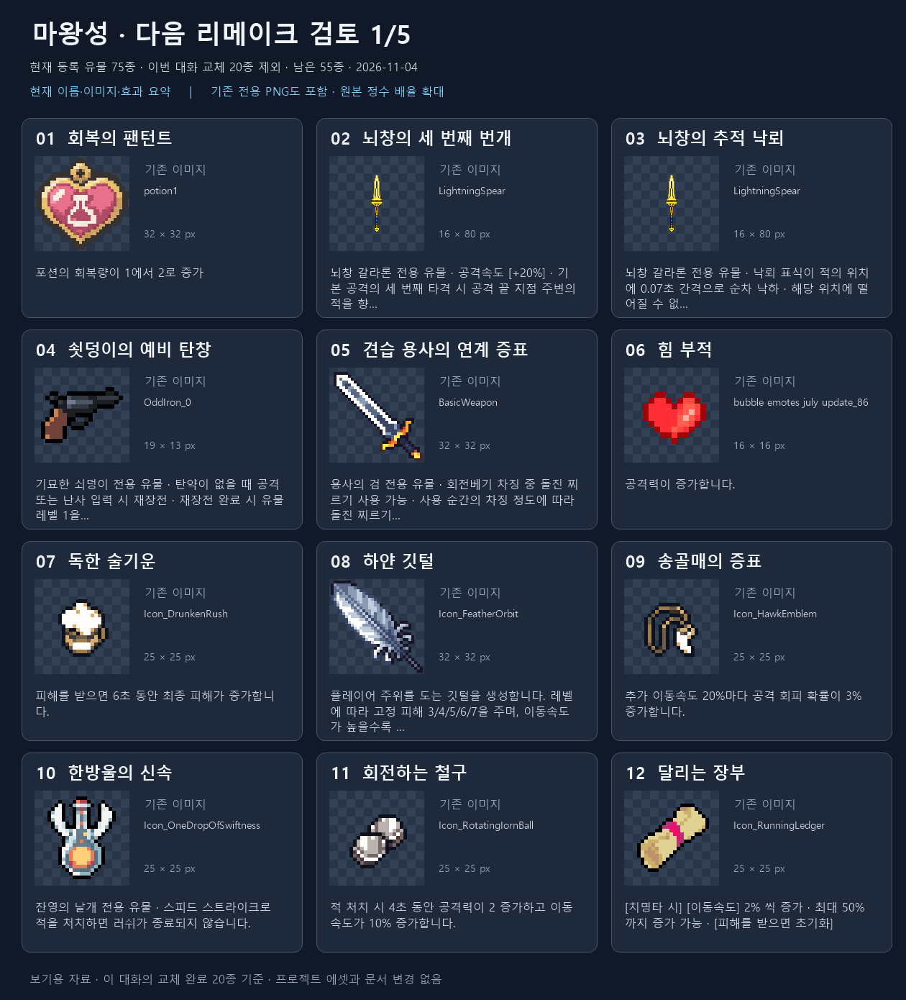
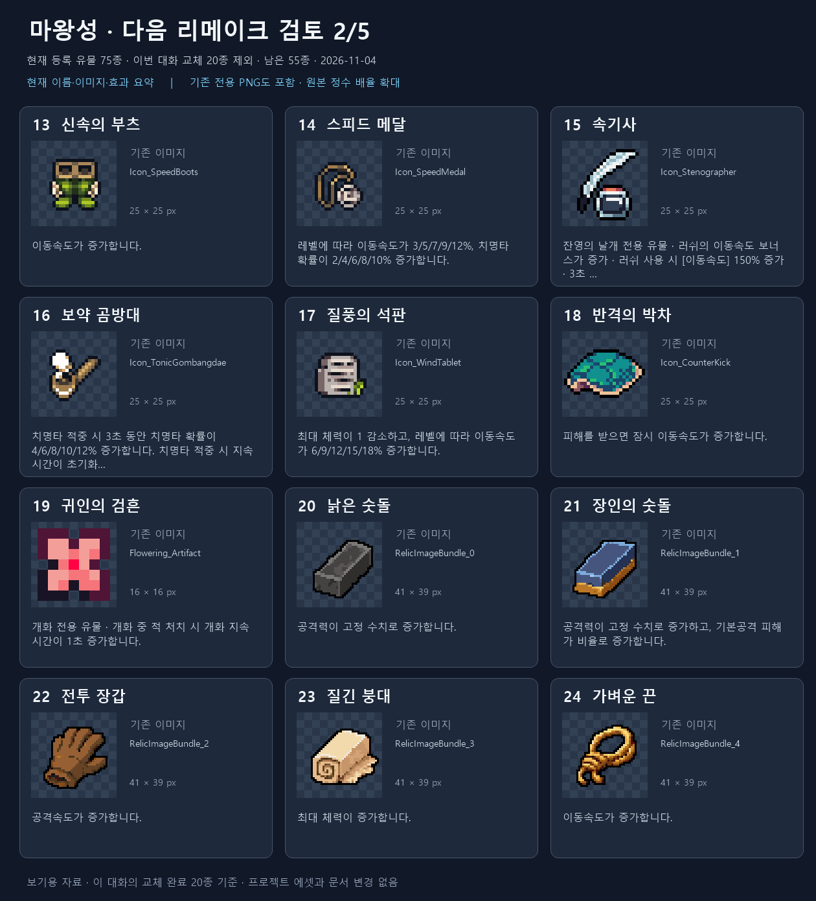
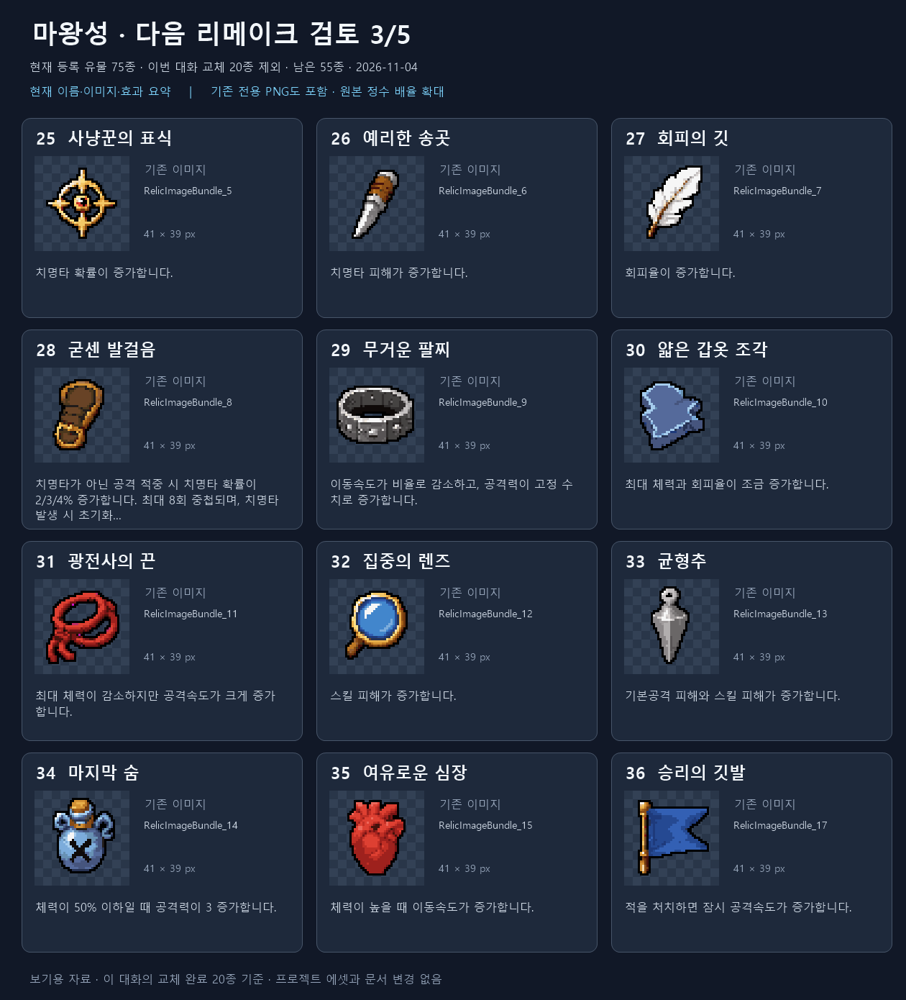
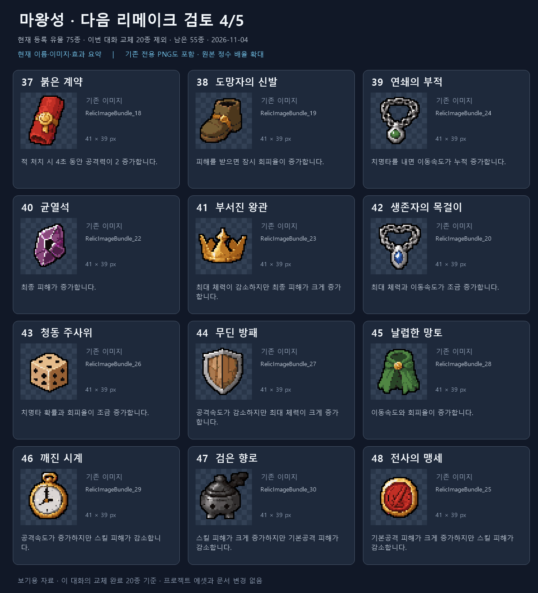
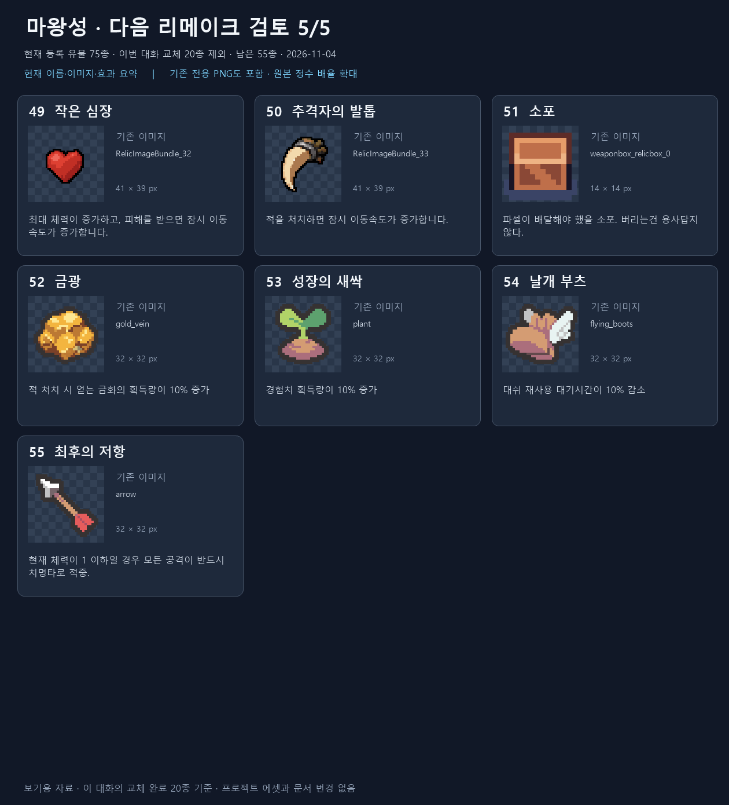

# 리메이크 후속 검토 유물 — 2026-11-04

현재 ItemDatabase에 등록된 75종에서 이 대화의 교체 완료 20종을 제외한 55종입니다. 날개 부츠와 기존 전용 PNG 12종도 포함합니다. 전용 PNG의 존재만으로 과거 리메이크 완료 여부를 확정하지 않았으며, 이 자료의 기준은 이 대화에서 확인한 교체 이력입니다.

미등록/보관용 정의는 대상에서 제외했습니다. 이미지의 원본 크기와 모양을 유지하고 정수 배율로 확대했습니다. 카드의 긴 효과는 요약/생략하며 아래 표에는 현재 번역 CSV의 전체 설명을 기록했습니다.

## 1장 — 1~12

| 번호 / 유물 | 원본 추출 PNG | 현재 효과 설명 |
| --- | --- | --- |
| 1 [회복의 팬턴트](../../../Assets/_Project/Data/Items/Relics/Definitions/RD_RecoveryPendant.asset) | [PNG](icons/RD_RecoveryPendant.png) | 포션의 회복량이 1에서 2로 증가 |
| 2 [뇌창의 세 번째 번개](../../../Assets/_Project/Data/Items/Relics/Definitions/RD_LightningSpearThirdStrike.asset) | [PNG](icons/RD_LightningSpearThirdStrike.png) | ● 뇌창 갈라론 전용 유물 ● 공격속도 [+20%] ● 기본 공격의 세 번째 타격 시 공격 끝 지점 주변의 적을 향해 뇌창 1개 낙하 |
| 3 [뇌창의 추적 낙뢰](../../../Assets/_Project/Data/Items/Relics/Definitions/RD_LightningSpearTargetedRain.asset) | [PNG](icons/RD_LightningSpearTargetedRain.png) | ● 뇌창 갈라론 전용 유물 ● 낙뢰 표식이 적의 위치에 0.07초 간격으로 순차 낙하 ● 해당 위치에 떨어질 수 없거나 다른 뇌창과 너무 가까우면 적과 가까운 빈 위치에 낙하 |
| 4 [쇳덩이의 예비 탄창](../../../Assets/_Project/Data/Items/Relics/Definitions/RD_OddIronMagazine.asset) | [PNG](icons/RD_OddIronMagazine.png) | ● 기묘한 쇠덩이 전용 유물 ● 탄약이 없을 때 공격 또는 난사 입력 시 재장전 ● 재장전 완료 시 유물 레벨 1을 소모해 완전 장전 ● 장전 후 다시 입력하면 발사 ● 유물 레벨은 남은 장전 횟수를 의미 ● 레벨이 0이 되면 유물 소멸 |
| 5 [견습 용사의 연계 증표](../../../Assets/_Project/Data/Items/Relics/Definitions/RD_ApprenticeChargeLink.asset) | [PNG](icons/RD_ApprenticeChargeLink.png) | ● 용사의 검 전용 유물 ● 회전베기 차징 중 돌진 찌르기 사용 가능 ● 사용 순간의 차징 정도에 따라 돌진 찌르기의 피해·크기·색상 변화 ● 최대 차징 시 돌진 찌르기 피해 약 1.67배 ● 돌진 중 버튼을 놓으면 강화 회전베기로 연계 |
| 6 [힘 부적](../../../Assets/_Project/Data/Items/Relics/Definitions/RD_AttackBonusRelic.asset) | [PNG](icons/RD_AttackBonusRelic.png) | 공격력이 증가합니다. |
| 7 [독한 술기운](../../../Assets/_Project/Data/Items/Relics/Definitions/RD_DrunkenRush.asset) | [PNG](icons/RD_DrunkenRush.png) | 피해를 받으면 6초 동안 최종 피해가 증가합니다. |
| 8 [하얀 깃털](../../../Assets/_Project/Data/Items/Relics/Definitions/RD_FeatherOrbit.asset) | [PNG](icons/RD_FeatherOrbit.png) | 플레이어 주위를 도는 깃털을 생성합니다. 레벨에 따라 고정 피해 3/4/5/6/7을 주며, 이동속도가 높을수록 더 빠르게 회전합니다. |
| 9 [송골매의 증표](../../../Assets/_Project/Data/Items/Relics/Definitions/RD_HawkEmblem.asset) | [PNG](icons/RD_HawkEmblem.png) | 추가 이동속도 20%마다 공격 회피 확률이 3% 증가합니다. |
| 10 [한방울의 신속](../../../Assets/_Project/Data/Items/Relics/Definitions/RD_OneDropOfSwiftness.asset) | [PNG](icons/RD_OneDropOfSwiftness.png) | 잔영의 날개 전용 유물 스피드 스트라이크로 적을 처치하면 러쉬가 종료되지 않습니다. |
| 11 [회전하는 철구](../../../Assets/_Project/Data/Items/Relics/Definitions/RD_RotatingIornBall.asset) | [PNG](icons/RD_RotatingIornBall.png) | 적 처치 시 4초 동안 공격력이 2 증가하고 이동속도가 10% 증가합니다. |
| 12 [달리는 장부](../../../Assets/_Project/Data/Items/Relics/Definitions/RD_RunningLedger.asset) | [PNG](icons/RD_RunningLedger.png) | [치명타 시] [이동속도] 2% 씩 증가 최대 50%까지 증가 가능 [피해를 받으면 초기화] |
## 2장 — 13~24

| 번호 / 유물 | 원본 추출 PNG | 현재 효과 설명 |
| --- | --- | --- |
| 13 [신속의 부츠](../../../Assets/_Project/Data/Items/Relics/Definitions/RD_SpeedBoots.asset) | [PNG](icons/RD_SpeedBoots.png) | 이동속도가 증가합니다. |
| 14 [스피드 메달](../../../Assets/_Project/Data/Items/Relics/Definitions/RD_SpeedMedal.asset) | [PNG](icons/RD_SpeedMedal.png) | 레벨에 따라 이동속도가 3/5/7/9/12%, 치명타 확률이 2/4/6/8/10% 증가합니다. |
| 15 [속기사](../../../Assets/_Project/Data/Items/Relics/Definitions/RD_Stenographer.asset) | [PNG](icons/RD_Stenographer.png) | 잔영의 날개 전용 유물 러쉬의 이동속도 보너스가 증가 러쉬 사용 시 [이동속도] 150% 증가 3초 후 [이동속도] 150% 추가 증가 3초 후 [이동속도] 200% 추가 증가 |
| 16 [보약 곰방대](../../../Assets/_Project/Data/Items/Relics/Definitions/RD_TonicGombangdae.asset) | [PNG](icons/RD_TonicGombangdae.png) | 치명타 적중 시 3초 동안 치명타 확률이 4/6/8/10/12% 증가합니다. 치명타 적중 시 지속 시간이 초기화됩니다. |
| 17 [질풍의 석판](../../../Assets/_Project/Data/Items/Relics/Definitions/RD_WindTablet.asset) | [PNG](icons/RD_WindTablet.png) | 최대 체력이 1 감소하고, 레벨에 따라 이동속도가 6/9/12/15/18% 증가합니다. |
| 18 [반격의 박차](../../../Assets/_Project/Data/Items/Relics/Definitions/RD_CounterKick.asset) | [PNG](icons/RD_CounterKick.png) | 피해를 받으면 잠시 이동속도가 증가합니다. |
| 19 [귀인의 검흔](../../../Assets/_Project/Data/Items/Relics/Definitions/RD_FloweringBloomExtension.asset) | [PNG](icons/RD_FloweringBloomExtension.png) | 개화 전용 유물 개화 중 적 처치 시 개화 지속 시간이 1초 증가합니다. |
| 20 [낡은 숫돌](../../../Assets/_Project/Data/Items/Relics/Definitions/RD_WornWhetstone.asset) | [PNG](icons/RD_WornWhetstone.png) | 공격력이 고정 수치로 증가합니다. |
| 21 [장인의 숫돌](../../../Assets/_Project/Data/Items/Relics/Definitions/RD_MasterWhetstone.asset) | [PNG](icons/RD_MasterWhetstone.png) | 공격력이 고정 수치로 증가하고, 기본공격 피해가 비율로 증가합니다. |
| 22 [전투 장갑](../../../Assets/_Project/Data/Items/Relics/Definitions/RD_CombatGloves.asset) | [PNG](icons/RD_CombatGloves.png) | 공격속도가 증가합니다. |
| 23 [질긴 붕대](../../../Assets/_Project/Data/Items/Relics/Definitions/RD_ToughBandage.asset) | [PNG](icons/RD_ToughBandage.png) | 최대 체력이 증가합니다. |
| 24 [가벼운 끈](../../../Assets/_Project/Data/Items/Relics/Definitions/RD_LightCord.asset) | [PNG](icons/RD_LightCord.png) | 이동속도가 증가합니다. |
## 3장 — 25~36

| 번호 / 유물 | 원본 추출 PNG | 현재 효과 설명 |
| --- | --- | --- |
| 25 [사냥꾼의 표식](../../../Assets/_Project/Data/Items/Relics/Definitions/RD_HunterMark.asset) | [PNG](icons/RD_HunterMark.png) | 치명타 확률이 증가합니다. |
| 26 [예리한 송곳](../../../Assets/_Project/Data/Items/Relics/Definitions/RD_SharpAwl.asset) | [PNG](icons/RD_SharpAwl.png) | 치명타 피해가 증가합니다. |
| 27 [회피의 깃](../../../Assets/_Project/Data/Items/Relics/Definitions/RD_EvasionFeather.asset) | [PNG](icons/RD_EvasionFeather.png) | 회피율이 증가합니다. |
| 28 [굳센 발걸음](../../../Assets/_Project/Data/Items/Relics/Definitions/RD_FirmStep.asset) | [PNG](icons/RD_FirmStep.png) | 치명타가 아닌 공격 적중 시 치명타 확률이 2/3/4% 증가합니다. 최대 8회 중첩되며, 치명타 발생 시 초기화됩니다. |
| 29 [무거운 팔찌](../../../Assets/_Project/Data/Items/Relics/Definitions/RD_HeavyBracelet.asset) | [PNG](icons/RD_HeavyBracelet.png) | 이동속도가 비율로 감소하고, 공격력이 고정 수치로 증가합니다. |
| 30 [얇은 갑옷 조각](../../../Assets/_Project/Data/Items/Relics/Definitions/RD_ThinArmorShard.asset) | [PNG](icons/RD_ThinArmorShard.png) | 최대 체력과 회피율이 조금 증가합니다. |
| 31 [광전사의 끈](../../../Assets/_Project/Data/Items/Relics/Definitions/RD_BerserkerCord.asset) | [PNG](icons/RD_BerserkerCord.png) | 최대 체력이 감소하지만 공격속도가 크게 증가합니다. |
| 32 [집중의 렌즈](../../../Assets/_Project/Data/Items/Relics/Definitions/RD_FocusLens.asset) | [PNG](icons/RD_FocusLens.png) | 스킬 피해가 증가합니다. |
| 33 [균형추](../../../Assets/_Project/Data/Items/Relics/Definitions/RD_BalanceWeight.asset) | [PNG](icons/RD_BalanceWeight.png) | 기본공격 피해와 스킬 피해가 증가합니다. |
| 34 [마지막 숨](../../../Assets/_Project/Data/Items/Relics/Definitions/RD_LastBreath.asset) | [PNG](icons/RD_LastBreath.png) | 체력이 50% 이하일 때 공격력이 3 증가합니다. |
| 35 [여유로운 심장](../../../Assets/_Project/Data/Items/Relics/Definitions/RD_CalmHeart.asset) | [PNG](icons/RD_CalmHeart.png) | 체력이 높을 때 이동속도가 증가합니다. |
| 36 [승리의 깃발](../../../Assets/_Project/Data/Items/Relics/Definitions/RD_VictoryFlag.asset) | [PNG](icons/RD_VictoryFlag.png) | 적을 처치하면 잠시 공격속도가 증가합니다. |
## 4장 — 37~48

| 번호 / 유물 | 원본 추출 PNG | 현재 효과 설명 |
| --- | --- | --- |
| 37 [붉은 계약](../../../Assets/_Project/Data/Items/Relics/Definitions/RD_RedContract.asset) | [PNG](icons/RD_RedContract.png) | 적 처치 시 4초 동안 공격력이 2 증가합니다. |
| 38 [도망자의 신발](../../../Assets/_Project/Data/Items/Relics/Definitions/RD_RunawayShoes.asset) | [PNG](icons/RD_RunawayShoes.png) | 피해를 받으면 잠시 회피율이 증가합니다. |
| 39 [연쇄의 부적](../../../Assets/_Project/Data/Items/Relics/Definitions/RD_ChainCharm.asset) | [PNG](icons/RD_ChainCharm.png) | 치명타를 내면 이동속도가 누적 증가합니다. |
| 40 [균열석](../../../Assets/_Project/Data/Items/Relics/Definitions/RD_RiftStone.asset) | [PNG](icons/RD_RiftStone.png) | 최종 피해가 증가합니다. |
| 41 [부서진 왕관](../../../Assets/_Project/Data/Items/Relics/Definitions/RD_BrokenCrown.asset) | [PNG](icons/RD_BrokenCrown.png) | 최대 체력이 감소하지만 최종 피해가 크게 증가합니다. |
| 42 [생존자의 목걸이](../../../Assets/_Project/Data/Items/Relics/Definitions/RD_SurvivorNecklace.asset) | [PNG](icons/RD_SurvivorNecklace.png) | 최대 체력과 이동속도가 조금 증가합니다. |
| 43 [청동 주사위](../../../Assets/_Project/Data/Items/Relics/Definitions/RD_BronzeDice.asset) | [PNG](icons/RD_BronzeDice.png) | 치명타 확률과 회피율이 조금 증가합니다. |
| 44 [무딘 방패](../../../Assets/_Project/Data/Items/Relics/Definitions/RD_BluntShield.asset) | [PNG](icons/RD_BluntShield.png) | 공격속도가 감소하지만 최대 체력이 크게 증가합니다. |
| 45 [날렵한 망토](../../../Assets/_Project/Data/Items/Relics/Definitions/RD_NimbleCloak.asset) | [PNG](icons/RD_NimbleCloak.png) | 이동속도와 회피율이 증가합니다. |
| 46 [깨진 시계](../../../Assets/_Project/Data/Items/Relics/Definitions/RD_BrokenClock.asset) | [PNG](icons/RD_BrokenClock.png) | 공격속도가 증가하지만 스킬 피해가 감소합니다. |
| 47 [검은 향로](../../../Assets/_Project/Data/Items/Relics/Definitions/RD_BlackIncense.asset) | [PNG](icons/RD_BlackIncense.png) | 스킬 피해가 크게 증가하지만 기본공격 피해가 감소합니다. |
| 48 [전사의 맹세](../../../Assets/_Project/Data/Items/Relics/Definitions/RD_WarriorOath.asset) | [PNG](icons/RD_WarriorOath.png) | 기본공격 피해가 크게 증가하지만 스킬 피해가 감소합니다. |
## 5장 — 49~55

| 번호 / 유물 | 원본 추출 PNG | 현재 효과 설명 |
| --- | --- | --- |
| 49 [작은 심장](../../../Assets/_Project/Data/Items/Relics/Definitions/RD_SmallHeart.asset) | [PNG](icons/RD_SmallHeart.png) | 최대 체력이 증가하고, 피해를 받으면 잠시 이동속도가 증가합니다. |
| 50 [추격자의 발톱](../../../Assets/_Project/Data/Items/Relics/Definitions/RD_PursuerClaw.asset) | [PNG](icons/RD_PursuerClaw.png) | 적을 처치하면 잠시 이동속도가 증가합니다. |
| 51 [소포](../../../Assets/_Project/Data/Items/Relics/RD_EventParcel.asset) | [PNG](icons/RD_EventParcel.png) | 파셀이 배달해야 했을 소포. 버리는건 용사답지 않다. |
| 52 [금광](../../../Assets/_Project/Data/Items/Relics/Definitions/RD_GoldVein.asset) | [PNG](icons/RD_GoldVein.png) | 적 처치 시 얻는 금화의 획득량이 10% 증가 |
| 53 [성장의 새싹](../../../Assets/_Project/Data/Items/Relics/Definitions/RD_GrowthSprout.asset) | [PNG](icons/RD_GrowthSprout.png) | 경험치 획득량이 10% 증가 |
| 54 [날개 부츠](../../../Assets/_Project/Data/Items/Relics/Definitions/RD_FlyingBoots.asset) | [PNG](icons/RD_FlyingBoots.png) | 대쉬 재사용 대기시간이 10% 감소 |
| 55 [최후의 저항](../../../Assets/_Project/Data/Items/Relics/Definitions/RD_LastStand.asset) | [PNG](icons/RD_LastStand.png) | 현재 체력이 1 이하일 경우 모든 공격이 반드시 치명타로 적중. |

## 검증과 변경 범위

55개 icon GUID/fileID를 PNG 메타데이터의 sprite rect와 대조했습니다. 추출 PNG의 알파와 불투명 색상, 카드의 정수 확대 픽셀 55/55를 확인했고, 보호한 소스 파일 162개 해시가 그대로입니다.

이 폴더의 카드 PNG 5개, 개별 추출 PNG 55개, 목록/페이지 데이터/검증 JSON, 렌더링 PowerShell 5개와 이 README만 생성했습니다. 프로젝트 Assets·기존 문서·로그는 변경하지 않았습니다.

Unity import·컴파일·Play Mode·실제 UI 확인은 실행하지 않았습니다. 효과는 현재 설명 기준이며 레벨별 수치 실측이 아닙니다. Doc Impact Check: no doc update needed. SessionLogs/ErrorLog/DecisionLog/Presentation HTML 변경 및 HTML stale candidate는 없습니다.
