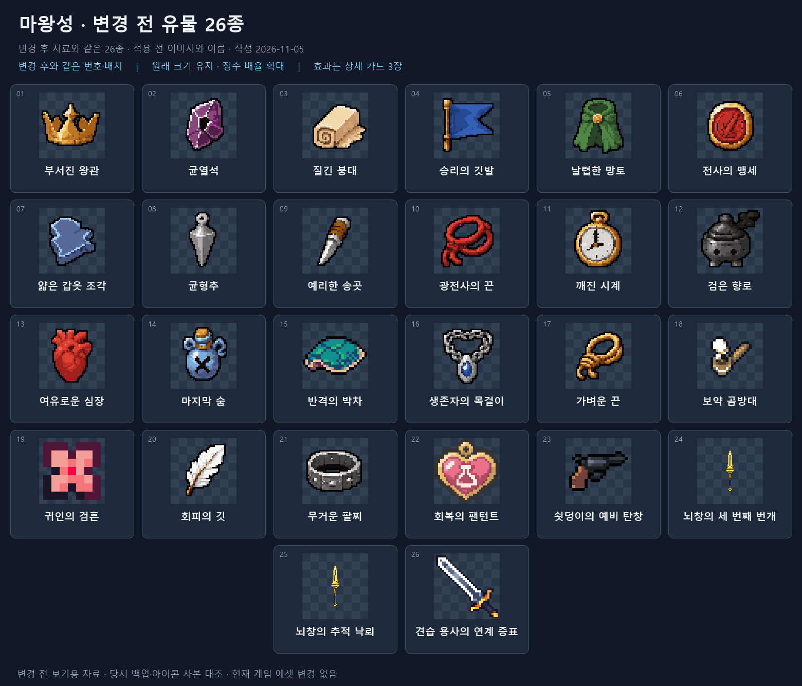
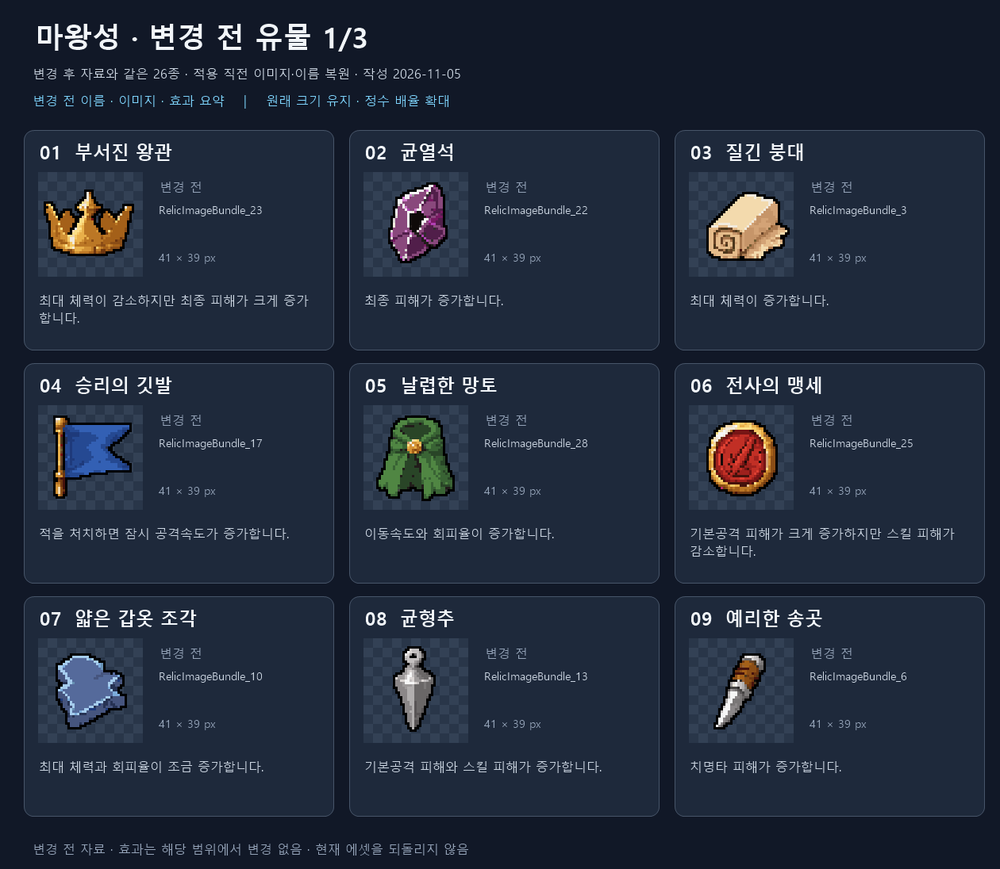
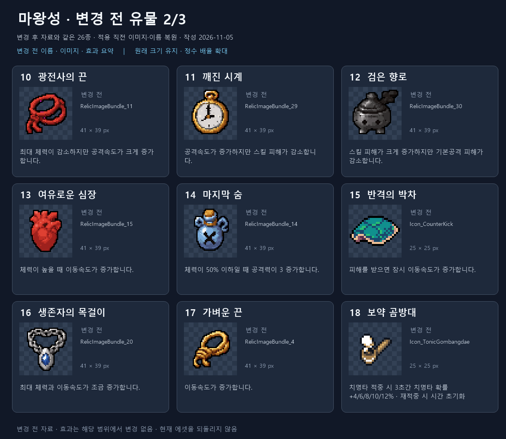
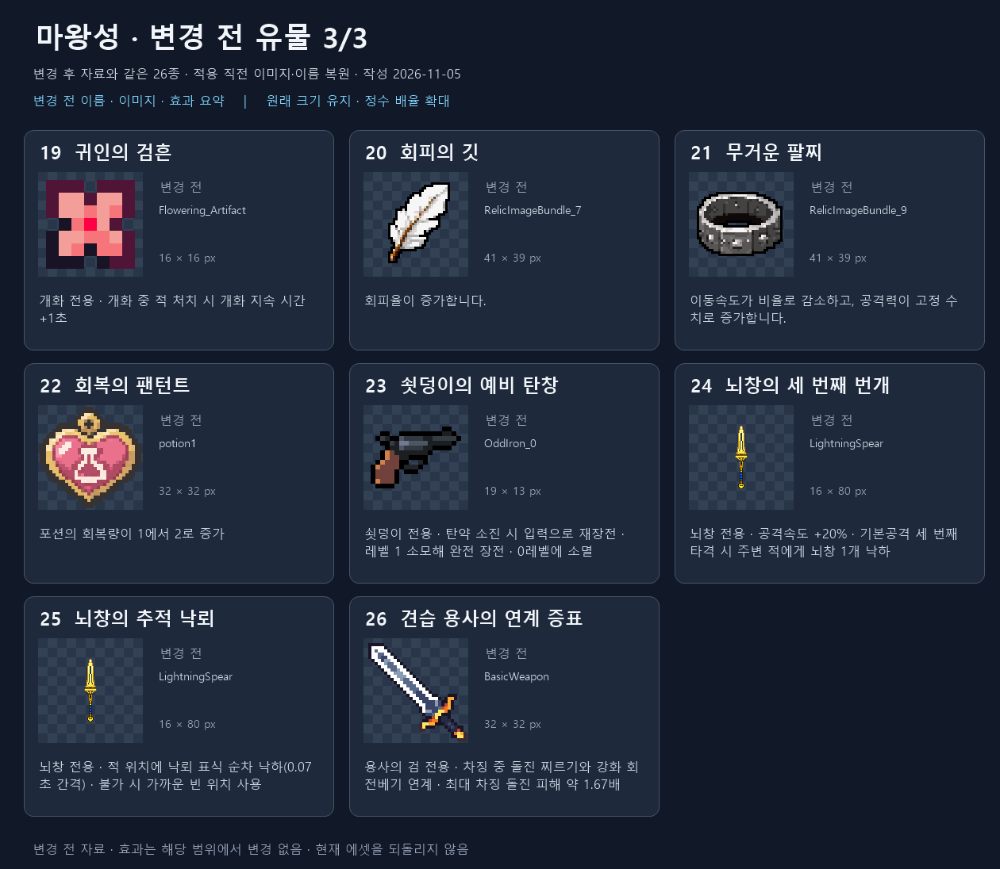

# 유물 26종 변경 전 이미지 자료 — 2026-11-05

부서진 왕관 묶음부터 마지막 5종까지, 변경 후 자료와 **같은 26종·같은 순서·같은 배치**로 각 유물의 이번 리메이크 전 이미지와 이름을 정리했습니다. 현재 게임 에셋을 되돌린 자료가 아닙니다.

26종 모두 복원 근거를 확인했습니다. 기존 자료에 보존된 아이콘 사본을 각 적용 직전 정의 백업과 대조했습니다. PNG만 교체하고 정의를 유지했던 반격의 박차·귀인의 검흔 2종은 유지된 정의를 대조했습니다. 덮어썼던 반격의 박차·보약 곰방대·귀인의 검흔 PNG 3개는 실제 적용 전 백업과 바이트가 같으며, 나머지 23개는 보존된 원본/시트에서 같은 영역의 픽셀 일치를 확인했습니다.

원래 크기(41×39, 25×25, 16×16, 19×13, 16×80 등)를 유지하며 정수 배율로 확대했습니다. 이전 뇌창 2종은 16×80 무기 이미지를 공유했으므로 카드에서 작고 가늘게 표시되는 것이 원본 형태입니다.

## 전체 이미지와 이름

[같은 배치의 변경 후 목록](../crown-to-final-current/overview-26.png) · [변경 후 전체 자료](../crown-to-final-current/README.md)

## 이미지·이름·효과 상세

효과 전체 설명은 변경 후와 26/26 일치합니다. 이름과 이미지를 비교할 수 있도록 당시 이름을 사용했습니다. 긴 효과는 카드에서만 요약합니다.

### 변경 전 유물 1/3

| 번호 / 변경 전 이름 | 현재 이름 | 변경 전 이미지 | 전체 효과 설명 |
| --- | --- | --- | --- |
| 01 부서진 왕관 | 부서진 왕관 | [PNG](icons/RD_BrokenCrown.png) | 최대 체력이 감소하지만 최종 피해가 크게 증가합니다. |
| 02 균열석 | 균열석 | [PNG](icons/RD_RiftStone.png) | 최종 피해가 증가합니다. |
| 03 질긴 붕대 | 질긴 붕대 | [PNG](icons/RD_ToughBandage.png) | 최대 체력이 증가합니다. |
| 04 승리의 깃발 | 광전사의 깃발 | [PNG](icons/RD_VictoryFlag.png) | 적을 처치하면 잠시 공격속도가 증가합니다. |
| 05 날렵한 망토 | 날렵한 망토 | [PNG](icons/RD_NimbleCloak.png) | 이동속도와 회피율이 증가합니다. |
| 06 전사의 맹세 | 전사의 메달 | [PNG](icons/RD_WarriorOath.png) | 기본공격 피해가 크게 증가하지만 스킬 피해가 감소합니다. |
| 07 얇은 갑옷 조각 | 얇은 갑옷 조각 | [PNG](icons/RD_ThinArmorShard.png) | 최대 체력과 회피율이 조금 증가합니다. |
| 08 균형추 | 균형추 | [PNG](icons/RD_BalanceWeight.png) | 기본공격 피해와 스킬 피해가 증가합니다. |
| 09 예리한 송곳 | 치명적인 도끼 | [PNG](icons/RD_SharpAwl.png) | 치명타 피해가 증가합니다. |

### 변경 전 유물 2/3

| 번호 / 변경 전 이름 | 현재 이름 | 변경 전 이미지 | 전체 효과 설명 |
| --- | --- | --- | --- |
| 10 광전사의 끈 | 광란의 열매 | [PNG](icons/RD_BerserkerCord.png) | 최대 체력이 감소하지만 공격속도가 크게 증가합니다. |
| 11 깨진 시계 | 전사의 완갑 | [PNG](icons/RD_BrokenClock.png) | 공격속도가 증가하지만 스킬 피해가 감소합니다. |
| 12 검은 향로 | 주술사 가면 | [PNG](icons/RD_BlackIncense.png) | 스킬 피해가 크게 증가하지만 기본공격 피해가 감소합니다. |
| 13 여유로운 심장 | 순풍의 소라 | [PNG](icons/RD_CalmHeart.png) | 체력이 높을 때 이동속도가 증가합니다. |
| 14 마지막 숨 | 깨진 투구 | [PNG](icons/RD_LastBreath.png) | 체력이 50% 이하일 때 공격력이 3 증가합니다. |
| 15 반격의 박차 | 반격의 박차 | [PNG](icons/RD_CounterKick.png) | 피해를 받으면 잠시 이동속도가 증가합니다. |
| 16 생존자의 목걸이 | 나뭇잎 펜던트 | [PNG](icons/RD_SurvivorNecklace.png) | 최대 체력과 이동속도가 조금 증가합니다. |
| 17 가벼운 끈 | 바람의 부채 | [PNG](icons/RD_LightCord.png) | 이동속도가 증가합니다. |
| 18 보약 곰방대 | 행운의 다트 | [PNG](icons/RD_TonicGombangdae.png) | 치명타 적중 시 3초 동안 치명타 확률이 4/6/8/10/12% 증가합니다. 치명타 적중 시 지속 시간이 초기화됩니다. |

### 변경 전 유물 3/3

| 번호 / 변경 전 이름 | 현재 이름 | 변경 전 이미지 | 전체 효과 설명 |
| --- | --- | --- | --- |
| 19 귀인의 검흔 | 귀인의 검흔 | [PNG](icons/RD_FloweringBloomExtension.png) | 개화 전용 유물 개화 중 적 처치 시 개화 지속 시간이 1초 증가합니다. |
| 20 회피의 깃 | 회피의 깃 | [PNG](icons/RD_EvasionFeather.png) | 회피율이 증가합니다. |
| 21 무거운 팔찌 | 무거운 팔찌 | [PNG](icons/RD_HeavyBracelet.png) | 이동속도가 비율로 감소하고, 공격력이 고정 수치로 증가합니다. |
| 22 회복의 팬턴트 | 회복의 팬턴트 | [PNG](icons/RD_RecoveryPendant.png) | 포션의 회복량이 1에서 2로 증가 |
| 23 쇳덩이의 예비 탄창 | 쇳덩이의 예비 탄창 | [PNG](icons/RD_OddIronMagazine.png) | ● 기묘한 쇠덩이 전용 유물 ● 탄약이 없을 때 공격 또는 난사 입력 시 재장전 ● 재장전 완료 시 유물 레벨 1을 소모해 완전 장전 ● 장전 후 다시 입력하면 발사 ● 유물 레벨은 남은 장전 횟수를 의미 ● 레벨이 0이 되면 유물 소멸 |
| 24 뇌창의 세 번째 번개 | 뇌창의 세 번째 번개 | [PNG](icons/RD_LightningSpearThirdStrike.png) | ● 뇌창 갈라론 전용 유물 ● 공격속도 [+20%] ● 기본 공격의 세 번째 타격 시 공격 끝 지점 주변의 적을 향해 뇌창 1개 낙하 |
| 25 뇌창의 추적 낙뢰 | 뇌창의 추적 낙뢰 | [PNG](icons/RD_LightningSpearTargetedRain.png) | ● 뇌창 갈라론 전용 유물 ● 낙뢰 표식이 적의 위치에 0.07초 간격으로 순차 낙하 ● 해당 위치에 떨어질 수 없거나 다른 뇌창과 너무 가까우면 적과 가까운 빈 위치에 낙하 |
| 26 견습 용사의 연계 증표 | 견습 용사의 연계 증표 | [PNG](icons/RD_ApprenticeChargeLink.png) | ● 용사의 검 전용 유물 ● 회전베기 차징 중 돌진 찌르기 사용 가능 ● 사용 순간의 차징 정도에 따라 돌진 찌르기의 피해·크기·색상 변화 ● 최대 차징 시 돌진 찌르기 피해 약 1.67배 ● 돌진 중 버튼을 놓으면 강화 회전베기로 연계 |

## 산출물과 확인

전체 목록 PNG 1장, 상세 카드 PNG 3장, 변경 전 아이콘 사본 26장, 원본·백업 근거를 포함한 데이터 JSON, 렌더링 PowerShell 2개, README·확인 기록·ZIP을 생성했습니다. 원본 사본 26개 일치, 26개 항목의 순서/연결, 효과 전체 문구 26개 일치, 보호 파일 163개 해시와 로컬 링크를 확인하고 전체 목록과 상세 3장을 시각 검토했습니다.

[전체 PNG 묶음](relics-26-before-review.zip) · [데이터와 복원 근거](data.json) · [확인 기록](verification.json) · [SessionLog](../../../Docs/SessionLogs/2026-11-05.md)

게임 에셋·이름·효과·번역·연결·저장 정책 추가 변경 없음. Unity import/컴파일/실제 화면/Play Mode 및 자동화 테스트 미실행. Doc Impact Check: SessionLog. ErrorLog/DecisionLog/StructureMemory/Presentation HTML 변경 및 새 HTML stale candidate 없음.
