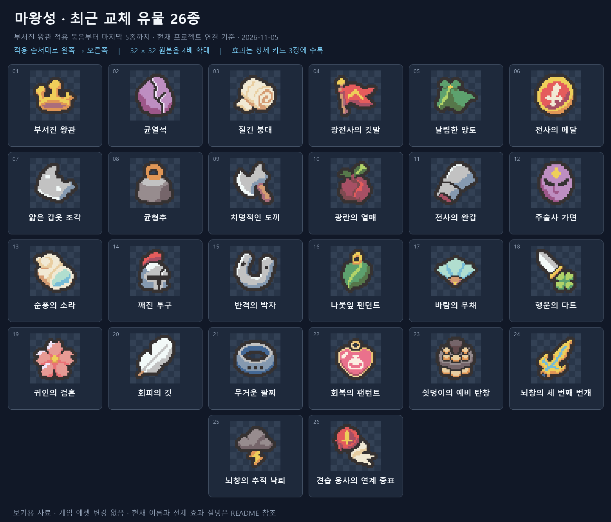
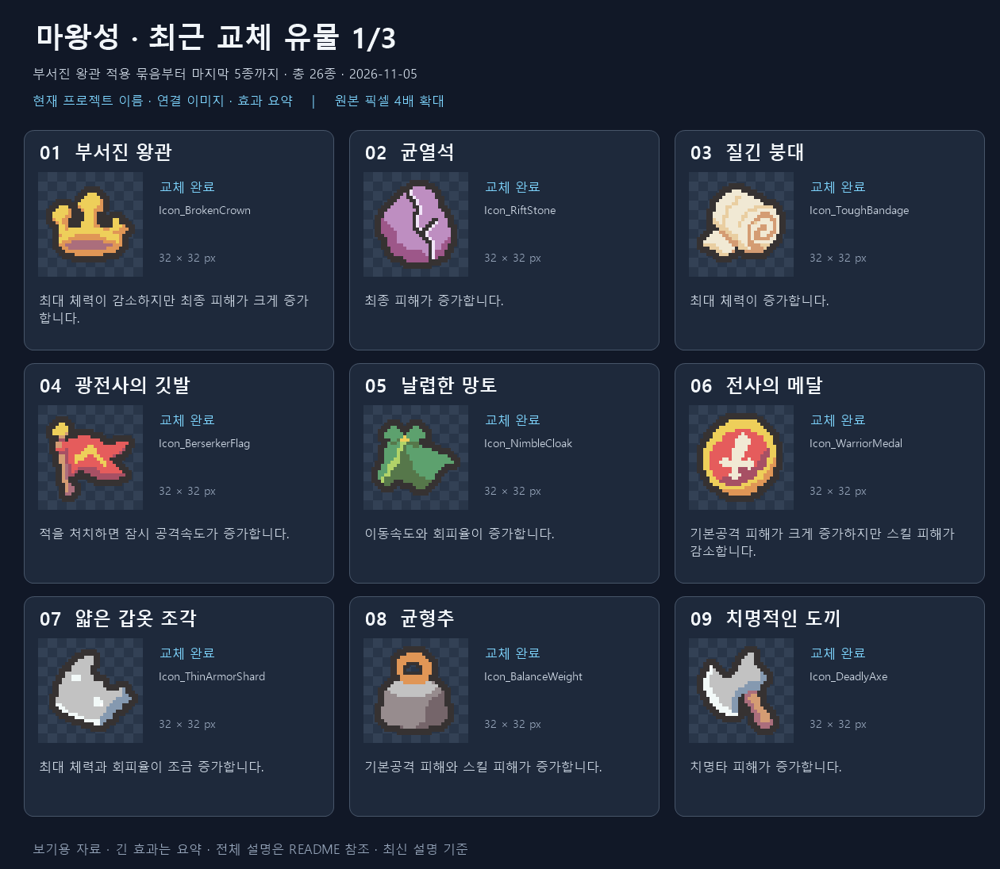
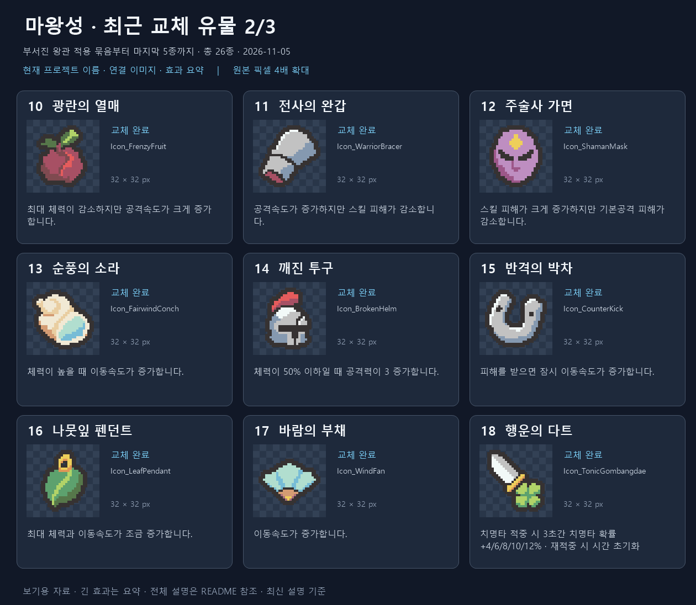
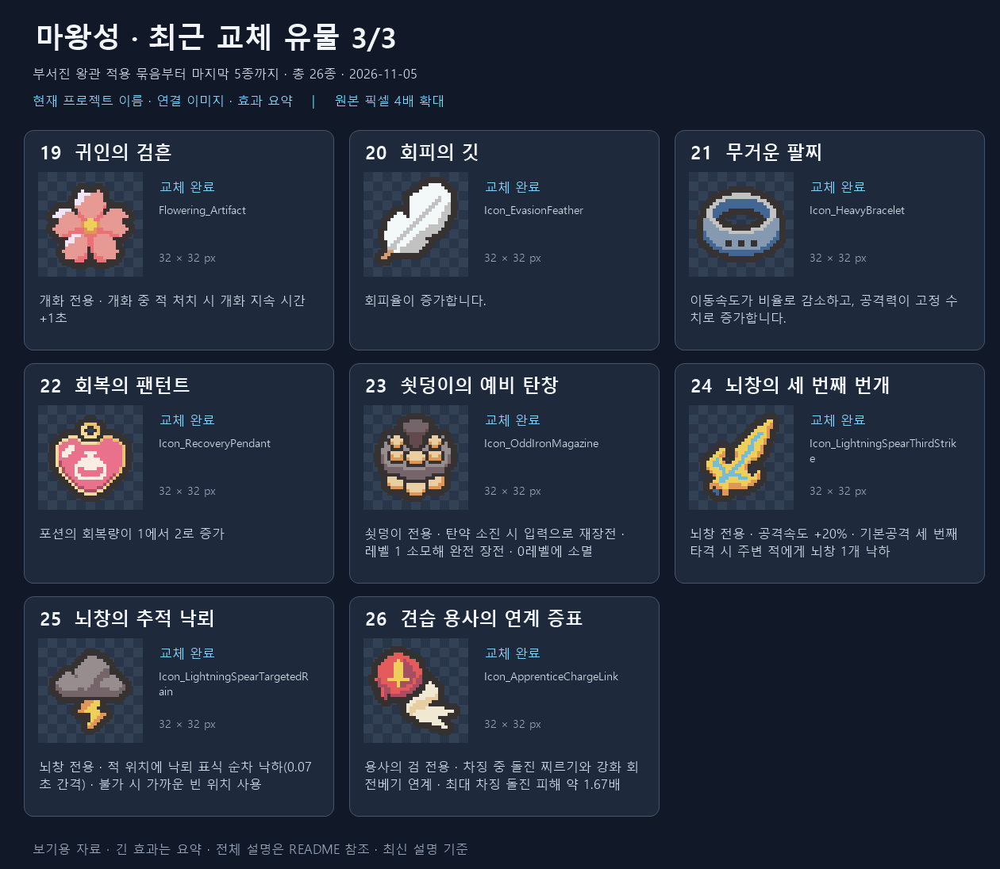

# 부서진 왕관부터 최종 적용까지 — 유물 26종 최신 자료

기준일: 2026-11-05. 부서진 왕관을 포함한 8종, 다음 9종, 행운의 다트 등 4종, 마지막 전용 유물 등 5종을 모았습니다. 실제 승인 적용한 26종만 포함하며 초안·미적용 대안은 제외했습니다.

현재 프로젝트 정의 GUID/icon fileID와 PNG 메타를 적용 기록과 대조했습니다. 이름·설명은 현재 한국어 CSV와 StringTable의 전체 값 52개가 일치함을 확인했습니다. 효과는 현재 설명 기준이며 런타임 실측 자료는 아닙니다.

## 전체 이미지와 이름

32×32 원본을 최근접 4배 확대했습니다. 적용 순서대로 왼쪽에서 오른쪽으로 읽습니다.

## 이미지·이름·효과 상세

긴 효과는 카드에서 요약하며 아래 표에는 현재 전체 설명을 기록했습니다.

### 최근 교체 유물 1/3

| 번호 / 현재 이름 | 이미지 | 현재 전체 효과 설명 |
| --- | --- | --- |
| 01 [부서진 왕관](../../../Assets/_Project/Data/Items/Relics/Definitions/RD_BrokenCrown.asset) | [32×32](icons/RD_BrokenCrown.png) | 최대 체력이 감소하지만 최종 피해가 크게 증가합니다. |
| 02 [균열석](../../../Assets/_Project/Data/Items/Relics/Definitions/RD_RiftStone.asset) | [32×32](icons/RD_RiftStone.png) | 최종 피해가 증가합니다. |
| 03 [질긴 붕대](../../../Assets/_Project/Data/Items/Relics/Definitions/RD_ToughBandage.asset) | [32×32](icons/RD_ToughBandage.png) | 최대 체력이 증가합니다. |
| 04 [광전사의 깃발](../../../Assets/_Project/Data/Items/Relics/Definitions/RD_VictoryFlag.asset) | [32×32](icons/RD_VictoryFlag.png) | 적을 처치하면 잠시 공격속도가 증가합니다. |
| 05 [날렵한 망토](../../../Assets/_Project/Data/Items/Relics/Definitions/RD_NimbleCloak.asset) | [32×32](icons/RD_NimbleCloak.png) | 이동속도와 회피율이 증가합니다. |
| 06 [전사의 메달](../../../Assets/_Project/Data/Items/Relics/Definitions/RD_WarriorOath.asset) | [32×32](icons/RD_WarriorOath.png) | 기본공격 피해가 크게 증가하지만 스킬 피해가 감소합니다. |
| 07 [얇은 갑옷 조각](../../../Assets/_Project/Data/Items/Relics/Definitions/RD_ThinArmorShard.asset) | [32×32](icons/RD_ThinArmorShard.png) | 최대 체력과 회피율이 조금 증가합니다. |
| 08 [균형추](../../../Assets/_Project/Data/Items/Relics/Definitions/RD_BalanceWeight.asset) | [32×32](icons/RD_BalanceWeight.png) | 기본공격 피해와 스킬 피해가 증가합니다. |
| 09 [치명적인 도끼](../../../Assets/_Project/Data/Items/Relics/Definitions/RD_SharpAwl.asset) | [32×32](icons/RD_SharpAwl.png) | 치명타 피해가 증가합니다. |

### 최근 교체 유물 2/3

| 번호 / 현재 이름 | 이미지 | 현재 전체 효과 설명 |
| --- | --- | --- |
| 10 [광란의 열매](../../../Assets/_Project/Data/Items/Relics/Definitions/RD_BerserkerCord.asset) | [32×32](icons/RD_BerserkerCord.png) | 최대 체력이 감소하지만 공격속도가 크게 증가합니다. |
| 11 [전사의 완갑](../../../Assets/_Project/Data/Items/Relics/Definitions/RD_BrokenClock.asset) | [32×32](icons/RD_BrokenClock.png) | 공격속도가 증가하지만 스킬 피해가 감소합니다. |
| 12 [주술사 가면](../../../Assets/_Project/Data/Items/Relics/Definitions/RD_BlackIncense.asset) | [32×32](icons/RD_BlackIncense.png) | 스킬 피해가 크게 증가하지만 기본공격 피해가 감소합니다. |
| 13 [순풍의 소라](../../../Assets/_Project/Data/Items/Relics/Definitions/RD_CalmHeart.asset) | [32×32](icons/RD_CalmHeart.png) | 체력이 높을 때 이동속도가 증가합니다. |
| 14 [깨진 투구](../../../Assets/_Project/Data/Items/Relics/Definitions/RD_LastBreath.asset) | [32×32](icons/RD_LastBreath.png) | 체력이 50% 이하일 때 공격력이 3 증가합니다. |
| 15 [반격의 박차](../../../Assets/_Project/Data/Items/Relics/Definitions/RD_CounterKick.asset) | [32×32](icons/RD_CounterKick.png) | 피해를 받으면 잠시 이동속도가 증가합니다. |
| 16 [나뭇잎 펜던트](../../../Assets/_Project/Data/Items/Relics/Definitions/RD_SurvivorNecklace.asset) | [32×32](icons/RD_SurvivorNecklace.png) | 최대 체력과 이동속도가 조금 증가합니다. |
| 17 [바람의 부채](../../../Assets/_Project/Data/Items/Relics/Definitions/RD_LightCord.asset) | [32×32](icons/RD_LightCord.png) | 이동속도가 증가합니다. |
| 18 [행운의 다트](../../../Assets/_Project/Data/Items/Relics/Definitions/RD_TonicGombangdae.asset) | [32×32](icons/RD_TonicGombangdae.png) | 치명타 적중 시 3초 동안 치명타 확률이 4/6/8/10/12% 증가합니다. 치명타 적중 시 지속 시간이 초기화됩니다. |

### 최근 교체 유물 3/3

| 번호 / 현재 이름 | 이미지 | 현재 전체 효과 설명 |
| --- | --- | --- |
| 19 [귀인의 검흔](../../../Assets/_Project/Data/Items/Relics/Definitions/RD_FloweringBloomExtension.asset) | [32×32](icons/RD_FloweringBloomExtension.png) | 개화 전용 유물 개화 중 적 처치 시 개화 지속 시간이 1초 증가합니다. |
| 20 [회피의 깃](../../../Assets/_Project/Data/Items/Relics/Definitions/RD_EvasionFeather.asset) | [32×32](icons/RD_EvasionFeather.png) | 회피율이 증가합니다. |
| 21 [무거운 팔찌](../../../Assets/_Project/Data/Items/Relics/Definitions/RD_HeavyBracelet.asset) | [32×32](icons/RD_HeavyBracelet.png) | 이동속도가 비율로 감소하고, 공격력이 고정 수치로 증가합니다. |
| 22 [회복의 팬턴트](../../../Assets/_Project/Data/Items/Relics/Definitions/RD_RecoveryPendant.asset) | [32×32](icons/RD_RecoveryPendant.png) | 포션의 회복량이 1에서 2로 증가 |
| 23 [쇳덩이의 예비 탄창](../../../Assets/_Project/Data/Items/Relics/Definitions/RD_OddIronMagazine.asset) | [32×32](icons/RD_OddIronMagazine.png) | ● 기묘한 쇠덩이 전용 유물 ● 탄약이 없을 때 공격 또는 난사 입력 시 재장전 ● 재장전 완료 시 유물 레벨 1을 소모해 완전 장전 ● 장전 후 다시 입력하면 발사 ● 유물 레벨은 남은 장전 횟수를 의미 ● 레벨이 0이 되면 유물 소멸 |
| 24 [뇌창의 세 번째 번개](../../../Assets/_Project/Data/Items/Relics/Definitions/RD_LightningSpearThirdStrike.asset) | [32×32](icons/RD_LightningSpearThirdStrike.png) | ● 뇌창 갈라론 전용 유물 ● 공격속도 [+20%] ● 기본 공격의 세 번째 타격 시 공격 끝 지점 주변의 적을 향해 뇌창 1개 낙하 |
| 25 [뇌창의 추적 낙뢰](../../../Assets/_Project/Data/Items/Relics/Definitions/RD_LightningSpearTargetedRain.asset) | [32×32](icons/RD_LightningSpearTargetedRain.png) | ● 뇌창 갈라론 전용 유물 ● 낙뢰 표식이 적의 위치에 0.07초 간격으로 순차 낙하 ● 해당 위치에 떨어질 수 없거나 다른 뇌창과 너무 가까우면 적과 가까운 빈 위치에 낙하 |
| 26 [견습 용사의 연계 증표](../../../Assets/_Project/Data/Items/Relics/Definitions/RD_ApprenticeChargeLink.asset) | [32×32](icons/RD_ApprenticeChargeLink.png) | ● 용사의 검 전용 유물 ● 회전베기 차징 중 돌진 찌르기 사용 가능 ● 사용 순간의 차징 정도에 따라 돌진 찌르기의 피해·크기·색상 변화 ● 최대 차징 시 돌진 찌르기 피해 약 1.67배 ● 돌진 중 버튼을 놓으면 강화 회전베기로 연계 |

## 참고와 파일

회복 펜던트와 예비 탄약은 현재 게임 표기인 **회복의 팬턴트**, **쇳덩이의 예비 탄창**으로 표시했습니다. 자료 작성 중 이름·번역·이미지·효과·연결·저장 정책은 바꾸지 않았습니다.

[전체 PNG 자료 묶음](relics-26-review.zip) · [현재 데이터](data.json) · [파일 확인 기록](verification.json) · [SessionLog](../../../Docs/SessionLogs/2026-11-05.md)

생성 파일: 전체 목록 PNG 1장, 상세 카드 PNG 3장, 원본과 바이트가 같은 아이콘 사본 26장, 데이터/페이지 JSON, 렌더링 PowerShell 2개, README·확인 기록·ZIP. 보호 대상 126개 파일 해시 보존 및 README 링크를 확인했습니다.

Unity import/컴파일/실제 화면/Play Mode 및 자동화 테스트는 실행하지 않았습니다. Doc Impact Check: SessionLog. ErrorLog/DecisionLog/StructureMemory/Presentation HTML 변경 및 새 HTML stale candidate 없음.
