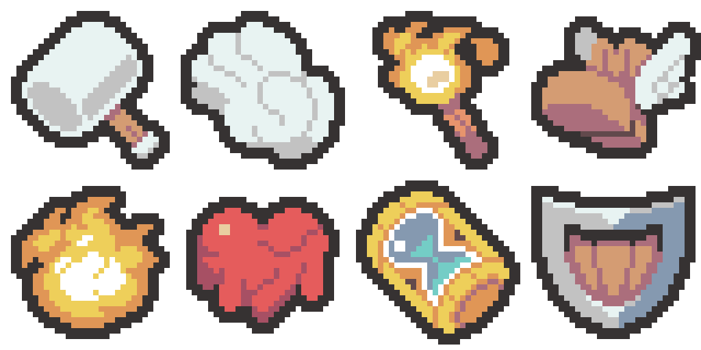

# 유물 픽셀아트 화풍 재정립 — 2026-11-04

이번에 받은 8개를 화풍의 우선 참고 자료로 삼습니다. 기존 유물/승인 이미지를 자동으로 다시 수정하는 작업은 아닙니다.

## 확인한 원본

64×64 시트 2장은 각각 32×32 아이콘 4개입니다. 1280×1280 시트는 각각 정확한 최근접 20배 확대이며, 알파까지 원본과 일치합니다. 반투명/안티앨리어싱 픽셀이 없는 도트입니다.

## 참고작의 특징

- **둥글고 도톰한 윤곽.** 망치·장갑·부츠의 큰 덩어리는 부드러운 곡선을 만들도록 1픽셀 계단을 배치합니다. 작은 모서리와 오목한 부분도 사물의 구조에 맞게 다듬습니다.
- **주조색과 그림자가 명확한 면.** 장갑은 밝은 주조색과 회색 그림자로 설명합니다. 망치도 금속 면에 명암 두 단계가 중심입니다. 회색 중간톤을 여러 단계 채워 넣지 않습니다.
- **재질별 색 역할.** 부츠의 가죽은 황갈색과 탁한 장밋빛 그림자, 금속은 밝은 회색과 청회색, 불꽃은 주황·노랑·밝은 중심부로 구분됩니다. 같은 하이라이트나 명암 공식을 모든 사물에 적용하지 않습니다.
- **필요한 내부 디테일.** 장갑의 손가락 경계·부츠의 날개 구분·모래시계의 테두리는 알아볼 수 있게 남깁니다. 작은 선과 점을 전부 금지하면 사물의 특징도 사라집니다.
- **색 수는 결과.** 외곽선 포함 장갑 3색, 화염·심장 4색, 망치 5색, 부츠·방패 6색, 지팡이 7색, 모래시계 8색입니다. 매번 6색을 채우도록 강제하지 않습니다. 사용자가 색 수를 지정하면 그 제한을 우선합니다.
- **평면 색면과 입체감의 균형.** 큰 면은 평면으로 칠하되 그림자 모양이 실제 굴곡과 두께를 설명합니다. 도형 아이콘처럼 획일적인 테두리·띠·중앙 반짝임을 붙이지 않습니다.

## 최근 초안에서 벗어난 부분과 교정

| 항목 | 최근 작업에서 확인한 문제 | 앞으로의 기준 |
| --- | --- | --- |
| 외곽선 | 모든 색 영역을 5×5 정사각형으로 확장해 모서리까지 불려 그렸음 | 2픽셀 굵기를 유지하면서 대각 모서리를 1픽셀 다듬는 둥근 윤곽으로 검토 |
| 색 수 | 각 유물에 정확히 6색을 쓰고 검증하도록 고정했음 | 소재별 주조색·그림자·필요한 강조색만 선택 |
| 명암 | 숫돌 등에 밝은 가장자리 띠와 여러 회색 단계를 넣어 재질이 흐려짐 | 숫돌은 무광 면과 마모 흔적, 유리·금속만 소재에 맞는 반사 |
| 형태 | 큰 색면과 단순화 조건이 사물의 곡선·구조보다 앞섰음 | 이름이 읽히는 실루엣과 구조를 먼저 결정 |
| 디테일 | 모든 작은 선·점을 일괄 배제하는 프롬프트 | 입구·손잡이·접힘·깃·손가락 등 식별에 필요한 선은 남김 |
| 참고 사용 | 날개 부츠 하나를 거의 모든 소재의 참고로 사용 | 같은 8종 중 금속·천/가죽·유리·발광에 맞는 참고를 함께 사용 |

외곽선 분석: 5×5에서 네 대각 모서리를 제외한 21칸의 둥근 확장 형태는 8개 중 5개의 가시 영역과 정확히 일치하고, 나머지는 1~3픽셀 차이입니다. 이전 25칸 정사각형 방식은 원본보다 24~44픽셀을 더 채웁니다. 이 결과는 모서리 처리의 기술적 참고이며, 내부의 어두운 면·구멍·재질 경계까지 일괄 처리하는 규칙이 아닙니다.

## 다음 초안에 적용

- 새 디자인은 이름을 기준으로 자유롭게 정합니다. 기존 물건의 모양을 따르라는 지시가 없으면 옛 도안을 형태 제약으로 사용하지 않습니다.
- 형식 조건은 실제 32×32, 투명 배경, 2픽셀 외곽선, 사방 최소 2픽셀 여백을 유지합니다.
- 외곽선은 생성된 실루엣과 원본 크기에서 함께 검토합니다. 정사각형 팽창 결과와 같다는 것을 합격 기준으로 삼지 않습니다.
- 색은 기존 제공 팔레트에서 고릅니다. 이번 참고작의 #FFFFFF·#E8F3F2·#74CDC6 등은 화풍 분석 자료이며 허용 팔레트에 자동 추가하지 않습니다.
- 색상/외곽선 검증 후 반드시 32×32 원본과 정수 확대본에서 형태·모서리·명암·필요한 디테일을 육안 확인합니다.
- 술잔은 술·입구·손잡이와 몸통의 관계, 석판은 돌의 두께와 새긴 문양, 숫돌은 무광 연마면과 마모, 렌즈는 유리와 금속 테두리의 차이를 중심으로 판단합니다.

## 파일

- [원본 시트 A](references/sheet-a-64x64.png) · [원본 시트 B](references/sheet-b-64x64.png)
- [20배 확대 A](references/sheet-a-1280x1280.png) · [20배 확대 B](references/sheet-b-1280x1280.png)
- [8종 128×64 참고 시트](reference-eight-128x64.png)
- [화풍 분석 수치와 기계 판독 프로필](style-profile.json)
- [향후 생성용 화풍 프롬프트](generation-style-prompt.txt)

원본 첨부 PNG는 그대로 복사 보존했고, 32×32 개별 참고와 정수 확대 참고 시트는 픽셀 보존 방식으로 추출했습니다. 이번 작업은 분석과 향후 화풍 기준 정리입니다. 새 유물 생성이나 프로젝트 이미지 교체는 수행하지 않았습니다.

Doc Impact Check: no doc update needed. 출력 폴더에 분석 자료만 생성했으며 프로젝트 Assets·기존 Docs·SessionLogs·ErrorLog·DecisionLog·Presentation HTML은 변경하지 않았습니다. Unity 실행 검증은 수행하지 않았습니다.

