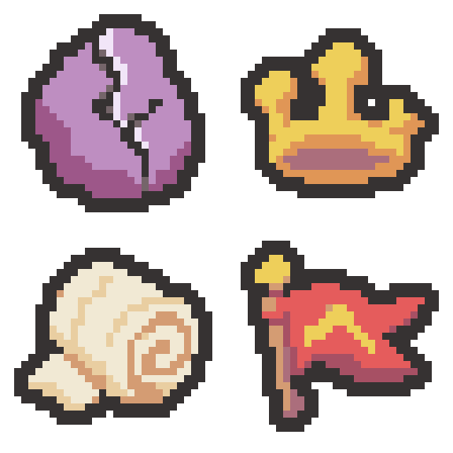

# 사용자 승인 화풍 기준 — 2026-11-04

사용자는 균열석·부서진 왕관·질긴 붕대·승리의 깃발 초안을 가장 만족한 방향으로 명시했고, 이후 작업에서도 같은 느낌을 유지하도록 요청했습니다.

- 기존 8개 참고작에 더해 이 4종을 후속 생성의 우선 화풍 참고로 사용합니다. 물체의 모양을 복사하는 제약이 아닙니다.
- 통통하고 명확한 큰 실루엣, 넓은 주조색과 한 단계 그림자, 식별에 필요한 소수 디테일을 유지합니다.
- 실제 32×32, 사방 최소 2픽셀 투명 여백, #363232의 2픽셀 외곽선과 둥근 대각 모서리, 제공 팔레트 한정을 유지합니다.
- 승인 초안의 외곽선 포함 색 수는 5·4·4·6색입니다. 정확히 6색을 채우거나 모든 소재에 광택·테두리 띠를 넣지 않습니다.
- 내장 image_gen으로 각 물체를 따로 생성하고, 32×32 최근접 내보내기·팔레트 정리·둥근 외곽선 조정 뒤 원본과 확대본을 육안 확인합니다. 내부 어두운 구조와 필요한 투명 구멍은 보존합니다.
- 사용자의 적용 지시 전에는 Assets에 넣지 않습니다.

[승인 배치 원본·프롬프트·확인](../imagegen/rift-crown-bandage-flag-2026-11-04/README.md)
