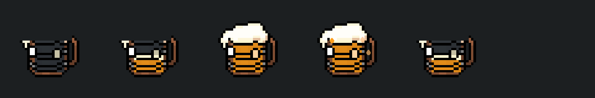

# Spiri reward and alcohol exposure — 2026-10-12

Implemented the user-approved three-second mug charge, 1.5-second drain,
confusion and Spiri affection-1 speed reward. A later explicit follow-up extends
direction reversal to directional dash. No additional
Inspector setup is required on the authored player prefab.

## Result

- Valid overlapping ground puddles share one recipient charge and head mug.
  Full charge occurs at3s; overflow activates strictly after3s.
- Below Spiri affection1, overflow reverses ordinary walking in all four
  directions and directional dash. Raw input, other skills, forced movement and
  no-direction aim fallback keep their directions.
- At affection >=1, the existing movement+25% and attack-speed additive+0.4
  modifiers replace confusion. The level-1 reward is registered for NPC2001.
- Last-puddle exit drains the current fill to zero over1.5s. Reentry resumes
  that quantity. Confusion ends at empty; speed buff refreshes at empty and
  then lasts5s. Reentry also refreshes an already-earned residual buff.
- Timers and overflow motion use scaled game time. Source ignition/absorption/
  disable releases contact; recipient disable removes owned GE/tags/modifiers.
- The authored mug uses existing Drink_0 art, a narrow fill shader and three
  authored droplets. The view does not create hierarchy or material instances.
- Temporary exposure GE and explicit tags are excluded from scene snapshots,
  preserving unrelated states and the existing save DTO.

## Changed files and purpose

| File | Purpose |
| --- | --- |
| [PlayerAlcoholExposure.cs](../../Assets/_Project/Runtime/Features/Player/Status/PlayerAlcoholExposure.cs) | Recipient-owned charge, drain, affinity branch, overlap sources and effect lifetime. |
| [AlcoholPuddleArea.cs](../../Assets/_Project/Runtime/Features/Map/Puddles/AlcoholPuddleArea.cs) | Valid hurtbox contacts, landing/Stay and source shutdown notifications; projectile/ignition behavior retained. |
| [PlayerIntentInput2D.cs](../../Assets/_Project/Runtime/Features/Player/Input/PlayerIntentInput2D.cs) | Shared confusion direction projection for walking and directional dash. |
| [AbilityLogic_Dash2D.cs](../../Assets/_Project/Runtime/Features/Player/Abilities/AbilityLogic_Dash2D.cs) | Follow-up: apply the same confusion projection to cached/raw-query directional dash. |
| [CombatBuffDebuffApplier.cs](../../Assets/_Project/Runtime/Features/Player/Status/CombatBuffDebuffApplier.cs) | Respect authored duration-display defaults for confusion. |
| [PlayerRuntimeCaptureCoordinator.cs](../../Assets/_Project/Runtime/Features/Player/Scene/PlayerRuntimeCaptureCoordinator.cs) | Omit the departing exposure owner's exact effects and granted tags. |
| [AlcoholExposurePlayerVisual.cs](../../Assets/_Project/Runtime/Presentation/Map/Puddles/AlcoholExposurePlayerVisual.cs) | Authored fill/overflow projection, stable head placement and safe destroyed-child cleanup. |
| [AlcoholMugFill.shader](../../Assets/_Project/Art/Shaders/AlcoholMugFill.shader) | Preserve mug outline/handle while filling the liquid interior and rendering foam/drops. |
| M_AlcoholMugFill.mat; M_AlcoholMugOverflowDrop.mat | New authored materials in Assets/_Project/Art/Materials/. |
| [PF Player.prefab](../../Assets/_Project/Prefabs/Player/PF%20Player.prefab) | Exposure/input/view references and authored mug/drop child hierarchy. |
| [GE_Puddle_AlcoholBuff.asset](../../Assets/_Project/Data/Abilities/Effects/GE_Puddle_AlcoholBuff.asset) | Change only duration0.35→5; keep both modifier values. |
| [DragonBossNpc.asset](../../Assets/_Project/Data/Dialogue/NPC/DragonBossNpc.asset) | Add only the affection1 reward reference. |
| State.Confusion.asset | New GameplayTag in the existing Resources/Tags folder; stable ID306. |
| GE_Puddle_Confusion.asset; SHD_Puddle_Confusion.asset; CBD_Puddle_Confusion.asset | New effect/tag, duration-hidden Debuff HUD and independent-duration application data in Data/Abilities/Effects/. |
| SpiriAlcoholPuddleReward.asset | Existing InfoOnlyAffectionEffect type, mug icon and reward explanation in Data/Dialogue/Affection/. |
| [SpiriAlcoholRewardAuthoring.cs](../../Assets/_Project/Editor/Tools/Data/SpiriAlcoholRewardAuthoring.cs) | Narrow, repeatable Unity API asset registration and append-only localization. |
| [AlcoholExposurePlayModeTests.cs](../../Assets/_Project/Tests/PlayMode/Procedural/AlcoholExposurePlayModeTests.cs) | Charge/drain/reentry, actual GE and attribute lifetime, affinity, ordinary input and scene snapshots. |
| [AlcoholExposurePlayerVisualPlayModeTests.cs](../../Assets/_Project/Tests/PlayMode/Procedural/AlcoholExposurePlayerVisualPlayModeTests.cs) | Authoring, projection/reuse, scale/flip, native motion/pause and destroyed-child safety. |
| [AlcoholPuddleContactPlayModeTests.cs](../../Assets/_Project/Tests/PlayMode/Procedural/AlcoholPuddleContactPlayModeTests.cs) | Multi-hurtbox contacts, airborne landing, shutdown, exact assets/locale keys and native render. |
| GameText_ko/en/ja/zh-Hans/zh-Hant.asset; GameText Shared Data.asset | Four new localized fields,20 values, preserving existing entries. |
| [GameTextAssetKeys.g.cs](../../Assets/_Project/Runtime/Core/Presentation/GameTextAssetKeys.g.cs); [GameText.csv](../../DataSheets/Localization/GameText.csv); [AssetInventory.json](../../DataSheets/Localization/AssetInventory.json) | Four matching identity/CSV/inventory entries for durable localization regeneration. |
| New Unity-generated metadata |14 unique new GUIDs; no existing GUID edits. |

Task memory: ActiveTasks/spiri-alcohol-exposure.md, TaskIndex.md,
SessionLogs/2026-10-12.md, StructureMemory/AlcoholExposure.md and its index,
RefactorBacklog/AlcoholPuddleLegacyAuthoring.md, DecisionLog.md and ErrorLog.md.
Each records the implemented ownership, selected rules, retained authoring
compatibility or verified Unity lifecycle trap. Architecture/Contracts/Guides
and Presentation HTML were not edited.

## Verification

The38-case native evidence below covers the initial walking-only slice.
The directional-dash follow-up has separate evidence under dash-followup/;
its PlayMode cases were not executed while the user's project Editor was open.

- Unity6000.4.2f1 native import/authoring completed successfully. Final test runs
  compiled the new production and test sources, including localized key mapping.
- [Native summary](native-test-summary.json):38 unique selected cases passed.
  The [37-case run](playmode-final-results.xml) passed36; its lone failure was
  destroyed authored-child cleanup during render-test teardown. After fixing
  the view and adding a dedicated regression, the [13-case visual/contact run](playmode-visual-contact-results.xml)
  passed13/13, including the repaired capture. The19 exposure and6 existing
  arrow/overlap-HUD/timer cases retain their passing results from the prior run.
- Native motion checks verify sway/drop movement, paused rotation/position/alpha,
  and stopping overflow during drain. Native reference/key readback covers
  the actual player prefab, Spiri reward and all20 locale values.
- Generated projects were refreshed by Unity's CodeEditor.SyncAll, with new
  runtime/Editor/test files included. Editor.csproj MSBuild Rebuild passed.
  ProceduralPlayModeTests.csproj MSBuild passed; both final commands exited0.
  Evidence: editor-msbuild-final.log and tests-msbuild-final.log. These runs were
  sequenced after native tests to avoid Unity resetting their Temp outputs.
- [Preservation audit](preservation-audit.json):155 existing metadata and111
  scenes/settings hashes unchanged;110 original player YAML records retain IDs
  and order, with16 new records. Existing fields change only root component/
  child appends and the input confusionTag. AlcoholPuddle.prefab is unchanged.
  Existing alcohol GE and NPC have only the approved duration/reward delta.
- All1852 old CSV/shared/locale entries and696 old inventory/key-map entries
  were preserved; exactly4 entries were appended. [Global GUID audit](global-guid-audit.json)
  checks all Assets metadata for the14 new IDs.
- Three player save slots and two prewarm files were preserved byte-for-byte;
  test-generated project prewarm output was restored after validation.
- Scoped whitespace, namespace/assembly, serialized-reference, lifecycle and
  Markdown-link checks are recorded in final-checks.json.

Native representative capture, left to right: empty contact, half charge,
full before overflow, overflow, half drain, fully drained/hidden.

## Limits and Suggested Later

Full manual combat/affection popup flow and a Player build were not executed.
The camera capture renders the real authored mug hierarchy/materials inside an
isolated recipient fixture, not a full gameplay scene. Visual placement and
balance during actual combat remain manual checks. Timer boundaries are
quantized to the game frame that crosses them.

The three obsolete serialized puddle buff fields remain hidden compatibility
data; a later explicit prefab/scene migration may remove them. No runtime
fallback hierarchy was added for the new mug.

Suggested Later: the existing PlayerInteractionSensor2D.EnsureFor fallback can
attempt to add a sensor requiring abstract Collider2D when authored sensor data
is absent. The real player prefab supplies its sensor. The contact fixture was
corrected to match it; this unrelated fallback was not changed.

Doc Impact Check: SessionLog + StructureMemory + RefactorBacklog + DecisionLog
+ ErrorLog. No Architecture/Contracts promotion or Presentation HTML stale
candidate was identified.
