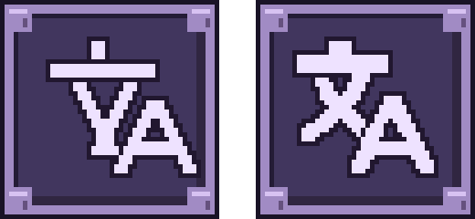
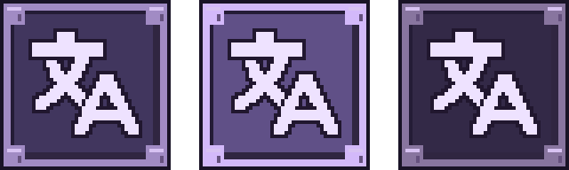

# Title language icon correction

2026-11-01. Micro-fix: the user reported the inner translation symbol looked wrong
and was off-center. The previous manually drawn symbol resembled Y/A and extended
too far right. The existing frame and three state palettes remain.

- Built-in imagegen produced a corrected 文/A silhouette from the previous button
  and approved preview. [Exact prompt](prompt.txt), [generated source](generated-glyph.png).
- Aseprite cropped the pale silhouette, sampled it onto a 30×29 native grid,
  reduced it to the existing pale palette, and centered it inside the 48px canvas.
  The shared authoring script adds the original one-pixel dark contour and frame.
  No glyph strokes were manually reconstructed after generation.
- Replaced `TitleLanguageNormal.png`, `TitleLanguageHover.png`,
  `TitleLanguagePressed.png`, and `TitleLanguageButton.aseprite` under
  `Assets/_Project/Art/Sprites/UI/Title/Language/`.
- Updated `Tools/Art/make_title_language_button.lua` to use the shared native
  `Tools/Art/TitleLanguageGlyph.png`; added
  `Tools/Art/prepare_title_language_glyph.lua` for reproducible source conversion.
- [Pixel checks](pixel-validation.txt): three 48×48 states, identical glyph masks,
  opaque output, preserved outer frame. Pale bounds are x9–38/y9–37, center
  (23.5,23.0), within half a pixel of the canvas center. Visual inspection at
  nearest-neighbor enlarged size and native size completed.
- [Protected-file checks](protected-after.json): TitleScene, both runtime scripts,
  and all existing artwork `.meta` files are byte-identical to this task's baseline.
- Unity import, compilation and Play Mode were not rerun for this image-only
  correction. Earlier 98 interaction checks belong to the integration task.
- Doc Impact: SessionLog and this narrow evidence record. Existing integration
  report points here because its captures show the previous artwork. No new
  StructureMemory, ErrorLog, DecisionLog or Presentation HTML update needed.

Left: previous. Right: corrected.

Normal, hover, pressed:

